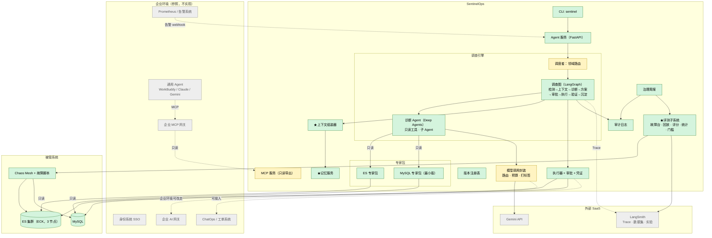

# 00 总览：SentinelOps 是什么、做到哪里为止

> 设计文档第 1 篇（共 9 篇）。本篇定范围，后面各篇定细节。
> 文档地图：00 总览 · 01 架构与部署 · 02 典型流程 · 03 契约 · 04 上下文 · 05 记忆 · 06 评测 · 07 治理 · 08 排期 · adr/
> 另外：REVIEW.md（需要人确认的全部内容）· golden-demo.md（演示脚本，也是端到端验收标准）

---

## 本篇结论

1. **一句话**：SentinelOps 是一个围绕 ES、可扩展到 MySQL 的运维 Agent。它的流程是"确定性检测 → LLM 诊断 → 人审批 → 受控执行 → 自动验证 → 沉淀"，**每一步都能评测、都有审计**。对外统一称为"受控修复"，不说"自愈"：第一版只执行单步动作，并且全部需要审批。
2. **主亮点是记忆和上下文**：分层上下文组装，加上相似事故检索。**评测是证据**：用消融实验和版本收敛曲线，证明这两项让指标提高了多少。
3. **LLM 只放在中间**：检测、执行、验证都是确定性代码，LLM 只负责诊断和选方案。依据是"每步 95% 准确，连续 10 步只剩约 60%"这笔账（见 [1]）。
4. **范围砍到只剩主路径**：2 个领域（ES + MySQL 最小版）、只有 CLI、单租户、不做平台自身的高可用。不做清单见 §5。
5. **本地和云同构**：本地用 kind，云上用 AWS EKS（东京区域），两边用同一套 Helm chart。日常改提示词、跑评测走"回放模式"，不需要真集群。

## 内容来源说明

| 标记 | 含义 |
|---|---|
| 无标记 | 来自已读过的官方文档或之前的调研，来源见文末 |
| 【据记忆】 | 凭记忆写的，没有逐条核实，列入 08 的技术验证清单 |
| 【推断】 | 设计判断，没有实验支撑 |
| 【估算】 | 粗略估计，只看量级 |
| 【待验证】 | 必须在技术验证（spike）阶段跑通，才能定稿 |
| 【待定】 | 参数的初始值，要用实验来调整 |
| 【预期】 | 实验之前写下的预期，用来和实测结果对照 |
| 【示意】 | 按设计写出的样例输出或图，不是实际运行结果 |

本篇是设计文档，**没有实测数字**。所有指标的目标值都是待基线跑出来之后再定的占位。

---

## 1. 本系统要回答的核心问题

1. 一个运维 Agent 怎样做到**可信**：它说的根因有证据吗？它的修复动作安全吗？出了事能查到是谁批准的吗？
2. 怎样证明**记忆和上下文真的有用**，而不只是"感觉更聪明了"？
3. 改了一句提示词，怎么知道它是**真的变好了**，还是随机波动？
4. 第二种数据库接进来时，**要写多少代码**？哪些可以直接复用？
5. CTO 每周只花 30 分钟，能看到什么？
6. 外部的通用 Agent（WorkBuddy、Claude 等）怎样**安全地**使用这里的能力？

## 2. L1 一句话本质

| 概念 | 一句话 |
|---|---|
| 专家包（Expert Pack） | 一个领域的全部知识打成一个包：检测器、只读工具、修复动作目录、runbook、评测集 |
| 检测器（Detector） | 确定性规则，把原始指标变成结构化的"问题事件"（Finding），不经过 LLM |
| 事实卡片（FactSheet） | 预先计算好的几十行结构化事实，是给 LLM 的第一层上下文，**不是原始 JSON** |
| 观测记录（Observation） | 每一次工具调用的输出都存下来，并有唯一 ID。诊断结论必须引用这些 ID |
| 调查（Investigation） | 一次从触发到结束的完整流程，对应 LangGraph 里的一个 thread |
| 动作目录（Action Catalog） | 所有允许的修复动作，每个动作都声明了风险等级、前置条件、预演方法、回滚方法和验证条件 |
| 执行器（Executor） | 唯一持有写权限凭证的组件。Agent 只能"提议"，由执行器去执行 |
| 事故记忆（Incident Memory） | 人确认过的"症状 → 根因 → 处置 → 效果"，用于检索相似事故 |
| Agent 版本（AgentVersion） | 提示词、工具、模型、上下文策略、记忆策略、专家包版本的快照哈希。所有指标都挂在版本上 |
| 回放（Replay） | 把一次调查里所有工具的输出录下来，之后离线重跑，不需要真集群 |
| 上线门槛（Gate） | 一组硬性条件，不满足就不允许新版本上线 |

## 3. L2 心智模型：一张图看全局

颜色约定：**绿色 = 本次要实现**；**黄色 = 只做薄薄一层或预留接口**；**灰色 = 外部系统，或企业环境里本来就有的东西，不实现**。



这张图要读出三件事：

1. **写权限只有一条路**：调查图 → 执行器 → 被管系统。诊断 Agent 和专家包的工具都只有只读权限。
2. **企业里本来就有的组件（AI 网关、MCP 网关、ChatOps），本次只预留接口**。例如模型调用全部经过 `LLMGW` 这一层封装，以后要切到企业 AI 网关时，只改这一处的配置。
3. **评测是一条独立的旁路**：它通过故障台制造问题，用回放重跑调查，把结果写进 LangSmith，但不依赖生产流量。

## 4. 设计原则（每条都对应后面的具体设计）

| # | 原则 | 落在哪里 |
|---|---|---|
| P1 | **确定性优先**：能用规则算出来的，不交给 LLM | 检测器、事实卡片、前置检查、验证条件（01、03） |
| P2 | **LLM 只提议，不执行** | 执行器是唯一持有写凭证的组件（01、07） |
| P3 | **结论必须引用证据**：诊断里的每个论断都要指向观测记录 ID | 诊断输出契约（03）、证据支持率指标（06） |
| P4 | **所有指标都挂在版本上** | AgentVersion（03）、收敛曲线（06） |
| P5 | **记忆只写人确认过的东西** | 记忆写入规则（05） |
| P6 | **只实现主路径**：边界情况记成待办，不写代码 | 本篇 §5、CLAUDE.md |
| P7 | **契约写死，实现放开**：03 篇的结构变更要走 ADR | 03、adr/ |
| P8 | **本地和云同构**：同一套 Helm chart，只换 values 文件 | 01 |

## 5. 范围与不做清单

### 本次要做

| 模块 | 做到什么程度 |
|---|---|
| ES 专家包 | 6–8 种故障对应的检测器、约 15 个只读工具、5–6 个修复动作 |
| MySQL 专家包 | 2–3 个检测器、约 5 个只读工具、1 个修复动作。**目的只是证明专家包接口能复用** |
| 调查引擎 | 一张主调查图 + 一个诊断 Deep Agent |
| 上下文与记忆 | 完整实现（主亮点） |
| 评测 | 第一版做 4 条：数据集版本、开发集和保留测试集分开、统计方法、失败归类。其余 4 条只留接口 |
| 治理 | 审计、审批、动作白名单、凭证隔离、每周 5 个数的周报 |
| 交互 | 只做 CLI |
| 部署 | 本地 kind，加 AWS EKS 东京区域 |

### 不做（P6 的具体化，Claude Code 编码时不要实现这些）

| 不做 | 原因 / 替代办法 |
|---|---|
| 管理前台 | 用 CLI；Trace 直接看 LangSmith，调试用 LangGraph Studio |
| 自建观测系统 | 用 LangSmith |
| 在线 A/B 测试 | 运维事件太少，统计上不显著。改用离线配对比较和影子模式，后者只留接口 |
| 多租户、复杂权限体系 | 单租户，只有两种角色：操作员和审批人 |
| 平台自身的高可用、多区域 | 单副本，靠 Postgres 的 checkpointer 实现断点恢复 |
| 第三个领域 | ES + MySQL 两个领域足够证明接口能复用 |
| ES 7.x 兼容 | 只支持当前主版本（S1 实测：ECK 3.5.0 + ES 9.5.3） |
| 跨领域根因关联的完整实现 | 调度者第一版只按领域路由，跨领域关联作为 M4 的可选项 |
| ChatOps 审批 | 审批走 CLI，执行器保留对接 ChatOps 的接口 |
| 模型微调 | 只优化提示词、上下文、记忆和工具，不改模型本身 |
| 按实体组织的记忆、服务拓扑图 | 第一版的记忆只按事故组织，回答不了"node-2 过去一个月出过哪些问题"。一线的 AI SRE 产品（Traversal、Cleric 等）都强调拓扑图和"世界模型"。以后的方向：给节点、索引、表这些实体建立历史记录，再加上跨领域的依赖图，支撑跨领域根因关联。第一版只有一个集群，拓扑很简单，投入产出比低 |
| 多个独立根因同时存在的场景 | 例如"一个索引的副本本来就放不下"和"分片数到了上限"同时发生。契约里每个场景只有一个 `root_cause_label`（03 §6.1），这类场景的真实答案不唯一，打分会惩罚一个合理的回答（M2 实测：v11 两个问题都给出了，但排序和"真实答案"不同就记为错）。等契约支持多个根因时再做 |
| 英文文档 | 当前不需要 |

## 6. 核心指标（定义见 06，这里只列名称）

| 指标 | 一句话定义 | 方向 |
|---|---|---|
| 根因 top-1 / top-3 准确率 | 排第一（或前三）的假设与真实根因一致的比例 | ↑ |
| 证据支持率 | 诊断里的论断有观测记录能支持的比例 | ↑ |
| 修复完成率 | 修复后验证通过，且全程没有不安全动作的比例 | ↑ |
| 不安全提议数 | 提出了白名单外的动作，或违反前置条件的动作的次数 | **= 0（硬门槛）** |
| 检测误报率 | 检测器报出、但实际不是问题的比例 | ↓ |
| 调查步数 / 成本 | 每次调查的工具调用次数和 token 费用 | ↓ |
| 记忆增益 | 有记忆和无记忆两种条件下，同一事故流里 top-1 准确率的差值 | ↑（主亮点的证据） |

目标值在 M1 跑出基线后，写进 06 篇。

## 7. 故事主线（演示脚本的骨架）

```
注入故障（磁盘水位过高 → 分片无法分配）
   → 巡检发现问题 → 诊断：引用证据，给出排序后的假设
   → 提出修复方案：预演结果、影响范围、回滚方法
   → 在 CLI 里审批 → 执行器执行 → 验证通过
   → 人确认根因 → 写入事故记忆
再次注入同类故障 → 诊断步数明显减少（记忆起作用）
   → 展示收敛曲线：v1…vN 各版本的准确率和成本
   → 展示治理周报
```

能讲给面试官的一句话：**"我做了一个可评测、可审计、受控修复的 ES 运维 Agent，并且用消融实验证明了记忆和上下文带来的增益。"** 具体数字等基线跑出来之后填入。

## 8. L5 判断：哪些场景走哪条路径

| 场景 | 路径 | 原因 |
|---|---|---|
| 定时巡检，没发现问题 | 只跑检测器，不调用 LLM | 省钱，结果也稳定 |
| 巡检发现问题 | 检测器 → 只读诊断 → 输出报告 | 默认不修复，只告诉人 |
| 告警触发，而且属于动作目录能处理的类型 | 走完整流程，带人工审批 | 主路径 |
| 诊断给不出有把握的根因 | 升级给人，附上目前收集到的证据 | 不硬猜 |
| 外部 Agent 来问"这个 ES 集群健康吗" | 通过 MCP 调用只读工具 | 外部 Agent 永远拿不到写操作 |
| 修改提示词或上下文策略 | 生成新的 AgentVersion → 跑回放评测 → 通过门槛才能上线 | 收敛机制 |

## 9. 设计评审自测

1. 为什么检测器里不用 LLM？——确定性规则可复现、成本低、能单独评测误报率；LLM 放在检测这一步，会让整条链路的误差叠加。
2. 诊断 Agent 能不能直接调用"删除索引"？——不能。它只有只读工具，修复只能以"从动作目录里选动作 + 参数"的形式提议，再由执行器执行。
3. 为什么所有指标都要挂在 AgentVersion 上？——否则看到指标变化时，说不清是哪个改动带来的，也就谈不上收敛。
4. MySQL 专家包为什么只做最小版？——它的作用是证明接口能复用，不是追求功能完整。
5. 外部 Agent 通过 MCP 接入时，最大的风险是什么？——权限放大。所以 MCP 只导出只读工具，并且按调用方的身份限制能访问的集群。

## 可以跳过的内容

第一次读可以跳过 §8 和 §9。§3 的全局图和 §5 的不做清单必须读。

## 来源与核实说明

1. Mezmo：The 2026 AI SRE Market Map（其中引用了 Dynatrace CTO 关于每步准确率逐级累积的说法）— https://www.mezmo.com/learn/the-2026-ai-sre-market-map-agents-harnesses-and-the-data-layer
2. 本篇其余内容是设计决策，来自与作者的多轮讨论，不是引用。
3. 未核实：ECK 支持的 ES 版本、Chaos Mesh 的故障类型，列入 08 的技术验证清单。

本篇完。下一篇：01 架构与部署。
