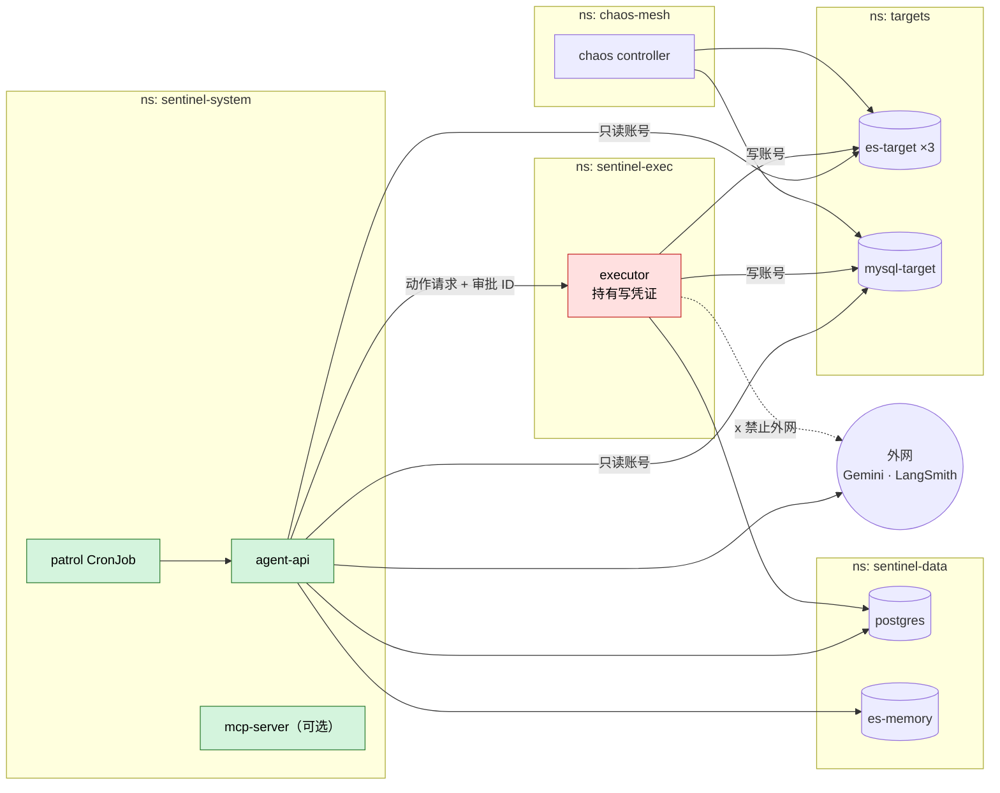

# 01 架构与部署：组件、边界、拓扑

> 设计文档第 2 篇。上一篇定了范围，本篇回答：系统由哪些组件组成、它们之间的边界在哪里、在本地和 AWS 上分别怎么部署、网络和权限怎么隔离。

---

## 本篇结论

1. **系统分成 6 层**：入口 → 调查引擎 → 能力（上下文、记忆、专家包）→ 执行与治理 → 存储 → 被管系统。依赖只能从上往下，**专家包不能反过来依赖核心代码**。
2. **整个架构最关键的切分点是工具后端的三种模式：真实（Live）、录制（Record）、回放（Replay）**。日常改提示词、跑评测都走回放模式，不需要真集群，一轮评测是分钟级【估算】。
3. **写权限物理隔离**：执行器单独一个进程、单独一个 K8s 命名空间、单独一份凭证，而且没有外网出口。诊断 Agent 用的 ES 账号只有 `monitor` 这类只读权限。
4. **Agent 的记忆存在单独的 ES 集群（es-memory）里，和被注入故障的目标集群（es-target）分开**。否则一注入故障，Agent 自己的记忆也跟着坏了。
5. **不依赖 LangGraph Server**：用 FastAPI 包装编译好的图，checkpointer 用 Postgres。原因是 LangGraph Server 自托管需要企业授权【据记忆，待验证】，而且用 FastAPI 包装也更容易讲清楚内部原理。
6. **部署形态有三种**：回放（docker compose，最快）→ 本地全链路（kind）→ AWS EKS（东京区域，只在演示时开启）。三者用同一套镜像，后两者用同一套 Helm chart。

## 内容来源说明

标记体系同 00 篇。本篇没有实测数字，资源和成本都是【估算】，以 M1 实际跑出来的数据为准。LangGraph `interrupt` 和 Deep Agents 的参数来自官方文档（见文末）。

## 本篇要回答的核心问题

1. 哪些组件必须是独立进程？为什么？
2. 加一个新领域（比如 MySQL），要动哪些目录、可以不动哪些目录？
3. 评测为什么可以不依赖真集群？
4. 写权限是怎么被限制住的，靠哪几道隔离？
5. 本地和 AWS 上的部署差在哪里？
6. 外部 Agent 从哪里接入，能碰到什么？

---

## 1. L1 组件清单

| 组件 | 一句话职责 | 形态 | 实现状态 |
|---|---|---|---|
| `sentinel` CLI | 所有操作的入口：触发调查、审批、评测、生成报告 | 本地命令行（Typer） | 实现 |
| agent-api | 托管调查图，接收告警 webhook，提供审批接口 | FastAPI 服务 | 实现 |
| 巡检定时任务 | 定时调用 agent-api 发起巡检 | K8s CronJob | 实现 |
| 调查图 | 主流程状态机：检测 → 上下文 → 诊断 → 方案 → 审批 → 执行 → 验证 → 沉淀 | LangGraph，进程内 | 实现 |
| 诊断 Agent | 开放式调查：规划、调用只读工具、启动子 Agent | Deep Agents，作为调查图里的一个节点 | 实现 |
| 调度者 | 根据问题事件的领域，选择对应的专家包 | 进程内 | 薄层 |
| 专家包 ES / MySQL | 检测器、只读工具、动作目录、知识、评测场景 | Python 包 + `pack.yaml` | 实现 |
| 上下文组装器 ★ | 按分层策略和 token 预算组装上下文 | 进程内库 | 实现 |
| 记忆服务 ★ | 事故记忆的写入、检索和失效 | 进程内库，存储在 es-memory | 实现 |
| 观测记录存储 | 保存每次工具调用的输出，分配观测 ID | 进程内库，存储在 Postgres，大块数据放文件或 S3 | 实现 |
| 执行器 | 校验审批、做前置检查、执行动作、回滚 | **独立进程**，独立命名空间 | 实现 |
| 审计 | 只追加的事件日志 | Postgres 表 | 实现 |
| 版本注册表 | 生成并存储 AgentVersion 快照 | 进程内库 + Postgres | 实现 |
| 评测子系统 ★ | 故障台、回放、评分、统计、门槛、失败归类 | CLI 进程 / K8s Job | 实现 |
| 治理周报 | 汇总审计、评测和成本数据，算出 5 个数 | CLI 子命令 | 实现 |
| 模型调用封装 | 统一出口：路由、预算、重试、打版本标签 | 进程内库 | 薄层 |
| MCP 服务 | 向外部 Agent 导出只读工具 | 独立进程（可选） | 薄层 |

**为什么只有执行器必须是独立进程**：它是唯一持有写凭证的组件。放在独立进程里，凭证才不会出现在 LLM 能接触到的内存和环境变量里；网络策略也可以单独给它收紧【推断：这是纵深防御的常规做法，参照 Muse 把凭证放在宿主侧服务里的设计】。

## 2. L2 分层与依赖规则

```
┌───────────────────────────────────────────────────────────────┐
│ ① 入口      CLI · agent-api(HTTP/webhook) · 巡检定时任务 · MCP 服务 │
├───────────────────────────────────────────────────────────────┤
│ ② 调查引擎  调度者 → 调查图(LangGraph) → 诊断 Agent(Deep Agents)  │
├──────────────────────┬───────────────────┬────────────────────┤
│ ③ 能力    上下文组装器★  │ 记忆服务★           │ 专家包(ES / MySQL)  │
│          观测记录存储    │ 版本注册表          │ 检测器·工具·动作·知识 │
├──────────────────────┴───────────────────┴────────────────────┤
│ ④ 执行与治理  执行器(独立进程) · 审批 · 审计 · 治理周报               │
├───────────────────────────────────────────────────────────────┤
│ ⑤ 存储      Postgres(checkpoint·审批·审计·版本·观测索引)            │
│            es-memory(事故记忆·知识库)  · 文件或 S3(回放录制)          │
├───────────────────────────────────────────────────────────────┤
│ ⑥ 被管系统  es-target(ECK 3 节点) · mysql-target · Chaos Mesh       │
└───────────────────────────────────────────────────────────────┘
   旁路：评测子系统（复用 ②③，替换工具后端为回放）  外部：Gemini API · LangSmith
```

**依赖规则**（写进 CLAUDE.md，由 import 检查强制执行）：

| 规则 | 原因 |
|---|---|
| `contracts` 不依赖任何其他模块 | 它是所有模块共享的语言 |
| `packs/*` 只能依赖 `contracts` 和 `sdk` | 新增领域时不需要碰核心代码，这是"可扩展性"的具体保证 |
| `core` 不能 import 任何具体的专家包 | 专家包通过注册表在运行时加载 |
| `exec` 不依赖 `core` | 执行器不信任调查引擎，只信任 Postgres 里的审批记录 |
| `eval` 只调用 `core` 的公开接口 | 评测测的是系统对外的行为，不是内部实现 |

## 3. L3 关键机制

### 3.1 工具后端的三种模式：评测为什么可以不依赖真集群

**现象**：一轮评测要跑几十个场景，每个场景跑 N 次。如果每次都要真实注入故障、等故障显现，一轮评测要花几个小时【估算】，提示词就没法快速迭代。

**原理**：专家包里的每个只读工具都调用同一个接口 `ToolBackend.call(tool, args)`，背后有三种实现：

| 模式 | 行为 | 什么时候用 |
|---|---|---|
| Live | 调用真实集群 | 生产环境、全链路演示 |
| Record | 调用真实集群，同时把（工具名, 参数）→ 输出录下来 | 故障台制造新场景的时候 |
| Replay | 从录制文件里按（工具名, 规范化后的参数）查找输出，**找不到就报错，而不是去访问集群** | 日常评测迭代 |

```
          ┌─────────────┐
 工具调用 ──▶│ ToolBackend │──Live────▶ es-target / mysql
          │  （接口）     │──Record──▶ es-target + 写入 fixtures/
          └─────────────┘──Replay──▶ fixtures/<场景>/<录制编号>.jsonl
```

**判断**：

- 回放的局限：如果新版本 Agent 调用了录制时没调用过的工具或参数，回放就找不到对应的输出。处理办法是**记录为"录制未覆盖"，单独统计**，不算作失败，也不伪造一个输出【推断：比按相近参数模糊匹配更诚实】。覆盖率太低时，就重新录制。
- 修复动作在回放模式下由执行器的模拟实现处理：录制文件里同时保存了"执行动作之后"的观测结果，验证步骤读取这些结果。

### 3.2 调查图和诊断 Agent 的分工

| | 调查图（LangGraph） | 诊断 Agent（Deep Agents） |
|---|---|---|
| 性质 | 确定性流程，节点和边都是固定的 | 开放式探索，由 LLM 规划 |
| 负责 | 流程控制、审批、执行、验证、审计 | 提出假设、调工具验证、输出带证据的结论 |
| 人工介入 | 用 `interrupt()` 暂停审批，用 `Command(resume=...)` 继续 [1] | **不开** `interrupt_on`，因为它只有只读工具 |
| 持久化 | Postgres checkpointer，以调查 ID 作为 `thread_id` | 继承同一个 thread |
| 记忆 | 不直接读写 | 通过上下文组装器拿到记忆；不能直接写记忆 |

为什么不把整个系统做成一个 Deep Agent：审批、执行、验证这几步必须是确定的，不能交给 LLM 自己去规划。LangGraph 的文档也提醒了一个具体的坑：节点在恢复时会**从节点第一行重新执行**，`interrupt()` 之前的副作用会再执行一次 [1]。所以审批节点里只有 `interrupt()`，执行动作放在另一个节点，并且用幂等键去重（详见 02 篇）。

### 3.3 三种存储为什么要分开

| 存储 | 存什么 | 为什么用它 |
|---|---|---|
| Postgres | checkpoint、审批、审计、版本、问题事件、观测记录索引 | 需要事务保证，审计要只追加，checkpointer 有现成的 Postgres 实现（`langgraph-checkpoint-postgres`，S3 实测可用） |
| es-memory | 事故记忆、runbook 和知识库 | 需要关键词和向量的混合检索。这也是作者的专长领域 |
| 文件或 S3 | 回放录制、大块的工具输出 | 体积大，只追加写，按场景组织 |
| LangSmith | Trace、数据集、实验结果 | 不自建观测系统（00 篇的不做清单） |

**es-memory 和 es-target 为什么必须分开**：es-target 是故障注入的对象。如果把记忆放在里面，注入"磁盘写满"故障的同时，Agent 的记忆也写不进去了；而且被管系统的管理员能直接看到、修改 Agent 的记忆，这本身就是一个注入入口【推断】。

### 3.4 模型调用封装

所有对 LLM 的调用都经过 `core/llm`，它负责四件事：

1. **路由**：按用途选模型。诊断用 Flash 档，评审用 Pro 档，具体型号在技术验证时确定。
2. **预算**：每次调查有 token 上限，超过就中止并升级给人。
3. **打标签**：每次调用都带上 `agent_version`、`investigation_id`、`purpose`，方便在 LangSmith 里按这些维度切片。
4. **出口可替换**：默认直接调 Gemini API；在企业环境里改一处配置，就可以切到企业 AI 网关。

## 4. 仓库结构

```
sentinelops/
├── CLAUDE.md                     # 编码规范 + 设计文档索引（08 篇里写）
├── pyproject.toml                # uv 管理，固定 Python 3.12
├── docs/design/                  # 本设计文档
├── src/sentinel/
│   ├── contracts/                # 03 篇的 Pydantic 模型（写死，改动要走 ADR）
│   ├── sdk/                      # 专家包基类：Detector、ReadTool、ActionSpec、Pack
│   ├── packs/
│   │   ├── es/                   # pack.yaml · detectors/ · tools/ · actions/ · knowledge/ · scenarios/
│   │   └── mysql/                # 同样的结构，最小版
│   ├── core/
│   │   ├── router.py             # 调度者
│   │   ├── graph/                # 调查图：节点、边、状态
│   │   ├── diagnosis/            # 诊断 Deep Agent 的组装
│   │   ├── context/              # ★ 上下文组装器
│   │   ├── memory/               # ★ 记忆服务
│   │   ├── observations/         # 观测记录存储
│   │   ├── toolbackend/          # Live / Record / Replay 三种后端
│   │   ├── llm/                  # 模型调用封装
│   │   └── versioning/           # AgentVersion
│   ├── exec/                     # 执行器（独立进程入口）
│   ├── governance/               # 审批、审计、周报
│   ├── eval/                     # ★ bench/ · replay/ · scorers/ · stats/ · gate/ · clustering/
│   ├── api/                      # FastAPI
│   ├── cli/                      # Typer
│   └── mcp/                      # 只读 MCP 服务
├── config/                       # models.yaml：各用途的模型型号和参数；代码里不写型号（ADR-008）
├── env/                          # 环境记忆 <集群>.yaml：期望节点数、业务重要性、维护窗口（05 §2，由人维护）
├── datasets/                     # 场景定义（以 git 为准，同步到 LangSmith）
├── fixtures/                     # 回放录制（大文件放 S3，git 里只放索引）
├── deploy/
│   ├── compose/                  # 回放模式：postgres + es-memory
│   ├── kind/                     # 本地集群配置
│   ├── helm/sentinelops/         # values-local.yaml · values-aws.yaml
│   ├── chaos/                    # Chaos Mesh 模板和故障脚本
│   └── terraform/aws/            # VPC · EKS · ECR
└── tests/                        # 单元测试和集成测试（评测不放在这里，放在 eval/）
```

**加一个新领域要改哪些地方**：在 `packs/<新领域>/` 下新增一个目录，在 `datasets/` 里加场景，在 `deploy/chaos/` 里加故障模板。`core/` 和 `exec/` 一行都不用改。这一点也是 M4 的验收标准（见 08 篇）。

## 5. 部署：三种形态

| 形态 | 包含什么 | 用途 | 启动方式 |
|---|---|---|---|
| **A. 回放** | docker compose：postgres + es-memory；CLI 在本机运行 | 日常开发：改提示词、改上下文策略、跑评测 | `docker compose up` |
| **B. 本地全链路** | kind 集群：所有组件 + es-target + mysql + Chaos Mesh | 录制新场景、端到端演示、联调执行器 | `make kind-up` |
| **C. AWS EKS** | 和 B 用同一套 Helm chart，只换 `values-aws.yaml` | 云上演示，证明能部署到云 | `terraform apply` 之后 `helm install` |

**本地资源（S1 实测，见 spike-results.md）**：

- es-target：3 节点，每个节点 1Gi heap、容器上限 2Gi。S1 时 kind 的 3 个节点合计约 6.1 GiB（当时 Docker Desktop 分配 9.7 GiB）。
- Docker Desktop 已调到 12 GiB（机器 16 GiB）。es-memory 单节点，heap 512Mi：几百条记忆加 768 维向量，用不到更多。
- M1 D1 实测（spike-results.md）：es-target、es-memory、Postgres、ECK 和 Chaos Mesh 全部运行时，Docker VM 已用约 7.8 GiB / 11.4 GiB，余量约 3.7 GiB，留给 agent（D3 起）和 MySQL（M4）。如果余量低于 1.5 GiB，先把 es-target 每个节点的 heap 降到 512Mi。
- es-target 的数据卷必须是**固定大小**的（每个 worker 节点上用 loop 设备建 3G ext4，做成静态 local PV）。kind 默认的 local-path 卷和 Docker VM 共用一块盘，磁盘填充故障会把整个 VM 写满（S2 发现）。
- 所有 kubectl 和 helm 命令都显式指定 `--context kind-sentinel`，防止误操作本机的其他集群。

### 5.1 K8s 命名空间与网络策略



| 网络策略 | 规则 |
|---|---|
| sentinel-exec 的入站流量 | 只允许来自 agent-api |
| sentinel-exec 的出站流量 | 只允许访问 targets 和 postgres，**禁止访问外网** |
| targets 的入站流量 | 只允许来自 agent-api（只读账号）、executor（写账号）和 chaos-mesh |
| sentinel-data 的入站流量 | 只允许来自 sentinel-system 和 sentinel-exec |
| 访问外网 | 只允许 sentinel-system（调用 Gemini 和 LangSmith）和评测 Job |

kind 默认的网络插件 kindnet（kind v0.33）**会执行** NetworkPolicy（S1 实测：有策略时，从不允许的命名空间访问会超时；去掉策略后能连通），本地不需要换插件。写策略时要放行 ECK operator 所在的 `elastic-system` 命名空间，以及 ES 节点之间的流量。

### 5.2 AWS 网络拓扑（东京区域 ap-northeast-1）

```
                          Internet
                             │
                    ┌────────┴────────┐
                    │ NAT Gateway      │  （只出不进，没有 ALB/Ingress）
                    └────────┬────────┘
 VPC 10.0.0.0/16             │
 ┌───────────────────────────┼─────────────────────────────────────┐
 │  public subnet ×2 (AZ-a/c)│：只放 NAT Gateway                     │
 │  ─────────────────────────┼──────────────────────────────────── │
 │  private subnet ×2 (AZ-a/c)                                     │
 │   ┌──────────── EKS managed node group（3 台，规格见下）──────────┐ │
 │   │ sentinel-system │ sentinel-exec │ sentinel-data │ targets  │ │
 │   │ chaos-mesh      │ ECK operator                             │ │
 │   └─────────────────────────────────────────────────────────────┘ │
 │   EBS gp3（ES、Postgres 的持久卷）                                   │
 │   VPC Endpoint：ECR（拉镜像）· S3（回放录制）                         │
 └─────────────────────────────────────────────────────────────────┘
 操作员本机 ──kubectl port-forward──▶ agent-api   （不暴露公网入口）
```

| 决策 | 选择 | 原因 |
|---|---|---|
| 入口 | 不用 ALB，用 `kubectl port-forward` | 只有 CLI 一个用户，不暴露公网，就少一个攻击面 |
| Postgres | 和本地一样跑在集群内，不用 RDS | 本地和云同构优先；RDS 作为升级选项写进 ADR |
| ES | ECK 跑在集群内，不用 Elastic Cloud | 故障注入需要控制节点；Elastic Cloud 上无法注入节点级故障 |
| 密钥 | 第一版用脚本从本地 `.env` 生成 K8s Secret | 主路径优先；之后可升级为 Secrets Manager + External Secrets |
| 节点规格 | 3 × m6i.xlarge（4 vCPU / 16 GiB）【估算】 | 能放下 es-target 3 节点和其他所有组件 |
| 成本控制 | 只在演示时 `terraform apply`，用完就 `destroy` | EKS 控制面按小时计费【据记忆：约 0.10 美元/小时】，加上 3 台节点和 NAT，常开每月要几百美元【估算】 |
| 数据出境 | 工具输出会发往 Gemini API 和 LangSmith（美国或欧盟区域） | 作品项目可以接受；企业环境需要加脱敏钩子，见 07 篇 |

## 6. 凭证与权限矩阵

| 主体 | es-target | mysql-target | Postgres | es-memory | 外网 |
|---|---|---|---|---|---|
| 诊断 Agent（运行在 agent-api 里） | **只读**：cluster `monitor`；indices `*` 的 `monitor`、`view_index_metadata`（S1 实测：10 个只读 API 都够用；读不到文档内容。M2 D6 实测：`_index_template`、`_nodes` 可读；`_ilm/policy` 返回 403，按决定不加权限，ILM 不进 L3 变更层） | **只读**：`PROCESS`、读取 `performance_schema` | 读写 | 读 | Gemini、LangSmith |
| 记忆写入（agent-api，人确认之后） | — | — | 读写 | **写** | — |
| 执行器 | **只有动作目录需要的那些写权限** | 同左 | 读审批、写审计 | — | **禁止** |
| 评测运行器 | 回放模式下不访问 | 同左 | 读写 | 读写（消融实验用单独的索引） | Gemini、LangSmith |
| 外部 Agent（经 MCP） | 只读工具的一个子集 | 同左 | — | — | — |

## 7. L5 技术选型

| 选择 | 放弃的方案 | 原因 | ADR |
|---|---|---|---|
| LangGraph 做外层流程 + Deep Agents 做诊断 | 全部用 Deep Agents | 审批、执行、验证必须是确定性的 | ADR-001 |
| FastAPI 托管图 | LangGraph Server | 不依赖授权；内部原理更容易讲清楚 | ADR-002 |
| 工具后端支持回放 | 每次评测都真实注入故障 | 迭代速度，以及评测结果可以复现 | ADR-003 |
| es-memory 和 es-target 分开 | 共用一个集群 | 故障隔离，以及防止从被管系统注入 | ADR-004 |
| 执行器独立进程 + 独立凭证 | 在调查图里直接执行 | 写权限物理隔离 | ADR-005 |
| LangSmith 做观测和数据集 | 自建，或用 Langfuse | 不重复造轮子；作者已经熟悉 LangSmith | ADR-006 |
| kind + ECK + Chaos Mesh，云上用 EKS | docker compose 全家桶 / ECS | 节点级故障注入需要 K8s；本地和云同构；顺带补上 K8s 和 Terraform 的经验 | ADR-007 |
| Gemini（Flash 档诊断、Pro 档评审） | 只用一个模型 | 用同一个模型给自己打分，分数会偏高 | ADR-008 |

## 8. 常见坑

| 坑 | 现象 | 原因 / 修法 |
|---|---|---|
| 审批节点里写了副作用 | 恢复之后动作被执行了两次 | LangGraph 恢复时会从节点第一行重新执行 [1]。审批节点里只放 `interrupt()`，执行放在单独的节点，并且用幂等键 |
| 用宽泛的 `try/except` 包住 `interrupt()` | 图不会暂停，直接往下执行 | `interrupt()` 是通过抛异常实现的，宽泛的 except 会把它吞掉 [1] |
| 回放时模糊匹配参数 | 评测分数虚高 | 找不到录制时应该报"未覆盖"，而不是返回一个相近参数的输出 |
| 记忆和目标集群放在一起 | 注入故障时记忆也一起坏了 | 3.3 节 |
| 工具输出直接塞进上下文 | token 爆掉，模型开始"读不进去" | 工具输出先进观测记录存储，进上下文时只放摘要和观测 ID（详见 04 篇） |
| 在 kind 上直接写 NetworkPolicy | 策略写了但不生效，自己却以为已经隔离 | 每次改完策略，都从一个不允许的命名空间实际访问一次，确认被拒绝（kindnet 会执行策略，但策略本身可能写错） |

## 9. 和熟悉的技术对照

| 本系统 | 类似于 |
|---|---|
| 调查图 + checkpointer | Temporal 或 Cadence 这类工作流引擎：持久化状态、可以暂停恢复 |
| 执行器 | K8s Operator 的 reconcile：声明目标、执行、检查是否达成，不达成就回退 |
| 工具后端的回放模式 | HTTP 录制回放测试（VCR、WireMock） |
| 上线门槛 | CI 里的质量门禁（SonarQube quality gate） |
| 专家包 | ES 插件，或者 Prometheus exporter：实现同一个接口，独立发布 |

## 10. 设计评审自测

1. 新版本 Agent 在回放时调用了录制里没有的工具，怎么处理？——记为"未覆盖"、单独统计，不算失败，也不伪造输出；覆盖率太低就重新录制。
2. 诊断 Agent 被日志内容里的注入指令诱导，要求"删除索引"，会发生什么？——它没有写工具。修复只能以方案的形式提出，方案必须在动作目录的白名单里，而且必须有人审批；执行器只认 Postgres 里的审批记录。
3. 为什么执行器不依赖 `core`？——它不信任调查引擎。即使调查引擎被攻破，执行器仍然只执行有审批记录的、白名单内的动作。
4. 在 EKS 上为什么不用 ALB？——只有一个 CLI 用户，用 port-forward 就够了，不需要暴露公网。
5. 加 MySQL 的时候，如果需要改 `core/`，说明什么？——说明专家包的接口设计有缺陷，应该回到 03 篇修改契约，而不是在 core 里给 MySQL 写特殊逻辑。

## 可以跳过的内容

§5.2 的 AWS 拓扑可以等到 M4 再细看。§9 的技术对照第一次读可以跳过。

## 来源与核实说明

1. LangChain 文档：LangGraph Interrupts（`interrupt()`、`Command(resume=...)`、恢复时节点重新执行、不要用宽泛的 try/except、需要 checkpointer 和 thread_id）— https://docs.langchain.com/oss/python/langgraph/interrupts （2026-11-09 读取）
2. LangChain 文档：Deep Agents Customization（`create_deep_agent` 的 `subagents`、`backend`、`interrupt_on` 需要 checkpointer、`StoreBackend`、`CompositeBackend`）— https://docs.langchain.com/oss/python/deepagents/customization （2026-11-09 读取，页面只读了前 10 万字符）
3. 未核实，列入 08 的技术验证清单：LangGraph Server 自托管的授权要求；`langgraph-checkpoint-postgres` 的当前用法；ECK 支持的 ES 版本；ES 只读权限的准确名称；kind 默认网络插件是否支持 NetworkPolicy；EKS 的当前价格。

本篇完。下一篇：02 典型流程。
