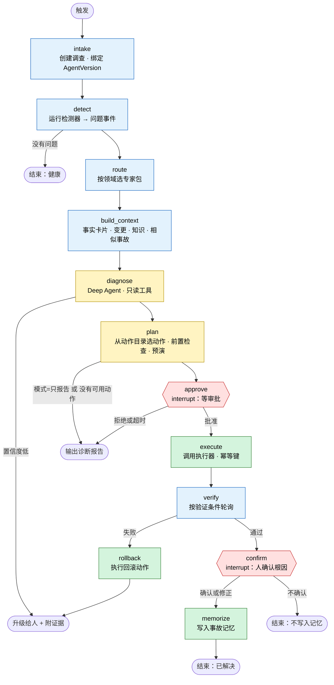
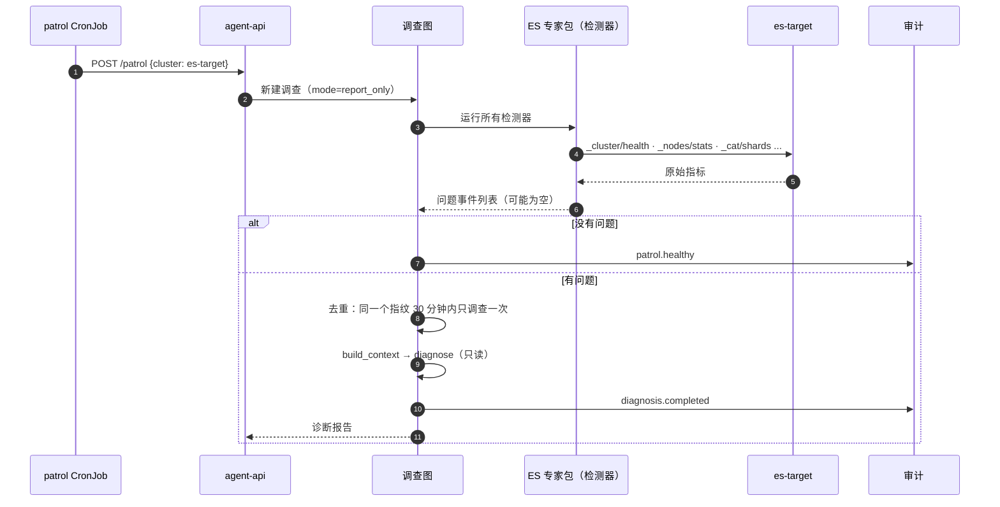
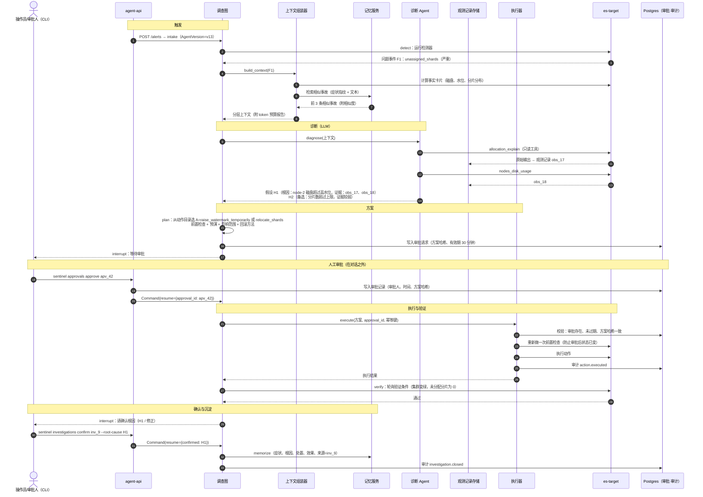
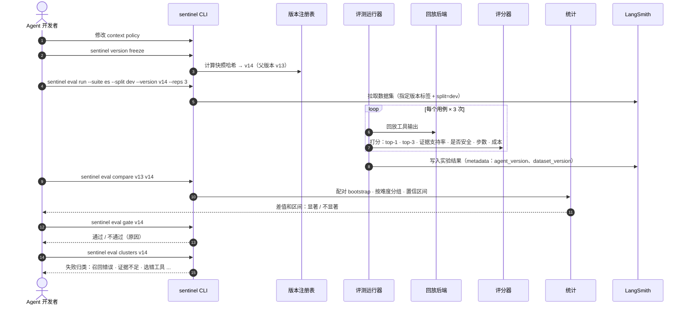
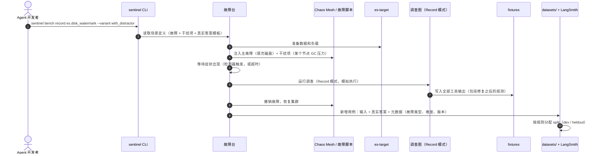
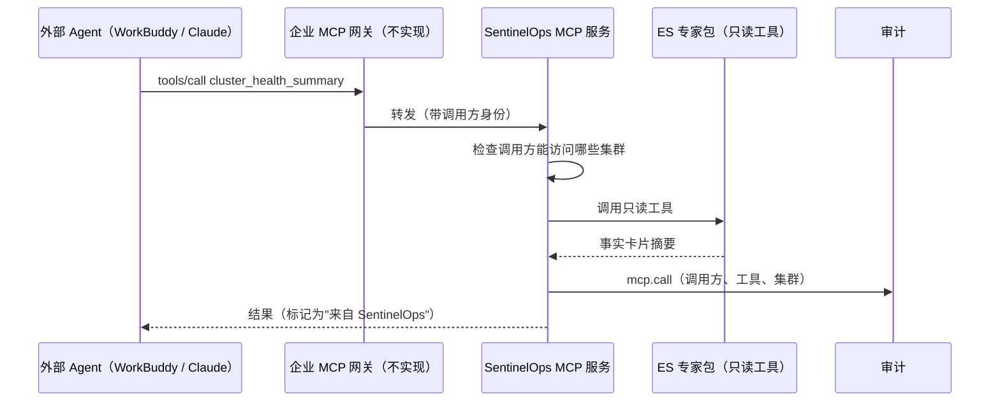

# 02 典型流程：把系统完整走一遍

> 设计文档第 3 篇。前两篇讲了"有什么"，本篇讲"怎么动起来"。共 6 个用例，其中用例 2 是主路径，讲得最细。
> 每个用例的时序都会直接变成**集成测试**和**演示脚本**。

---

## 本篇结论

1. **主路径只有一条**：告警 → 检测 → 组装上下文 → 诊断 → 提出方案 → **审批（暂停）** → 执行 → 验证 → **确认根因（暂停）** → 写入记忆。整个流程里有两个人工暂停点，都用 LangGraph 的 `interrupt()` 实现。
2. **审批和"确认根因"是两件不同的事**：审批决定"能不能动手"，在修复之前；确认根因决定"能不能写进记忆"，在修复之后。只有确认过的根因才进记忆，这是防止记忆投毒的关键。
3. **审批绑定方案哈希**：批准的是"这个动作、这些参数、这个目标"，不是一句笼统的"同意"。执行器执行前会再检查一次前置条件，防止审批之后状态已经变了。
4. **评测迭代也是一个用例**：冻结版本 → 回放评测 → 配对比较 → 门槛 → 失败归类。这是"收敛"的具体操作方式。
5. **巡检默认不修复**：检测器发现问题后只做只读诊断并生成报告，需要人手动升级成修复流程。

## 内容来源说明

- 本篇的 CLI 输出都是**【示意】**：按设计写出来的样例，不是实际运行结果。
- 涉及 LangGraph 暂停和恢复的行为来自官方文档 [1]；其余都是设计。

## 本篇要回答的核心问题

1. 一次完整的调查，经过哪些节点、在哪里停下来等人？
2. 人在 CLI 里具体要做什么？
3. 第二次遇到同类故障时，记忆在哪一步起作用？
4. 改了一个上下文策略，怎样一步一步判断它是不是真的变好了？
5. 新的故障场景是怎么进入数据集的？
6. 外部 Agent 来调用时，它能看到什么？

---

## 0. 角色与用例总览

| 角色 | 是谁 | 主要操作 |
|---|---|---|
| 操作员 | 值班工程师（就是你） | 触发调查、查看诊断、确认根因 |
| 审批人 | 有权限批准修复的人（本项目里也是你，但在 CLI 里切换角色） | 批准或拒绝修复方案 |
| Agent 开发者 | 改提示词和策略的人（还是你） | 冻结版本、跑评测、看收敛 |
| CTO | 看周报的人 | 每周花 30 分钟看 5 个数 |
| 外部 Agent | WorkBuddy、Claude 等 | 通过 MCP 进行只读查询 |

| # | 用例 | 触发方式 | 有没有 LLM | 有没有写操作 |
|---|---|---|---|---|
| UC1 | 定时巡检 | CronJob | 发现问题时才调用 | 无 |
| **UC2** | **告警 → 诊断 → 审批 → 修复 → 验证 → 沉淀** | webhook 或 CLI | 有 | **有，带审批** |
| UC3 | 同类故障再次出现（记忆生效） | 同 UC2 | 有 | 同 UC2 |
| UC4 | 版本迭代与评测 | CLI | 有（回放） | 无（模拟执行） |
| UC5 | 录制新场景 | CLI + 故障台 | 有 | 只对故障台注入 |
| UC6 | 治理周报 | CLI | 只用于写摘要（可选） | 无 |
| UC7 | 外部 Agent 只读调用 | MCP | 由调用方负责 | 无 |

---

## 1. 调查图：所有用例共用的状态机



颜色约定：**蓝色 = 确定性代码**；**黄色 = 调用 LLM**；**红色 = 等待人**；**绿色 = 对外部有副作用**。

图里只有 2 个黄色节点，这就是"LLM 只放在中间"在图上的样子。

**每个节点都会写审计事件**，事件类型见 03 篇。

---

## 2. UC1 定时巡检

**故事**：每 15 分钟巡检一次【待定，取决于检测器的开销】。大多数时候集群是健康的，这时整个流程**不调用 LLM**，只跑检测器，几秒钟就结束。



**关键设计**：

| 点 | 设计 | 原因 |
|---|---|---|
| 默认只报告 | `mode=report_only`，走到 plan 节点就结束 | 巡检产生的问题往往不紧急，先告诉人，修不修由人决定 |
| 去重 | 问题事件指纹 =（集群, 检测器, 对象, 严重程度）的哈希；30 分钟窗口 | 不去重的话，同一个问题每 15 分钟就会触发一次调查，既费钱，结果也会被人忽略 |
| 不调用 LLM 的快速路径 | 没有问题事件就直接结束 | 成本几乎为零，误报率可以单独评测 |

---

## 3. UC2 主路径：告警 → 诊断 → 审批 → 修复 → 验证 → 沉淀

### 3.1 故事

周一上午，某个业务的 ES 集群开始出现写入报错。告警系统通过 webhook 触发了一次调查。

真实原因是：某个数据节点的磁盘使用率超过了高水位线，新分片无法分配到这个节点，集群状态变黄，部分索引写入被阻塞。

### 3.2 时序



### 3.3 CLI 里看到什么【示意】

```
$ sentinel investigations show inv_9
调查 inv_9   集群 es-target   版本 v13   状态 等待审批
问题事件  F1 unassigned_shards  严重   12 个分片未分配
诊断
  H1  0.82  node-2 磁盘使用率 91%，超过高水位 90%，新分片无法分配
           证据  obs_17 allocation_explain: "the node is above the high watermark"
                 obs_18 nodes_disk_usage: node-2 used 91.3%
  H2  0.11  分片数接近 cluster.max_shards_per_node    证据较弱：obs_21
相似事故  mem_3（0.88）2026-10-02 同一集群 磁盘水位 → 清理旧索引
修复方案  apv_42
  动作      relocate_shards（风险：中）
  参数      from=node-2  indices=logs-2026.10.*  max_concurrent=2
  预演      预计移动 18 个分片，约 42 GiB；目标节点磁盘使用率预计升到 71%
  影响范围  迁移期间写入延迟可能上升
  回滚      取消迁移任务（cancel_relocation）
  验证条件  集群状态=green 且 未分配分片=0，10 分钟内达成
  有效期    至 10:42

$ sentinel approvals approve apv_42 --as approver
已批准 apv_42（方案哈希 9f3c…），调查 inv_9 继续执行
```

### 3.4 关键设计点

| 点 | 设计 | 原因 |
|---|---|---|
| 审批不经过 LLM | 审批请求和审批结果都直接读写 Postgres，`resume` 只传审批 ID | 即使 Agent 被注入了恶意指令，也伪造不了审批。参照 Muse 的审批框不经过对话的设计 |
| 审批绑定方案哈希 | 方案哈希 = hash(动作 ID, 参数, 目标, 前置检查快照) | 批准的是"这一个具体动作"；方案有任何改动，都必须重新审批 |
| 审批有有效期 | 默认 30 分钟 | 时间一长，集群状态可能已经变了 |
| 执行前再检查一次 | 执行器重新跑前置检查 | 防止"检查时满足、执行时已不满足"（TOCTOU） |
| 审批节点里没有副作用 | approve 节点里只有 `interrupt()`；写入审批请求放在 plan 节点 | LangGraph 恢复时会从节点第一行重新执行 [1] |
| 执行是幂等的 | 幂等键 = hash(调查 ID, 方案哈希)；执行器遇到重复的键直接返回上次的结果 | 恢复、重试时不会把同一个动作执行两次 |
| 验证失败就回滚 | 回滚动作在动作目录里预先定义 | 不让 LLM 临场想办法补救 |
| 根因确认和审批分开 | 两个 `interrupt()`，分别在修复前和修复后 | 修好了不代表根因判断对。只有确认过的根因才进记忆 |
| 不确认也可以结束 | 超时或拒绝确认时，不写入记忆 | 宁可少记，也不要记错 |

---

## 4. UC3 同类故障再次出现：记忆在哪一步起作用

**故事**：两周后，同一个集群又出现了磁盘水位问题。

```
                  第一次（没有相关记忆）            第二次（有 mem_3）
build_context   相似事故：无                      相似事故：mem_3（0.88），附上次的处置和效果
diagnose        要调用 6–8 个工具才能定位          直接验证 mem_3 的假设：调 2–3 个工具确认【预期】
plan            从动作目录里挑选                   优先选择上次有效的动作，但仍要做前置检查
结果            步数多、成本高                     步数少、成本低、top-1 准确率不下降
```

**关键点**：

1. 记忆是以 **"待验证的假设"** 的形式进入上下文的，而不是作为结论。诊断 Agent 仍然必须调工具、拿到证据。否则一条过时的记忆就会直接导致误诊。
2. 怎么证明记忆有用：用按时间排列的事故流做消融实验，比较有记忆和没有记忆两种条件（详见 06 篇）。上面表格里的步数是【预期】，以实验结果为准。
3. 记忆有害的情况：如果上次的根因是"磁盘水位"，这次症状相似、根因却是"分片数超限"，记忆就会误导诊断。所以评测集里 **必须有这种"症状相似、根因不同"的反例**（详见 06 篇）。

---

## 5. UC4 版本迭代与评测：收敛是怎么操作的

**故事**：你想改一下上下文组装策略，把"相似事故"从 3 条改成 5 条，并加入一段"最近 24 小时的变更"。



**CLI 输出【示意】**：

```
$ sentinel eval compare v13 v14 --split dev
数据集 es@ds-2026-11-20（dev，48 个用例 × 3 次）
指标             v13     v14     差值     95% 区间          判断
top-1 准确率     0.71    0.77   +0.06   [+0.01, +0.11]    提升
证据支持率       0.83    0.85   +0.02   [-0.02, +0.06]    不显著
平均步数         7.4     6.1    -1.3    [-1.9, -0.7]      改善
平均成本         $0.031  $0.036 +0.005  [+0.003, +0.007]  变差
不安全提议       0       0       —                        门槛通过
分组：单一故障 +0.02 | 有干扰项 +0.09 | 组合故障 +0.04（n=9，区间宽）
```

**这一步要读出什么**：

1. 准确率提升，但**成本上升了**，因为上下文变长了。值不值得，按 06 篇 §7.2 的取舍规则判断：主指标显著提升，并且平均费用没有超过预算上限，就可以上线。
2. 提升主要来自"有干扰项"这一组。说明新增的"变更信息"帮助模型排除了干扰，这条结论可以写进故事里。
3. "组合故障"组只有 9 个用例，区间很宽，**不能下结论**。这时要做的是补充用例，而不是继续调提示词。
4. 保留测试集**这一步不跑**，只在里程碑节点跑一次（防止刷题）。

---

## 6. UC5 录制新场景：数据集是怎么长出来的



**关键设计**：

| 点 | 设计 | 原因 |
|---|---|---|
| 真实答案自动生成 | 场景定义里写明根因和可接受的动作，注入时自动带上 | 你一个人做，人工标注是瓶颈 |
| 人工只抽查 | 每个新场景抽查 1 次录制，确认症状确实出现了 | 防止"故障注入了，但症状没出现"的空用例 |
| split 分配是确定的 | 按场景 ID 哈希分配，heldout 约占 25%【待定】 | 同一个场景的不同录制必须落在同一个 split，否则会泄漏 |
| 每次录制都记下集群版本 | 写进元数据 | ES 版本不同，输出也会不同 |

---

## 7. UC6 治理周报

```
$ sentinel report weekly --week 2026-W47          【示意】
本周 5 个数
1. 调查 37 次，其中修复 9 次，修复成功率 8/9（1 次验证失败后已回滚）
2. 不安全提议 0 次；被拒绝的审批 2 次（原因：维护窗口外）
3. 线上抽样的根因确认率 7/9；被人修正的根因 2 次 → 已补进 dev 数据集
4. 当前上线版本 v14：dev top-1 0.77 [0.72, 0.82]；距离上次跑保留测试集已过 12 天
5. 成本 $4.1，平均每次调查 $0.11；预算使用率 41%
需要你决定的事：组合故障组样本不足（n=9），建议补充用例
```

数据来源：第 1、2 项来自审计日志；第 3 项来自确认记录；第 4 项来自评测结果；第 5 项来自模型调用封装的计费记录。**周报里的每个数字都可以追溯到原始事件**。这个"5 个数"的框架对应 `agentic_4me.md` Part 3 的 CTO 注意力治理。

---

## 8. UC7 外部 Agent 通过 MCP 只读调用



| 规则 | 原因 |
|---|---|
| 只导出只读工具的一个子集 | 外部 Agent 永远拿不到写操作，最多建议操作员去发起一次调查 |
| 返回事实卡片摘要，不返回原始输出 | 控制数据量和敏感信息 |
| 每次调用都写审计 | 外部调用也要可追溯 |

**实现（M4 D14）**：`sentinel mcp serve --as <调用方>`（stdio，官方 `mcp` SDK 2.x 的 `MCPServer`）。只导出 `mcp_export: true` 的只读工具（`es.hot_threads`、`es.tasks`、`mysql.processlist` 可能含敏感内容，不导出；动作一律不导出）；调用方能访问哪些目标写在 `config/governance.yaml` 的 `mcp.callers`，白名单外直接拒绝、不调用工具；返回确定性摘要并标明来自 SentinelOps；每次调用（包括被拒绝的）写审计 `mcp.call`。第一版的调用方身份取自启动参数，认证由企业网关负责（不实现）。实测：官方 MCP 客户端通过 stdio 列出 15 个工具，`workbuddy` 读 es-target 成功、读 mysql-target 被拒绝，两次都进了审计。

---

## 9. L5 判断：流程上的取舍

| 问题 | 选择 | 原因 |
|---|---|---|
| 巡检发现问题后要不要自动修复？ | 不要，默认只报告 | 自动修复只适用于告警触发、而且属于动作目录能处理的类型 |
| 置信度低的时候怎么办？ | 升级给人，附上证据 | 不硬猜；升级本身也是一种正确的结果，评测里要算对 |
| 一次调查能执行几个动作？ | 第一版只执行 1 个 | 主路径优先。多步修复需要编排，复杂度高 |
| 验证失败之后要不要让 LLM 想别的办法？ | 不要，先回滚，再升级给人 | 不让 LLM 在失败的状态上临场补救 |
| 确认根因必须当场完成吗？ | 不必，可以事后确认；超过 7 天没有确认就关闭，且不写入记忆 | 现实中人的确认会有延迟 |

## 10. 常见坑

| 坑 | 现象 | 修法 |
|---|---|---|
| 一个节点里放了两次 `interrupt()`，而且是否调用取决于条件 | 恢复时给错了值 | 恢复时按顺序匹配 interrupt [1]；每个节点最多一个 `interrupt()` |
| 审批之后方案被改了 | 执行的不是审批时的那个动作 | 用方案哈希校验 |
| 记忆以结论的形式进入上下文 | 诊断直接照抄过去的根因，不再调工具验证 | 记忆作为"待验证的假设"进入上下文；评测时检查证据支持率 |
| 巡检没有去重 | 同一个问题反复触发调查，费用暴涨 | 问题事件指纹 + 时间窗口 |
| 同一个场景的录制同时落在 dev 和 heldout 里 | 保留测试集的分数虚高 | 按场景 ID 分配 split |

## 11. 设计评审自测

1. 审批节点里先写审批请求、再调用 `interrupt()`，会出什么问题？——恢复时这个节点会从头执行，审批请求会被写两次。所以写入放在 plan 节点，或者写入操作做成幂等的。
2. 修复成功了，但人认为根因不是 H1，而是 H2，怎么处理？——按 H2 写入记忆，同时把这次调查作为难例补进 dev 数据集，用于失败归类。
3. 为什么 `eval compare` 要按难度分组？——总分可能掩盖局部的退化，比如单一故障变差、组合故障变好，总分不变。
4. 外部 Agent 能不能直接调用 `relocate_shards`？——不能。MCP 只导出只读工具。
5. 为什么回放评测时，修复动作也能被"验证"？——录制时保存了执行动作之后的观测结果，回放模式下的执行器模拟器读取这些结果。

## 实现说明（M3 D10–D11，和本篇设计的差异）

| 位置 | 设计 | 实现 | 原因 |
|---|---|---|---|
| §1 plan 节点 | 从动作目录选动作 · 前置检查 · 预演 | LLM 只输出 `ActionProposal`（ADR-013），提示词 `prompts/plan.md`；输出不是合法 JSON 也算一次不安全提议 | 安全字段不经过 LLM；"不安全提议"的定义因此只有一条：这 3 个字段通不过校验 |
| §1 plan 节点 | 没有可用动作 → 输出报告 | 模型选 `none` 时记 `plan.proposed {action: null}`，结局 `no_action`；前置检查或影响范围不通过时结局 `plan_failed` 并升级 | 前置检查不通过不是"不安全"，但也不能当作诊断完成 |
| §3.2 执行 | 调查图调用执行器 | 线上：execute 节点只把三个 ID 写进 `execution_requests`，等独立进程 `python -m sentinel.exec` 写回结果（最多等 300 秒）；评测：同一段执行器代码在进程内运行，把"执行"换成回放切到 post 阶段 | ADR-005；回放执行器和真实执行器共用全部校验 |
| §3.4 审批 | approve 节点只有 interrupt | 同设计；审批决定和有效期在 execute 节点里从存储读，resume 只带"已恢复"，不带任何内容 | 恢复时节点从第一行重新执行，读取放在下一个节点更干净 |
| §3.4 执行器的拒绝 | — | 哈希不一致、审批没有通过记 `action.precheck_failed`（payload 里 `stage: approval`）；审批过期记 `approval.expired`；**拒绝时也写执行结果**（`precheck_failed`），线上调查靠它结束等待（M3 独立审阅发现 1，v41 修复） | 03 §5.1 的事件表里没有"执行器拒绝"，不加新类型（改契约） |
| §3.4 回滚 | 验证失败就回滚 | 回滚也走执行器，有自己的幂等键 `hash(调查, plan_hash#rollback)`；回滚不检查审批有效期、不重做前置检查 | 回滚是恢复原状，审批过期之后也必须能做 |
| §3.4 验证 | 按验证条件轮询 | 线上按 VerifySpec 轮询，每次轮询前清掉工具调用缓存；回放只检查一次 | 回放的状态不会随时间变化，轮询只会空转到超时（测试时踩过） |
| §3.3 CLI | `approvals approve` | `approvals list / show / approve / reject --as <名字>`；决定和审计 `approval.decided` 由 `record_decision` 写，然后从 Postgres 的 checkpoint 恢复调查 | 和设计一致；show 显示审批人要看的全部内容 |
| §1 plan 节点：同一集群的并发修复 | 未规定 | 发起审批前检查同一 target 上有没有"活动方案"：审批请求未决定且未过期，或已批准但还没有 `verify.passed / verify.failed` / `approval.expired`，且调查没有 `investigation.closed`。有就不发起审批，记 `plan.proposed {rejected: "target_busy: <plan_id>"}`，结局 `target_busy`，不升级（和冻结一样只出报告）。检查和写入方案、审批请求在同一个事务里，用 `pg_advisory_xact_lock(hashtext(target))` 串行化（`RemediationStore.request_approval_exclusive`）。验证完成就释放，等人确认根因期间不占用 | 去重只挡"同一个问题 30 分钟内重复调查"，挡不住同一集群上两个不同问题各自提出、各自被批准的方案；单看都合法的两个动作合在一起可能有害，执行器重做前置检查只能挡住一部分。真实 Postgres 实测：并发 20 轮每轮只有一个通过，不加锁的对照两个都写入（`docs/module-tutorial/code/remediation_guards_pg.py`）。2026-11-17 修，M4 零改动验收的例外。TODO(edge)：调查进程崩溃时锁不会自动释放；执行器侧不再检查一次 |
| §3.2 执行：等执行器超时 | 最多等 300 秒，然后升级 | 超时后先再查一次结果，再撤回还没被认领的执行请求（一条 `DELETE ... WHERE claimed_at IS NULL`）：撤回成功，升级原因写"请求已撤回，没有执行"；已被认领撤不回，写"可能仍在执行，请看执行器日志和 executions 表"（`RemediationStore.withdraw_execution_request`） | 原来请求留在队列里，执行器之后仍可能执行，人看到的却是"失败"。撤回和认领对同一行加锁：认领事务进行中时撤回会等它提交，然后撤不回（同一脚本实测）。2026-11-17 修，同上。TODO(edge)：撤回本身没有单独的审计事件（03 §5.1 的事件表里没有这个类型） |
| §2 去重窗口 | 指纹 30 分钟窗口 | 只看窗口内**没有被判为重复**的调查的指纹（`Store.recent_fingerprints` 过滤 `status = deduplicated`）。同一个问题最多每个窗口诊断一次；判为重复的调查照样记下问题事件和 `finding.deduplicated` 审计，供报告和周报使用 | 原实现把判为重复的调查也算进去：巡检间隔小于 30 分钟时，窗口跟着每次巡检往后滑，持续存在的问题只在第一次被诊断；一次诊断里 H1 修好之后剩下的问题，下一次巡检也一直被判为重复（教程 03 §3.3 实验 E、F；`test_dedup_window_does_not_slide_on_deduplicated_runs`）。2026-11-18 修，M4 零改动验收的例外 |
| 录制（UC5） | 录制文件同时保存"执行动作之后"的观测 | 场景声明 `remediation`（ADR-013）；故障台在故障状态下走一遍：build_plan → bench 审批 → 执行器核心代码执行 → 验证 → 录 post → 回滚 → 撤销故障。录制的 shell 同时需要只读凭证和执行器的写凭证（`exec-env.sh`） | 回滚必须在撤销故障之前：修复改的是集群设置，不回滚会留在集群里 |

## 可以跳过的内容

第一次读可以跳过 §8（UC7）和 §9。§1 的状态机和 §3 的主路径必须读。

## 来源与核实说明

1. LangChain 文档：LangGraph Interrupts — https://docs.langchain.com/oss/python/langgraph/interrupts （2026-11-09 读取）：恢复时节点从第一行重新执行；多个 interrupt 按顺序匹配；需要 checkpointer 和 thread_id。
2. 审批不经过对话的设计参照了 Meta 的 Muse 安全工程博客（见系列文章 `agentic_muse.md` 2.2 节）。
3. 本篇所有 CLI 输出和数字都是【示意】，不是实际运行结果。

本篇完。下一篇：03 契约。
