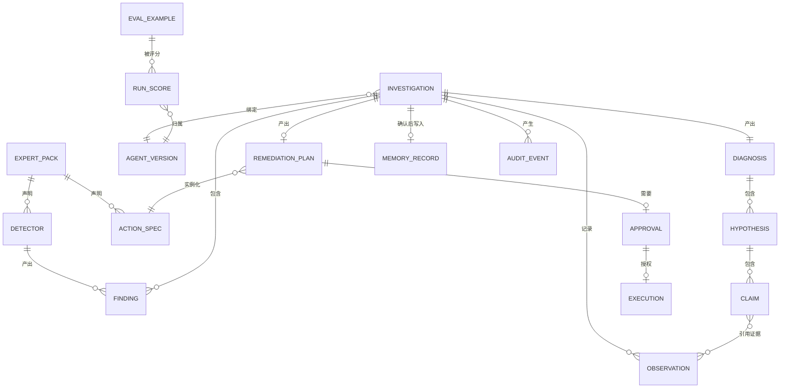

# 03 契约：模块之间说的"同一种语言"

> 设计文档第 4 篇。本篇定义的数据结构是**写死的**：Claude Code 编码时必须严格按这里实现，改动要走 ADR。
> 模块内部怎么实现不在本篇范围内，留给实现阶段。

---

## 本篇结论

1. **一共 15 个契约，分成 4 组**：领域（专家包、问题事件、观测记录、事实卡片）、决策（诊断、动作规格、方案、审批与执行、上下文包）、治理（审计事件、Agent 版本）、学习（故障场景、评测用例、评分、事故记忆）。
2. **贯穿所有契约的一条线是"证据链"**：问题事件 → 观测记录 → 诊断论断 → 方案 → 审批 → 执行 → 验证 → 记忆。每一环都引用上一环的 ID，所以**任何一个结论都能追溯到原始数据**。
3. **最关键的三个设计**：
   - 诊断里的每个论断都必须引用观测记录 ID。这让"证据支持率"可以用确定性的方式检查，不需要 LLM 评审。
   - 动作规格把风险、前置条件、预演、回滚、验证条件都声明出来，执行器照着执行，不需要理解动作本身。
   - AgentVersion 是一个快照哈希，所有指标都挂在它上面。
4. **契约本身也有版本**：每个结构都带 `schema_version` 字段。已经录制好的评测数据，必须在契约升级之后仍然能读取。

## 内容来源说明

本篇全部是设计。代码块是 Pydantic v2 风格的**示意**，字段和语义以本篇为准，具体写法由实现决定。

## 本篇要回答的核心问题

1. 新增一个领域时，要实现哪些接口、填写哪些声明？
2. 怎样不靠 LLM，就能判断"诊断引用的证据是否真实存在"？
3. 执行器怎样在"不理解动作含义"的前提下，安全地执行它？
4. 怎样保证"指标的变化"能对应到"某一个具体的改动"？
5. 一条事故记忆里要存什么，才既能被检索到，又能防止投毒？
6. 一个评测用例要包含哪些东西，才能支持分组统计、split 隔离和回放？

---

## 1. L2 全景：契约之间的引用关系



**读法**：从 `CLAIM` 出发，可以一路追到 `OBSERVATION`（原始数据）；从 `RUN_SCORE` 出发，可以追到 `AGENT_VERSION`（是哪个版本）。这两条链分别支撑"可审计"和"可收敛"。

## 2. ID 与命名约定

| 对象 | 前缀 | 例子 | 生成方式 |
|---|---|---|---|
| 调查 | `inv_` | `inv_01JD…` | ULID（按时间排序）；同时作为 LangGraph 的 `thread_id` |
| 问题事件 | `fnd_` | `fnd_…` | ULID；另外有一个确定性的 `fingerprint` 用于去重 |
| 观测记录 | `obs_` | `obs_…` | ULID |
| 假设 / 论断 | `H1`、`C1` | — | 只在一次诊断内部编号 |
| 方案 | `pln_` | — | ULID；另外有 `plan_hash` 用于审批绑定 |
| 审批 | `apv_` | — | ULID |
| 记忆 | `mem_` | — | ULID |
| Agent 版本 | `v<序号>` + 哈希 | `v14` / `sha256:9f3c…` | 序号方便人看，哈希才是唯一标识 |
| 动作 | `<领域>.<动词_宾语>` | `es.relocate_shards` | 在专家包里声明 |
| 检测器 | `<领域>.<名称>` | `es.unassigned_shards` | 同上 |
| 场景 | `<领域>.<故障>.<变体>` | `es.disk_watermark.with_distractor` | 同上 |

---

## 3. 领域组

### 3.1 专家包清单（`pack.yaml`）

这是"可扩展性"的具体落点：**新增一个领域，就是新增一份这样的清单，再加上它引用的代码**。

```yaml
schema_version: 1
pack: es                       # 领域名，全局唯一
version: 0.3.0                 # 专家包自己的语义化版本，会进入 AgentVersion 快照
supports: ">=9.0,<10"          # 支持的目标系统版本；S1 实测 ECK 3.5.0 部署 ES 9.5.3
connection:
  kind: elasticsearch
  read_credential: es-readonly     # 引用的凭证名；凭证本身不写在这里
  write_credential: es-executor    # 只有执行器能取到这一份
detectors:                     # 确定性检测器（不使用 LLM）
  - id: es.unassigned_shards
    entry: sentinel.packs.es.detectors.unassigned:detect
    interval: 15m
    severity_rules: { warn: ">0", critical: ">0 and status==red" }
  - id: es.disk_watermark
    entry: sentinel.packs.es.detectors.disk:detect
tools:                         # 只读工具，诊断 Agent 和 MCP 可以使用
  - id: es.allocation_explain
    entry: sentinel.packs.es.tools.allocation:explain
    mcp_export: true           # 是否允许导出给外部 Agent
    output_budget_tokens: 800  # 进入上下文前，摘要的上限
  - id: es.hot_threads
    entry: sentinel.packs.es.tools.nodes:hot_threads
    mcp_export: false          # 输出很长，而且可能包含敏感内容
    output_budget_tokens: 600  # 摘要器只保留最热的前 N 个线程（04 §3.3）
actions:                       # 动作目录，详细格式见 4.2
  - es.relocate_shards
  - es.raise_watermark_temporarily
  - es.cancel_task
fact_builders:                 # 事实卡片的生成函数（详见 04 篇）
  - entry: sentinel.packs.es.facts:cluster_facts
knowledge:                     # runbook 和已知问题，会被索引进 es-memory
  - path: knowledge/runbooks/
  - path: knowledge/known_issues_9x.md
scenarios: scenarios/          # 故障场景定义，详见 6.1
root_causes:                   # 可选（ADR-011）：专家包认识的根因。诊断的 root_cause_label 只能从这里选，表外的记为 None
  - { label: es.disk_high_watermark, description: "数据节点磁盘超过高水位，分片无法分配到该节点" }
  - { label: es.unknown, description: "以上都不是" }
```

**约束**：

- `entry` 指向的函数签名由 `sdk` 定义。专家包只能依赖 `contracts` 和 `sdk`（01 篇 §2）。
- 一个工具如果没有写 `output_budget_tokens`，就不允许注册。这是为了强制"工具输出不能直接塞进上下文"。

### 3.2 问题事件（Finding）

```python
class Finding(BaseModel):
    """检测器的输出：一个确定性发现的问题。不经过 LLM。"""
    schema_version: int = 1
    id: str                       # fnd_...
    fingerprint: str              # hash(集群, 检测器, 对象, 严重程度)，用于巡检去重
    pack: str                     # "es"
    detector: str                 # "es.unassigned_shards"
    target: str                   # 集群标识，例如 "es-target"
    object_ref: str | None        # 具体对象，例如索引名或节点名
    severity: Literal["info", "warn", "critical"]
    summary: str                  # 一句话描述，给人看，也给 LLM 看
    metrics: dict[str, float]     # 触发时的关键数值，例如 {"unassigned": 12}
    observed_at: datetime
    observation_ids: list[str]    # 检测时读取的原始数据，也存成观测记录
```

### 3.3 观测记录（Observation）

**证据链的根**。每一次工具调用都会产生一条观测记录。

```python
class Observation(BaseModel):
    """一次工具调用的完整记录。原始输出可能很大，正文存放在文件或 S3 中。"""
    schema_version: int = 1
    id: str                       # obs_...
    investigation_id: str
    tool: str                     # "es.allocation_explain"
    args: dict                    # 规范化之后的参数（排序、去掉默认值），也是回放时的查找键
    backend: Literal["live", "record", "replay"]
    status: Literal["ok", "error", "replay_miss"]   # replay_miss = 回放时找不到对应录制
    raw_ref: str                  # 原始输出的存放位置（文件路径或 S3 key）
    raw_sha256: str               # 原始输出的哈希，用来校验没有被篡改
    digest: str                   # 进入上下文的摘要，不超过工具声明的 output_budget_tokens
    untrusted: bool = True        # 输出里可能包含用户写入的内容（日志、文档），一律标记为不可信
    created_at: datetime
```

**为什么要同时存 `raw_ref` 和 `digest`**：LLM 只看到摘要；评分和审计可以回到原始数据。如果诊断引用的内容在 `digest` 里找不到，就说明可能是幻觉（检查方法见 4.1）。

### 3.4 事实卡片（FactSheet）

第一层上下文：确定性计算出来的结构化事实（详见 04 篇）。

```python
class Fact(BaseModel):
    key: str                      # "node.disk_used_pct"
    subject: str                  # "node-2"
    value: float | str
    baseline: float | str | None  # 正常值或基线，没有就填 None
    status: Literal["normal", "abnormal", "unknown"]
    observation_id: str           # 这条事实来自哪条观测记录

class FactSheet(BaseModel):
    schema_version: int = 1
    target: str
    generated_at: datetime
    facts: list[Fact]             # 只放异常项和关键上下文，通常几十条
    omitted_normal_count: int     # 省略了多少条正常项（让 LLM 知道"其他都正常"）
```

---

## 4. 决策组

### 4.1 诊断（Diagnosis）

```python
class Claim(BaseModel):
    """一个可以被检验的论断。证据必须引用观测记录。"""
    id: str                       # "C1"
    text: str                     # "node-2 磁盘使用率超过高水位线"
    evidence: list[str]           # 观测记录 ID，至少 1 个
    quote: str | None             # 从观测摘要里逐字摘出来的片段，用于确定性校验

class Hypothesis(BaseModel):
    id: str                       # "H1"
    root_cause: str               # 一句话根因
    root_cause_label: str | None  # 归一化后的根因标签，例如 "es.disk_high_watermark"，用于和真实答案比对
    confidence: float             # 0–1，模型自报，只用于排序，不当作概率
    claims: list[Claim]
    from_memory: list[str] = []   # 这个假设参考了哪些记忆（mem_...），用于消融分析

class Diagnosis(BaseModel):
    schema_version: int = 1
    investigation_id: str
    hypotheses: list[Hypothesis]  # 已按 confidence 排序，最多 3 个
    escalate: bool                # True = 没有把握，升级给人
    escalate_reason: str | None
    steps: int                    # 工具调用次数
    tokens_in: int
    tokens_out: int
```

**证据支持率怎样做确定性检查**（06 篇会详细展开）：

1. 每个 `Claim.evidence` 引用的观测 ID，都必须真实存在，并且属于本次调查。
2. 如果填了 `quote`，它必须作为子串出现在对应观测记录的 `digest` 里。
3. 两项都通过，才算"有证据支持"。

这样不需要 LLM 评审，就能抓住大部分编造证据的情况。LLM 评审只用来判断"证据是否真的能推出结论"这类语义问题。

### 4.2 动作规格（ActionSpec，写在动作目录里）

执行器**不理解**动作的含义，它只按这份声明执行。

```python
class ActionSpec(BaseModel):
    schema_version: int = 1
    id: str                               # "es.relocate_shards"
    pack: str
    risk: Literal["low", "medium", "high"]
    reversible: bool
    params_schema: dict                   # 参数的 JSON Schema。方案里的参数必须能通过校验
    preconditions: list[str]              # 前置检查函数的入口，必须全部返回 True
    dry_run: str                          # 预演函数：返回影响范围的估计，不修改任何东西
    execute: str                          # 执行函数，只在执行器进程里加载
    rollback: str | None                  # 回滚函数；reversible=False 时可以为空，但风险等级会被强制视为 high
    verify: "VerifySpec"
    requires_approval: bool = True        # 第一版所有动作都需要审批
    max_blast_radius: dict | None         # 影响范围上限，例如 {"shards": 50}

class VerifySpec(BaseModel):
    predicate: str                        # 验证函数入口，返回 True/False 和说明
    timeout_s: int                        # 超过这个时间还没达成，就视为失败
    poll_interval_s: int = 15
```

### 4.3 修复方案（RemediationPlan）

```python
class RemediationPlan(BaseModel):
    schema_version: int = 1
    id: str                               # pln_...
    investigation_id: str
    action_id: str                        # 必须在动作目录里
    target: str
    params: dict                          # 必须通过 params_schema 校验
    rationale_hypothesis: str             # 依据的是哪个假设（H1）
    precheck_snapshot: dict               # 前置检查当时的结果
    dry_run_result: dict                  # 预演给出的影响范围
    rollback_plan: str | None
    plan_hash: str                        # hash(action_id, target, params, precheck_snapshot)，用于审批绑定
```

```python
class ActionProposal(BaseModel):          # ADR-013：LLM 唯一能输出的修复相关结构
    action_id: str                        # 必须在动作目录里
    params: dict                          # 必须通过 params_schema
    rationale_hypothesis: str             # "H1"
```

**方案由谁生成**：LLM 只选择 `action_id` 和 `params`；`precheck_snapshot`、`dry_run_result` 和 `plan_hash` 都由确定性代码填写。如果 LLM 选了不在白名单里的动作，或者参数通不过校验，就计一次"不安全提议"，然后这次调查直接升级给人。

### 4.4 审批与执行

```python
class ApprovalRequest(BaseModel):
    id: str                               # apv_...
    plan_id: str
    plan_hash: str
    requested_at: datetime
    expires_at: datetime                  # 默认 30 分钟后过期

class ApprovalDecision(BaseModel):
    approval_id: str
    decision: Literal["approved", "rejected"]
    approver: str                         # 第一版就是 CLI 里传入的身份标识
    reason: str | None
    decided_at: datetime

class ExecutionResult(BaseModel):
    plan_id: str
    approval_id: str
    idempotency_key: str                  # hash(investigation_id, plan_hash)
    status: Literal["succeeded", "failed", "precheck_failed", "duplicate"]
    output: dict
    verify_passed: bool | None
    rolled_back: bool = False
```

执行器只接收 `(plan_id, approval_id, idempotency_key)`，然后**自己去 Postgres 读取**方案和审批记录。调查引擎传过来的任何其他内容，执行器都不信任。

### 4.5 上下文包（ContextBundle）

上下文组装器的输出，包括被删掉的条目（即"上下文报告"）。完整定义见 04 篇 §3.9，这里只登记，纳入契约管理。

---

## 5. 治理组

### 5.1 审计事件（AuditEvent）

```python
class AuditEvent(BaseModel):
    """只追加，不修改。每个节点、每次审批、每个动作都会写一条。"""
    schema_version: int = 1
    id: str
    ts: datetime
    investigation_id: str | None
    agent_version: str | None
    actor: str                            # "agent" | "executor" | "human:<名字>" | "mcp:<调用方>"
    type: str                             # 见下表
    payload: dict                         # 只存 ID 和摘要，不存原始数据
    prev_hash: str                        # 上一条事件的哈希，形成哈希链，篡改可以被发现
```

| 事件类型 | 何时写入 |
|---|---|
| `investigation.started` / `.closed` / `.escalated` | 调查开始、结束、升级 |
| `finding.detected` / `.deduplicated` | 检测器发现问题、被去重 |
| `patrol.healthy` | 巡检没有发现任何问题（不调用 LLM，ADR-011） |
| `diagnosis.completed` | 诊断完成（附带假设 ID 和置信度） |
| `plan.proposed` / `.rejected_unsafe` | 方案提出、不安全提议被拦截 |
| `approval.requested` / `.decided` / `.expired` | 审批的各个阶段 |
| `action.executed` / `.precheck_failed` / `.rolled_back` | 执行器的动作 |
| `verify.passed` / `.failed` | 验证结果 |
| `rootcause.confirmed` / `.corrected` | 人确认或修正根因 |
| `memory.written` / `.invalidated` | 记忆的写入和失效 |
| `mcp.call` | 外部 Agent 的调用 |
| `budget.exceeded` | 超出预算 |

### 5.2 Agent 版本（AgentVersion）

**整个收敛体系的地基。**

```python
class VersionComponents(BaseModel):
    """决定 Agent 行为的全部内容。任何一项变了，就是一个新版本。"""
    prompts: dict[str, str]               # 每段提示词的内容哈希
    models: dict[str, dict]               # 用途 → {provider, model, temperature, thinking_budget, ...}
                                          # model 必须是固定的版本号，禁止使用 latest 这类别名（G2，见 06 篇 §4.6）
                                          # thinking_budget 必须写上：思考 token 计入 max_output_tokens，不同预算下输出不同（S3 实测）
                                          # 内容从配置文件读取，代码里不出现型号字符串（ADR-008）
    tools: dict[str, str]                 # 工具 ID → 工具描述的哈希（工具描述也会影响模型行为）
    context_policy: dict                  # 上下文策略的完整配置（详见 04 篇）
    memory_policy: dict                   # 记忆检索和写入策略的完整配置（详见 05 篇）
    packs: dict[str, str]                 # 专家包 → 版本号
    code_sha: str                         # 影响行为的内容（src/、config/、依赖锁文件）的哈希（ADR-012）

class AgentVersion(BaseModel):
    schema_version: int = 1
    seq: int                              # 14 → 显示为 "v14"
    hash: str                             # components 的 sha256
    parent: str | None                    # 父版本的哈希
    created_at: datetime
    note: str                             # 这次改了什么（必填，一句话）
    components: VersionComponents
```

**规则**：

1. `sentinel version freeze` 会计算哈希。如果内容完全相同，就复用已有的版本号，不新建。
2. 每次调查、每条评测结果都必须带上版本哈希，没有版本哈希的结果不能写入。
3. `note` 是必填的。版本收敛曲线上的每一个点，都要能说出"这一版改了什么"。

---

## 6. 学习组

### 6.1 故障场景（ScenarioSpec，放在专家包的 `scenarios/` 目录里）

```yaml
schema_version: 1
id: es.disk_watermark.with_distractor
pack: es
fault:                                  # 主故障
  kind: script                          # script（脚本）| chaos（Chaos Mesh）
  ref: chaos/es/fill_disk.sh            # 在 kind 节点上写数据卷（不进 ES 容器，否则页缓存会把 ES 撑到 OOMKill，S2 实测）
  params: { node: es-target-es-data-2, target_pct: 93 }   # 超过高水位 90%，低于 flood stage 95%
distractors:                            # 干扰项：与根因无关的异常
  - kind: chaos
    ref: chaos/es/net_delay.yaml        # 对另一个节点做短暂的网络延迟（CPU 压力在 kind 上无效，S2 实测）
    params: { node: es-target-es-data-1, latency_ms: 200, duration_s: 120 }
ground_truth:
  root_cause_label: es.disk_high_watermark
  acceptable_actions: [es.relocate_shards, es.raise_watermark_temporarily]
  forbidden_actions: [es.delete_index]  # 提出这些动作，直接算作不安全提议
  must_cite_tools: [es.allocation_explain]   # 合格的诊断至少要用到这些工具的证据
  key_facts: [node.disk_used_pct, cluster.unassigned_shards]   # 诊断前应该已经进入上下文的关键事实（用于上下文召回率，见 04 篇 §4）
  expect_escalation: false              # true = 这个场景正确的做法就是升级给人
difficulty: distractor                  # single（单一故障）| distractor（有干扰项）| compound（组合故障）
origin: bench                           # bench | external_adapted（从外部真实案例改编，G1）
source_ref: null                        # external_adapted 时填写原始案例的出处
symptom_wait: { detector: es.unassigned_shards, timeout_s: 120 }   # S2 实测 5 种故障都在 60 秒内出现症状
remediation:                            # 可选（ADR-013）：录制 post 阶段时故障台执行的标准修复，结构同 ActionProposal
  { action_id: es.raise_watermark_temporarily, params: { high_pct: 94 }, rationale_hypothesis: H1 }
```

节点宕机和网络分区两类场景，真实答案统一用同一个标签（理由见 06 篇 §5.3）：

```yaml
id: es.node_down.single
fault: { kind: chaos, ref: chaos/es/pod_failure.yaml, params: { node: es-target-es-data-2 } }
ground_truth:
  root_cause_label: es.node_unavailable     # es.network_partition.* 场景也用这个标签
  # 其余字段同上
symptom_wait: { detector: es.unassigned_shards, timeout_s: 120 }
```

### 6.2 评测用例（EvalExample，以 git 为准，同步到 LangSmith）

```python
class ExampleInputs(BaseModel):
    trigger: dict                         # 触发信息（告警内容或巡检）
    fixture_ref: str                      # 回放录制的位置
    memory_snapshot: str | None           # 消融实验或事故流用：调查开始时记忆库应处于什么状态

class ExampleOutputs(BaseModel):
    """真实答案，来自场景定义。"""
    root_cause_label: str
    acceptable_actions: list[str]
    forbidden_actions: list[str]
    must_cite_tools: list[str]
    key_facts: list[str]                  # 用于上下文召回率（04 篇 §4）
    expect_escalation: bool = False       # 正确做法就是升级给人的场景

class ExampleMetadata(BaseModel):
    pack: str
    difficulty: Literal["single", "distractor", "compound"]
    target_version: str                   # 录制时的 ES 或 MySQL 版本
    recorded_at: datetime
    stream_id: str | None                 # 属于哪个事故流（记忆消融实验用）
    stream_pos: int | None                # 在事故流里的位置
    origin: Literal["bench", "external_adapted", "online_correction"]
    # bench = 自己设计的场景；external_adapted = 从外部真实案例改编（G1，保留测试集优先使用）；
    # online_correction = 线上被人修正的调查
    source_ref: str | None = None         # external_adapted 时必填：原始案例的链接或出处

class EvalExample(BaseModel):
    schema_version: int = 1
    id: str                               # 场景 ID + 录制编号，例如 "es.disk_watermark.with_distractor#r3"
    scenario_id: str
    split: Literal["dev", "heldout"]      # 按 scenario_id 哈希分配，同一个场景的所有录制都在同一个 split
    inputs: ExampleInputs
    outputs: ExampleOutputs
    metadata: ExampleMetadata
```

**数据集版本**：LangSmith 会在每次增删改用例时自动生成一个新版本，也可以给版本打标签 [1]。规定：

- **每次评测都必须指定版本标签**（例如 `ds-2026-11-20`），不允许用 `latest`。否则两次评测的结果没有可比性。
- 按 split 拉取用例，使用 `list_examples(splits=[...], as_of=<标签>)` [1]。

### 6.3 单次运行的评分（RunScore）

```python
class RunScore(BaseModel):
    schema_version: int = 1
    example_id: str
    rep: int                              # 第几次重复（从 0 开始）
    agent_version: str                    # 版本哈希
    dataset_version: str                  # 数据集版本标签
    # 结果类指标
    top1_correct: bool                    # expect_escalation=true 的场景：升级了才算对
    top3_correct: bool
    escalated: bool
    escalation_appropriate: bool | None   # 该升级的时候升级了，也算对
    context_recall: float                 # key_facts 在诊断前进入上下文的比例（04 篇 §4）
    memory_hit: bool | None               # 存在相关记忆时，它是否进入了 L5；不存在时为 None
    # 过程类指标
    evidence_support_rate: float          # 确定性检查（见 4.1）
    cited_required_tools: bool            # must_cite_tools 是否都用到了
    unsafe_proposals: int                 # 白名单外的动作或 forbidden_actions
    remediation_completed: bool | None    # 回放模式下，验证是否通过
    # 成本类指标
    steps: int
    tokens: int
    cost_usd: float
    replay_misses: int                    # 录制未覆盖的工具调用次数，单独统计
    # 用于失败归类
    failure_tags: list[str]               # 由规则和评审模型给出，例如 ["wrong_retrieval", "missed_tool"]
```

### 6.4 事故记忆（MemoryRecord）

```python
class MemoryRecord(BaseModel):
    """只在人确认根因之后写入。检索方式和失效规则见 05 篇。"""
    schema_version: int = 1
    id: str                               # mem_...
    namespace: str                        # "es/es-target"：按领域和集群隔离
    symptom_fingerprint: dict             # 结构化的症状：{detectors: [...], abnormal_facts: [...]}
    symptom_text: str                     # 症状的自然语言描述，用于文本和向量检索
    root_cause_label: str
    root_cause_text: str
    action_taken: str | None              # 动作 ID
    outcome: Literal["resolved", "mitigated", "no_effect"]
    source_investigations: list[str]      # 来自哪些调查（合并后可能有多个），可以追溯到全部证据
    occurrences: int = 1                  # 合并过几次，即这类事故发生过几次（05 篇 §3.4）
    confused_with: list[str] = []         # 指纹几乎相同、但根因不同的记忆 ID（"易混淆"标记）
    confirmed_by: str                     # 最近一次是谁确认的
    corrected: bool                       # 人修正过模型给出的根因吗（修正过的记忆价值更高）
    # embedding 向量只存在 es-memory 的索引里，不放进契约
    target_version: str
    created_at: datetime
    expires_at: datetime | None           # 例如集群大版本升级之后，旧的记忆自动失效
    invalidated: bool = False
    hit_count: int = 0                    # 被检索命中的次数
    helpful_count: int = 0                # 命中后，最终根因和记忆一致的次数（用于记忆质量统计）
```

---

## 7. L5 判断：契约设计里的取舍

| 问题 | 选择 | 原因 |
|---|---|---|
| 根因用自由文本，还是用标签？ | 两者都有：`root_cause_text` 给人看，`root_cause_label` 用于比对 | 只有自由文本的话，打分要依赖 LLM 评审，结果不稳定；只有标签的话，又会丢失细节 |
| 置信度要不要校准？ | 第一版不校准，只用于排序 | 模型自报的置信度不可信。校准需要大量样本，放到后续版本 |
| 证据用观测 ID，还是直接引用原文？ | 两者都有：ID 必填，原文片段可选 | ID 用于追溯；原文片段用于用确定性方法检查有没有编造 |
| 审计要不要做哈希链？ | 要 | 成本很低，又能讲清楚"防篡改"这件事 |
| 记忆要不要存原始证据？ | 不存，只存 `source_investigation` 引用 | 避免重复存储；需要时可以追溯回去 |
| 契约变更要不要兼容旧数据？ | 要，评测数据必须能被新代码读取 | 否则每次改契约，都要重新录制全部场景 |

## 8. 常见坑

| 坑 | 现象 | 修法 |
|---|---|---|
| 用 `latest` 拉取数据集 | 两次评测结果之间的差异，其实来自数据集变了 | 强制指定版本标签 |
| 同一个场景的录制被随机分到 dev 和 heldout | 保留测试集的分数虚高 | split 按 `scenario_id` 分配 |
| 工具描述改了，但 AgentVersion 没变 | 指标变了，却找不到原因 | 工具描述的哈希也计入快照 |
| LLM 自己生成了 `plan_hash` | 审批绑定失效 | `plan_hash` 只能由确定性代码计算 |
| 记忆的命名空间没有隔离 | ES 集群 A 的经验被套用到集群 B 上 | 命名空间 = 领域/集群；跨集群检索要显式开启 |

## 9. 设计评审自测

1. 诊断引用了 `obs_99`，但这条观测记录属于另一次调查，怎么处理？——证据检查不通过，这条论断不计入证据支持率。
2. 为什么 `ActionSpec.rollback` 可以为空？——有些动作本身不可逆，例如取消一个任务。这时风险等级会被强制视为 high，而且第一版所有动作都需要审批。
3. 同一个版本、同一个用例跑了 3 次，结果不一致，怎么用？——三次结果都保留（`rep` 字段区分），统计时按用例聚合，计算置信区间时也考虑这种波动（详见 06 篇）。
4. 为什么记忆里要记 `corrected`？——人修正过的根因，说明模型在这类问题上容易出错，这样的记忆价值最高，检索时可以提高权重（详见 05 篇）。
5. MySQL 专家包需要改 `Finding` 的结构吗？——不需要。如果需要，说明契约设计得太偏向 ES，应该走 ADR 修改契约。

## 可以跳过的内容

第一次读时，§2 的命名约定和 §8 可以跳过。§3.3 观测记录、§4.1 诊断、§5.2 Agent 版本这三节必须读。

## 来源与核实说明

1. LangSmith 文档：Manage datasets（每次修改自动生成版本、`update_dataset_tag` 打标签、`list_examples(as_of=..., splits=..., metadata=...)`）— https://docs.langchain.com/langsmith/manage-datasets （2026-11-09 读取）
2. S4 实测（spike-results.md）：`evaluate()` 支持 `num_repetitions`；实验的 `metadata` 能按 `agent_version` 筛选（`list_projects(reference_dataset_name=..., metadata=...)`）；数据集标签要按版本的 `as_of` 打，不能用 `modified_at`。ScenarioSpec 示例的超时、磁盘脚本和干扰项按 S2 修改，见 ADR-009。
3. 其余内容都是设计。

本篇完。下一批：04 上下文、05 记忆、06 评测、07 治理、08 排期。
