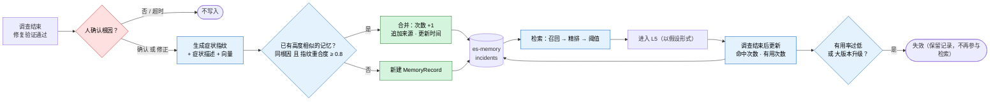

# 05 记忆系统：只记确认过的事，像搜索引擎一样把它找回来

> 设计文档第 6 篇，主亮点之一。04 篇讲了记忆以什么形式进入上下文；本篇讲记忆怎样写入、检索、合并、失效，以及怎样证明它有用、怎样防止它有害。

---

## 本篇结论

1. **"记忆"其实是四样东西，其中只有一样是真正的"学习"**：
   - 环境记忆：人工维护的配置。
   - 基线：统计计算出来的数值。
   - 事故记忆：从经验中学习，**这是本篇的核心**。
   - 程序记忆：runbook，第一版不自动生成。
   把这四样混成一个"记忆库"，是最常见的设计错误。
2. **写入门槛只有一条：人确认过根因**。模型自己得出的结论，不管看起来多可信，都不写入。这是防止记忆投毒的第一道闸门。
3. **检索就是一个小型搜索引擎**：
   - 召回：结构化指纹、关键词、向量三路召回，再用 RRF 融合。
   - 精排：指纹重合度、时间衰减、处置结果、是否被人修正、历史有用率等特征。
   - 阈值：低于阈值就什么都不放，宁缺毋滥。
   这一部分直接用上作者在搜索方面的专长。
4. **记忆有完整的生命周期**：写入时合并相似条目（不无限增长）；每次被使用之后都更新"有用率"；有用率持续偏低，或者目标系统大版本升级，就让它失效。
5. **记忆的价值必须用实验证明**：用按时间排列的事故流做 消融实验（有记忆 / 无记忆 / 记忆以结论形式呈现），同时统计"记忆帮了倒忙"的次数。只报告增益、不报告伤害，是不完整的。

## 内容来源说明

标记体系同 00 篇。本篇没有实测数字，所有权重和阈值都是【待定】的初始值，在 M2 用开发集调整。ES RRF 的语法来自官方文档 [1]。

## 本篇要回答的核心问题

1. 哪些东西应该被"记住"，哪些不应该？
2. 什么时候写入？谁有权写入？
3. 怎样判断"这次的故障和上次那次像不像"？
4. 记忆会不会越来越多、越来越乱？怎么合并、怎么淘汰？
5. 一条错误的记忆会造成什么危害？怎么发现、怎么挡住？
6. 怎样用数据证明"有记忆比没记忆好"？

---

## 1. L1 一句话本质

| 概念 | 一句话 |
|---|---|
| 环境记忆 | 人写的集群说明：重要性、维护窗口、已知的特殊情况 |
| 基线 | 每个指标的"正常值"，由统计算出来，不经过 LLM |
| 事故记忆 | 人确认过的"症状 → 根因 → 处置 → 效果" |
| 程序记忆 | 怎样处理某一类问题（runbook），由人审核后才能生效 |
| 症状指纹 | 把一次故障的症状离散化成一组标签，用于结构化匹配 |
| 合并 | 新记忆和已有记忆高度相似时，合并到已有记忆里，而不是新建一条 |
| 有用率 | 一条记忆被检索命中之后，最终根因和它一致的比例 |
| 记忆快照 | 某一时刻记忆库的完整导出，用来让评测可以复现 |

## 2. L2 心智模型：四类记忆，各管各的

| 类型 | 存什么 | 存在哪里 | 谁写入 | 怎么进入上下文 | 第一版 |
|---|---|---|---|---|---|
| 环境记忆 | 业务重要性、维护窗口、已知特殊情况 | `env/<集群>.yaml`（git） | 人 | L1 事实卡片里的"环境"一行 | 做 |
| 基线 | 各项指标 7 天的滚动中位数和 p95 | Postgres 或 es-memory 的 `baselines` 索引 | 巡检定时任务，由统计算出 | L1 每条事实的 `baseline` 字段 | 做 |
| **事故记忆** | 症状、根因、处置、效果 | es-memory 的 `incidents` 索引 | **人确认之后，由系统写入** | L5，以假设形式呈现 | **做（核心）** |
| 程序记忆 | runbook、已知问题 | 专家包的 `knowledge/`（git） | 人；系统只给出建议 | L4 知识 | 只做"建议"命令 |

**为什么基线不放进 LLM 的记忆里**：基线是数字，统计计算又准又便宜。让 LLM 去"记住"某个节点平时的 CPU 是 35%，既不可靠，也没必要。**能算出来的就不要记**（P1 原则在记忆上的体现）。

### 事故记忆的生命周期



---

## 3. L3 机制

### 3.1 写入门槛：为什么只写人确认过的东西

**现象**：如果让 Agent 把自己的每一次诊断结论都写进记忆，一次误诊就会被写成"经验"。下次遇到相似的症状，这条错误的经验会被检索出来，引导模型再错一次。错误就这样自我强化了。

**原理**：这和推荐系统里的"反馈循环"是同一个问题：模型的输出变成了模型下一次的输入。推荐系统用探索、去偏来打破这个循环；**在运维场景里，最简单也最可靠的办法是：在输出写回输入之前，加一道 人工确认**。

**规则**：

| 规则 | 说明 |
|---|---|
| 只在 `rootcause.confirmed` 或 `rootcause.corrected` 之后写入 | 两个事件都会写入审计日志（03 篇 §5.1） |
| 人修正过的根因，标记 `corrected=true` | 这类记忆最有价值：它记录的正是模型容易出错的地方 |
| 修复没有效果，也可以写入 | `outcome=no_effect`。"这个动作对这个问题没用"也是经验 |
| 记忆的文本由系统模板生成，不直接用模型的原话 | 防止注入内容随着模型的输出混进记忆（§3.6） |
| `symptom_text` 的模板用英文，字段用 standard 分词 | 模板只由检测器 ID、事实键和档位拼成，英文用 standard 分词就够了，不需要中文分词插件（S5 发现中文按单字切分，召回很粗） |

### 3.2 症状指纹：怎样判断"像不像"

自然语言描述的相似度不够可靠：同一个问题可以有很多种说法；说法相似的两段描述，根因也可能完全不同。所以先把症状 **离散化**：

```
症状指纹 = {
  检测器：   det:es.unassigned_shards
  异常事实： fact:node.disk_used_pct:high
             fact:cluster.status:yellow
  对象类型： obj:data_node
  变更：     chg:cluster_settings   （如果最近有变更）
}
```

| 设计点 | 做法 | 原因 |
|---|---|---|
| 异常事实要分档 | 只记录"偏高 / 偏低 / 严重偏高"，不记录具体数值 | 91% 和 93% 的磁盘使用率应该匹配为同一个症状 |
| 不记录具体的节点名、索引名 | 对象只记录类型 | 换一个节点出同样的问题，也应该能匹配上 |
| 指纹由确定性代码生成 | 来源是 Finding、FactSheet 和变更层 | 可复现，可以单独测试 |
| 相似度用加权 Jaccard | 检测器的权重高于异常事实，异常事实的权重高于对象类型 | 检测器最能说明问题的类型【推断，权重在 M2 调整】 |

### 3.3 检索：召回 → 精排 → 阈值

```
             ┌──── 指纹召回：terms 查询，匹配 fingerprint 字段 ────┐
 本次症状 ──▶ ├──── 文本召回：match 查询，匹配 symptom_text ────────┼─▶ RRF 融合 ─▶ 候选（最多 20 条）
             └──── 向量召回：knn 查询，匹配 embedding ──────────────┘
                     公共过滤条件：namespace = 本集群 · 未失效 · 版本兼容
                                          │
                                          ▼
                 精排：特征加权打分 ─▶ 阈值过滤 ─▶ top-k（默认 3）─▶ L5
```

**召回**：三路分别查询，在**客户端**用 RRF 融合。ES 的 RRF retriever 在 basic 授权下不可用（S5 实测返回 403：`current license is non-compliant for [Reciprocal Rank Fusion (RRF)]`），ECK 默认就是 basic 授权。

```python
# 每一路都带公共过滤条件（namespace = 本集群 · 未失效 · 版本兼容），各取前 20 条
# score(doc) = Σ_路 w_路 / (60 + rank_路(doc))；60 和 ES 默认的 rank_constant 一致
weights = {"fingerprint": 2.0, "text": 1.0, "knn": 1.0}   # 计入 memory_policy【待定】
```

客户端融合也有好处：每一路的排名都能看到，调试时可以知道是哪一路把一条记忆召回的。下面是原来设计的服务端写法，留作参考：如果以后换成更高的授权级别，可以切回去。

```json
{
  "retriever": {
    "rrf": {
      "retrievers": [
        { "retriever": { "standard": { "query": { "terms": { "fingerprint": ["det:es.unassigned_shards", "fact:node.disk_used_pct:high"] } } } }, "weight": 2.0 },
        { "standard": { "query": { "match": { "symptom_text": "unassigned shards; data node disk usage high; cluster yellow" } } } },
        { "knn": { "field": "embedding", "query_vector": [0.1, 0.2], "k": 20, "num_candidates": 100 } }
      ],
      "rank_window_size": 20,
      "filter": { "bool": { "filter": [
        { "term": { "namespace": "es/es-target" } },
        { "term": { "invalidated": false } }
      ] } }
    }
  }
}
```

S5 用这段查询（带 `weight` 和不带 `weight` 两种写法）在 basic 授权下都返回 403。客户端融合在同样的 10 条测试数据上，把正确答案排在第 1，另一个 namespace 的记录也被过滤掉了。

**精排**（第一版的特征和初始权重，计入 `memory_policy`）：

| 特征 | 含义 | 初始权重【待定】 | 原因 |
|---|---|---|---|
| `rrf_score` | 召回阶段的融合分数 | 0.30 | 基础相关性 |
| `fp_jaccard` | 症状指纹的加权 Jaccard | 0.30 | 结构化的相似度最可靠 |
| `recency` | 时间衰减，`exp(-天数/30)` | 0.10 | 最近的经验更可能仍然有效 |
| `outcome` | resolved=1，mitigated=0.5，no_effect=0.2 | 0.10 | 解决过问题的经验更有参考价值 |
| `corrected` | 被人修正过就加分 | 0.05 | 模型容易出错的地方 |
| `helpful_ratio` | (有用次数 + 1) / (命中次数 + 2) | 0.15 | 历史表现；加 1 和加 2 是平滑，防止样本太少时的极端值 |

**阈值**：精排分数低于 `min_score`（初始 0.55【待定】）就不放进上下文。**一条不相关的记忆比没有记忆更有害**，因为模型会倾向于去验证它，浪费步数，甚至被它带偏。

**判断**：这套"多路召回 + 特征精排 + 阈值"的结构，和搜索、推荐系统的排序链路是同构的。第一版用手工设定的线性权重就够了：样本量（几十到一百多个用例）不足以训练排序模型，硬训的话一定过拟合【推断】。

### 3.4 合并：记忆不能无限增长

写入之前，先查有没有"同一个根因标签，并且指纹重合度 ≥ 0.8"的记忆：

| 情况 | 处理 |
|---|---|
| 有 | 合并：发生次数 +1，在来源列表里追加本次调查，更新最后发生时间；如果本次被人修正过，也把 `corrected` 置为 true |
| 没有 | 新建 |
| 根因相同，但指纹差别很大 | 新建。同一个根因可以表现出不同的症状，这正是值得记住的 |
| 指纹几乎相同，但根因不同 | 新建，**并且给两条记忆都打上"易混淆"的标记** |

最后一种情况最有价值：它正好对应"症状相似、根因不同"的反例。检索时如果两条都命中了，就在 L5 里明确提示"历史上这种症状出现过两种不同的根因"，迫使模型去找区分证据。

### 3.5 基线：不经过 LLM 的"记忆"

| 设计点 | 做法 |
|---|---|
| 计算方式 | 巡检时记录指标；按（集群, 节点或索引, 指标）计算 7 天滚动中位数和 p95 |
| 冷启动 | 数据不足 24 小时，基线就记为"未知"。有绝对阈值的事实（磁盘水位、分片比例、集群状态）照常按阈值判断正常或异常；没有绝对阈值的（CPU、heap、拒绝数）`status` 记为 unknown（M1 D2 实现） |
| 判定异常 | 超过 p95，或者超过绝对阈值（例如磁盘高水位）。两者都由专家包定义 |
| 评测 | 回放模式下，基线也从录制文件里读取，保证可以复现 |

### 3.6 防投毒：四道防线

| 防线 | 挡住什么 |
|---|---|
| 1. 只写人确认过的内容 | 模型的错误结论自我强化 |
| 2. 记忆文本由模板生成，不可信内容做转义 | 日志里的注入内容随着诊断结论进入记忆，下次又被当作"经验"读出来 |
| 3. 按命名空间隔离（领域/集群） | 一个集群的经验，被错误地套用到另一个集群上 |
| 4. 记忆只能以"待验证的假设"形式进入上下文 | 即使存在错误的记忆，诊断仍然必须拿到本次的证据才能下结论 |

另外，`memory.written` 和 `memory.invalidated` 都会写入审计日志。任何一条记忆，都能追溯到它来自哪次调查、是谁确认的。

### 3.7 反馈更新与失效

每次调查结束、人确认根因之后：

```
对于 L5 中出现过的每一条记忆 m：
    m.hit_count += 1
    如果 m.root_cause_label == 最终确认的根因：
        m.helpful_count += 1
    否则，如果 top-1 假设来自 m（from_memory 包含 m），并且 top-1 是错的：
        记一次"记忆伤害"（memory_harm）→ 写入审计，进入失效判断
```

| 失效条件 | 处理 |
|---|---|
| 命中 ≥ 5 次，且有用率 < 0.3【待定】 | 自动失效，写入审计 |
| 记忆伤害 ≥ 2 次 | 自动失效，并在周报里列出 |
| 目标系统大版本升级 | 按 `target_version` 批量设置过期 |
| 人手动标记 | `sentinel memory invalidate mem_3 --reason ...` |

失效的记忆**不删除**，只是不再参与检索。这样保留了审计链，也可以事后分析"哪类记忆容易失效"。

### 3.8 程序记忆：第一版只给建议

`sentinel memory suggest-runbooks` 会找出"同一个根因出现 ≥ 3 次，而且处置动作一致"的记忆簇，生成 runbook 草稿，放进 `knowledge/drafts/`。**由人审核之后，才能移到 `knowledge/` 目录下生效**。

为什么不自动生效：runbook 会作为 L4 知识，影响所有以后的诊断，影响面比单条事故记忆大得多。

---

## 4. 记忆怎么评测

### 4.1 指标

| 指标 | 定义 | 意义 |
|---|---|---|
| **记忆增益** | 同一个事故流，有记忆和无记忆两种条件下 top-1 的差值（配对比较，见 06 篇） | 主亮点的核心证据 |
| 步数节省 | 同上，比较的是平均步数 | 记忆让诊断更快 |
| 记忆命中率 | 存在相关记忆的用例中，相关记忆进入 L5 的比例 | 检索召回能力 |
| 记忆精度 | 进入 L5 的记忆中，根因和本次一致的比例 | 检索精度 |
| **记忆伤害率** | top-1 来自记忆、但 top-1 是错的用例比例 | 记忆的副作用，必须和增益一起报告 |

### 4.2 事故流：怎样构造"有记忆"的评测

单个用例测不出记忆的价值，因为记忆是靠积累起来的。所以要构造**按时间排列的事故流**：

```
事故流 S1（同一个集群，按时间先后）
  pos 1  es.disk_watermark.single          ← 第一次遇到，没有相关记忆
  pos 2  es.hot_shard.single
  pos 3  es.disk_watermark.with_distractor ← 第二次遇到，有相关记忆
  pos 4  es.shard_limit.single             ← 症状和磁盘水位相似、根因不同（反例）
  pos 5  es.disk_watermark.compound        ← 第三次遇到
```

**运行方式**：

1. 每个事故流开始时，创建一个空的记忆索引 `mem-eval-<运行 ID>`。
2. 按 `stream_pos` 的顺序依次回放。每个用例结束后，**用真实答案模拟"人确认根因"**，写入记忆。
3. 对照组使用同样的顺序，但关闭记忆检索。
4. 比较两组在 pos ≥ 2 的那些用例上的表现。

**这个设计的偏差，必须如实说明**：模拟确认时用的是真实答案，相当于假设"人每次都能确认对"。这比现实**更乐观**。后续版本可以加一个"10% 的确认是错的"对照组，来测试记忆在噪声下的稳健性【未实跑，第一版不做】。

### 4.3 记忆快照：保证评测可以复现

| 用途 | 做法 |
|---|---|
| 单个用例需要一个特定的记忆状态 | `EvalExample.inputs.memory_snapshot` 指向一份 JSONL 快照，回放前加载到临时索引 |
| 事故流 | 从空索引开始，按顺序写入（见 4.2） |
| 线上记忆的备份 | `sentinel memory export` 导出为快照，计入当前版本 |

---

## 5. 计划做的实验（事先写下预期）

| # | 实验 | 预期【推断】 | 如果被推翻 |
|---|---|---|---|
| M-E1 | 记忆增益（有 / 无） | pos ≥ 2 的用例 top-1 提升、步数下降；pos 1 持平 | 没有提升：检查命中率。命中率低，是检索问题；命中率高却没有提升，说明呈现方式有问题，或者场景本身太简单 |
| M-E2 | 只用指纹召回 / 只用向量召回 / 三路融合 | 三路融合的命中率最高；只用向量召回在反例上的精度最差 | 只用指纹召回就足够好：说明可以去掉向量召回，简化系统 |
| M-E3 | 阈值 0 / 0.55 / 0.7 | 阈值为 0 时，反例上的伤害率最高 | 阈值对结果没有影响：说明精排分数的区分度不够 |
| M-E4 | 假设形式 vs 结论形式（同 04 篇的 E5） | 结论形式步数更少，但伤害率更高 | — |

M-E1 是 M2 的必做实验，是故事的核心证据；M-E2 和 M-E3 视时间而定。

## 6. L5 判断

| 场景 | 选择 | 原因 |
|---|---|---|
| 模型诊断得很有把握，但人还没确认 | 不写入记忆 | 写入门槛只有一条 |
| 想让 Agent"记住"某个节点平时 CPU 就高 | 写进环境记忆（yaml），或者让基线自己学出来 | 不要用事故记忆来记录环境特征 |
| 记忆越来越多，检索变慢 | 先检查合并规则有没有生效 | 记忆数量应该接近"不同根因 × 不同症状"的组合数，而不是调查次数 |
| 想用 LLM 来判断两条记忆是否应该合并 | 第一版不用，用指纹规则 | 可复现、可以测试；需要时再加 |
| 跨集群共享经验 | 第一版不做；以后需要显式开启，并且降权 | 不同集群的环境差异很大 |

## 7. 常见坑

| 坑 | 现象 | 修法 |
|---|---|---|
| 把 Agent 的每次结论都写进记忆 | 误诊被自我强化 | 只写人确认过的 |
| 指纹里包含节点名 | 换一个节点出同样的问题就匹配不上 | 对象只记录类型 |
| 指纹里包含精确数值 | 91% 和 93% 匹配不上 | 分档 |
| 没有阈值 | 每次都塞进 3 条记忆，即使毫不相关 | 低于阈值就不放 |
| 只报告记忆增益 | 看起来很好，其实在反例上有伤害 | 同时报告伤害率 |
| 评测时用线上的记忆库 | 结果不可复现，而且评测会污染线上记忆 | 每次评测用临时索引 |
| 用 `helpful_count / hit_count` 直接算有用率 | 命中 1 次、有用 1 次，有用率就是 100% | 加平滑 |

## 8. 和熟悉的技术对照

| 记忆系统 | 搜索 / 推荐系统 |
|---|---|
| 三路召回 + RRF | 多路召回融合 |
| 特征加权精排 | 精排模型（第一版是线性模型） |
| 阈值 | 相关性门槛，不出低质结果 |
| 有用率反馈 | 点击反馈 / CTR 平滑（贝叶斯平均） |
| 合并 | 文档去重（near-duplicate detection） |
| 失效 | 索引里的过期和下线 |
| 写入门槛 = 人确认 | 打破推荐系统里的反馈循环 |
| 事故流评测 | 时间切分的离线回放评测 |

## 9. 设计评审自测

1. 为什么不让 LLM 自己决定要记住什么？——模型的输出会变成它自己下一次的输入，一次错误就会被自我强化。人确认是最简单、最可靠的闸门。
2. 一条记忆命中 10 次，有用 2 次，该怎么办？——平滑后的有用率是 0.25，低于 0.3，自动失效。
3. 事故流评测里，为什么只比较 pos ≥ 2 的用例？——pos 1 的时候还没有相关记忆，两组本来就应该一样。把它们算进去，只会稀释差异。
4. 为什么"指纹几乎相同、但根因不同"的两条记忆都要保留，还要打上"易混淆"标记？——这正是最容易误诊的情况。同时呈现两种可能性，能迫使模型去寻找区分证据。
5. 记忆模拟确认用的是真实答案，这会让实验结果偏向哪个方向？——偏乐观，因为现实中人也会确认错。需要在报告里写明。

## 可以跳过的内容

第一次读时可以跳过 §3.5、§3.8 和 §8。§2、§3.1、§3.3 和 §4.2 必须读。

## 来源与核实说明

1. Elastic 文档：RRF retriever（多路检索融合、`rank_constant` 默认 60、`rank_window_size`、`filter`、每路结果的 `weight`）— https://www.elastic.co/docs/reference/elasticsearch/rest-apis/retrievers/rrf-retriever （2026-11-09 读取；授权要求部分未读到）
2. S5 实测（spike-results.md）：RRF retriever 在 basic 授权下不可用，改为客户端融合；embedding 用 `gemini-embedding-001`，默认 3072 维，指定 `output_dimensionality=768`，单次约 0.5 秒。未核实：embedding 的价格（M2 的成本统计里补上）。
3. 本篇的权重、阈值和失效条件都是【待定】的初始值。

本篇完。下一篇：06 评测。
