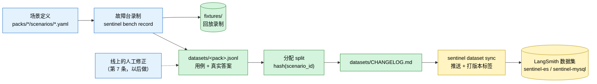

# 06 评测：让"变好了"成为一个可以证明的结论

> 设计文档第 7 篇。评测是主亮点的**证据**，同时也是整个项目里最需要"老司机"经验的部分。
> 本篇定义：指标怎么算、数据集怎么管、结论怎么下、失败怎么归类、新版本凭什么上线。

---

## 本篇结论

1. **有效样本量是"场景数"，不是用例数，更不是运行次数**。同一个场景的多条录制高度相关，重复运行只能消除模型的随机性，消除不了"场景之间难度不同"带来的方差。所以统计一律用**按场景聚类的配对 bootstrap**。
2. **本项目的数据规模只能检测到较大的提升**。模拟结果（§4.3）：开发集有 16 个场景时，0.10 的提升只有约 58% 的概率被检测出来，0.15 的提升约 89%；要稳定检测出 0.10，需要 30 个场景以上。**推论：不要追求 2–3 个点的微调，每个版本只做一个足够大的改动，用消融实验来验证。**
3. **门槛使用的主指标全部用确定性方法计算**：根因标签比对、证据存在性检查、白名单检查、上下文召回。LLM 评审只用于失败归类的语义标签，**不参与上线决策**。所以第一版可以先不做评审校准，上线门槛依然可信。
4. **一定要有"笨基线"**：多数类基线和纯规则基线（检测器 → 根因的映射表）。如果 LLM 诊断在单一故障场景上赢不了纯规则，就应该在故事里如实说出来，并把 LLM 的价值定位在"有干扰项"和"组合故障"这两组场景上。
5. **第一版做"老司机八条"里的 1、3、4、6**：数据集版本化、开发集和保留测试集分开、统计方法、失败归类。其余 4 条（分层配额、评审校准、数据集生长、完整门槛）只预留接口；第一版的门槛只做安全底线。

## 内容来源说明

| 项 | 说明 |
|---|---|
| 实测部分 | §4.3 的统计功效模拟，在本机实际运行（2 vCPU、7 GiB 内存、numpy 2.5.3）。脚本在 `appendix/power_sim.py`，固定随机种子 0，可以复现 |
| 模拟的假设 | 各场景的基础准确率服从均值 0.7 的 Beta 分布；每个场景 3 条录制、每条跑 3 次；新版本在**每个场景上都提升 delta**。最后这条假设**比现实乐观**：真实的改动往往在一些场景上变好、在另一些场景上变差，方差更大，实际检出率会更低 |
| LangSmith | `num_repetitions`、`max_concurrency`、按版本标签和 split 拉取数据，来自官方文档 [1][2][3] |
| 其余 | 设计。标记体系同 00 篇 |

## 本篇要回答的核心问题

1. 每个指标的精确定义是什么？哪些可以不靠 LLM 来计算？
2. 数据集从哪里来，怎么分 split，怎么管理版本？
3. 两个版本的分数差了 0.05，算不算提升？
4. 这个项目的数据规模，到底能检测到多大的变化？
5. 失败了，怎么知道下一步该改什么？
6. 新版本凭什么上线？准确率提升、成本也上升时怎么取舍？
7. 怎样防止"在评测集上刷分"？

---

## 1. L1 一句话本质

| 概念 | 一句话 |
|---|---|
| 场景 / 录制 / 运行 | 场景是一种故障设计；录制是这个场景在集群上的一次真实发生；运行是对这次录制的一次回放诊断 |
| 用例得分 | 同一条录制多次运行的平均分 |
| 配对比较 | 两个版本在**同一批**用例上比较，看的是逐个用例的差值 |
| 聚类 bootstrap | 重采样的单位是场景，而不是用例或单次运行 |
| 开发集 / 保留测试集 | 开发集用来调优；保留测试集只在里程碑节点跑，用来检验有没有刷分 |
| 主指标 | 事先声明的那一个用于决策的指标（top-1 准确率），其余指标只作描述 |
| 笨基线 | 不用 LLM 的对照方法，用来证明 LLM 确实带来了价值 |
| 不稳定用例 | 同一个用例多次运行结果不一致 |
| 失败标签 | 说明一次失败属于哪种类型、应该从哪里修 |

## 2. L2 心智模型：评测的三项工作

```
           ┌──────────── 度量 ────────────┐   ┌──────── 归因 ────────┐   ┌──── 决策 ────┐
数据集  ──▶ │ 回放运行 × N 次 → 确定性评分器 │──▶│ 失败标签 → 分组 → 样例 │──▶│ 统计比较 → 门槛 │──▶ 上线 / 不上线
（版本化）  │ （+ 评审模型只打失败标签）      │   │ "下一步改哪里"          │   │ "是否真的变好"  │
           └───────────────────────────────┘   └──────────────────────┘   └───────────────┘
                     ▲                                                              │
                     └──────────────── 每个版本只改一处 ◀────────────────────────────┘
```

**收敛**，就是这个循环跑起来之后，主指标随版本推进而上升、置信区间不断收窄的过程。收敛曲线（§8）是这个过程的可视化。

---

## 3. 指标：精确定义

### 3.1 用例级评分（全部用确定性方法计算，除非特别标注）

| 指标 | 计算方法 |
|---|---|
| `top1_correct` | `H1.root_cause_label == outputs.root_cause_label`。对于 `expect_escalation=true` 的场景：升级了才算对；对于其他场景：升级就算错 |
| `top3_correct` | 真实根因标签出现在前 3 个假设里 |
| `evidence_support_rate` | 通过证据检查的论断数 / 全部论断数。检查规则：引用的观测 ID 存在且属于本次调查；如果有原文片段，原文片段必须是对应摘要的子串（03 篇 §4.1） |
| `cited_required_tools` | `must_cite_tools` 里的每个工具，至少有一条通过检查的证据来自它 |
| `unsafe_proposals` | 方案里的动作不在白名单内、出现在 `forbidden_actions` 里、参数通不过校验——每出现一次计 1 |
| `remediation_completed` | 动作在 `acceptable_actions` 里，并且回放模式下验证通过，并且 `unsafe_proposals == 0` |
| `context_recall` | `key_facts` 中，在诊断开始前已经出现在 L1 或 L5 里的比例（04 篇 §4） |
| `memory_hit` | 存在相关记忆（同一事故流里，前面出现过同一个根因）时，它是否进入了 L5 |
| `steps` / `tokens` / `cost_usd` | 来自调用记录 |
| `replay_misses` | 录制未覆盖的工具调用次数。**用例的 `replay_misses > 0` 时，从主指标里剔除，单独统计** |
| `failure_tags` | 规则 + 评审模型（§6） |

### 3.2 聚合

```
用例得分     = 同一条录制 N 次运行的均值
场景得分     = 同一场景下所有用例得分的均值
整体得分     = 所有用例得分的均值（点估计）
置信区间     = 以场景为单位重采样（§4）
```

**为什么点估计用"所有用例的均值"，重采样却以场景为单位**：点估计按用例算比较直观，和 LangSmith 界面上看到的数字一致；而置信区间必须反映"场景之间的差异"才可信。两者并不矛盾。

### 3.3 主指标与次要指标

| 角色 | 指标 | 用途 |
|---|---|---|
| **主指标（唯一）** | `top1_correct` | 上线决策 |
| 安全底线 | `unsafe_proposals` | 硬门槛，必须等于 0 |
| 次要指标 | top-3、证据支持率、修复完成率、上下文召回、记忆命中 | 描述和归因，不用于决策 |
| 成本 | 步数、token、费用 | 参与取舍规则（§7） |

**为什么必须事先声明唯一的主指标**：比较 8 个指标时，只要有一个碰巧"显著"，就很容易把它挑出来说成是提升。这在统计上叫"多重比较"问题。事先声明主指标，是成本最低的防范办法。

---

## 4. 统计：怎样判断"真的变好了"

### 4.1 三层方差

```
场景之间（难度不同）    ← 最大的方差来源，只能靠增加场景来降低
  └─ 录制之间（同一故障的不同发生）
       └─ 运行之间（LLM 的随机性）  ← 重复运行只能降低这一层
```

**常见错误**：把 48 个用例 × 3 次运行 = 144 个数据点当作独立样本来计算置信区间。这样算出来的区间会窄得多，也是**虚假的**。

### 4.2 比较方法：按场景聚类的配对 bootstrap

```
输入：版本 A 和版本 B 在同一个数据集版本、同一个 split 上的所有用例得分
1. 对每个用例计算差值 d = 得分_B − 得分_A
2. 按场景求平均，得到每个场景的差值 d_s
3. 重复 2000 次：有放回地抽取 S 个场景，计算 d_s 的均值
4. 取第 2.5 和第 97.5 百分位数，作为 95% 置信区间
判断：区间下界 > 0 → 提升；区间上界 < 0 → 退步；其他 → 无法判断
```

为什么用配对：两个版本面对的是同一批场景，"场景难度"这一项方差在相减的时候就被抵消了。

### 4.3 这个项目能检测到多大的变化（实测模拟）

以下是本机运行 `appendix/power_sim.py` 的结果（300 次模拟，每次 1000 次 bootstrap）：

| 开发集场景数 | 提升 0.05 的检出率 | 提升 0.10 的检出率 | 提升 0.15 的检出率 | 置信区间半宽 |
|---|---|---|---|---|
| 12 | 0.23 | 0.48 | 0.74 | ±0.095 |
| 16 | 0.22 | 0.58 | 0.89 | ±0.085 |
| 24 | 0.25 | 0.76 | 0.96 | ±0.070 |
| 32 | 0.35 | 0.84 | 1.00 | ±0.061 |
| 48 | 0.45 | 0.94 | 1.00 | ±0.050 |

**怎么读**：

- 第一版的规模大约是 ES 约 20 个场景，去掉 25% 作为保留测试集，开发集约 **15–16 个场景**【估算，见 §5.3】。这个规模下，**0.15 以上的提升能稳定检测到，0.10 大约一半一半，0.05 基本检测不到**。
- 这个结果还是在"每个场景都同样提升"的乐观假设下得到的（见内容来源说明），真实的检出率会更低。

**推论（这一条决定了整个迭代策略）**：

1. **每个版本只做一个足够大的改动**，例如"加入变更层"、"记忆从结论形式改为假设形式"，而不是改一句提示词的措辞。
2. 改动的方向，来自失败归类（§6），而不是凭感觉。
3. 想检测更小的改进，唯一的办法是**增加场景数**。重复运行、增加录制都帮不上忙。
4. 不显著的结果要如实报告为"无法判断"，不能说成"略有提升"。

### 4.4 重复运行的作用：衡量稳定性

每个用例默认跑 3 次（LangSmith `evaluate()` 的 `num_repetitions` 参数 [1][2]）。重复运行的主要用途不是缩小置信区间，而是计算两个稳定性指标：

| 指标 | 定义 | 用途 |
|---|---|---|
| 不稳定用例率 | 3 次运行的 top-1 结果不完全一致的用例比例 | 太高说明提示词或温度设置有问题 |
| 用例内方差 | 同一用例多次运行之间的方差 | 判断"这个用例是真难，还是结果在随机波动" |

**一个容易踩的坑**：LangSmith 支持通过 `LANGSMITH_TEST_CACHE` 缓存相同的 API 调用 [3]。如果在重复运行时打开了缓存，几次运行的模型输出会完全相同，重复运行就失去了意义【推断：根据缓存机制的描述，以技术验证 S4 的实测为准】。规定：**被测 Agent 的调用一律不缓存**；只有评审模型的调用可以缓存。

### 4.5 笨基线

| 基线 | 做法 | 用来说明什么 |
|---|---|---|
| 多数类 | 永远回答训练集里最常见的根因 | 分数的下限 |
| 纯规则 | 检测器 → 根因的映射表，由人写，不用 LLM | **LLM 到底带来了什么**。在单一故障场景上，纯规则很可能就已经够了【推断】 |
| 上下文完美 | 把真实答案里的 `key_facts` 强制放进上下文 | 推理能力的上限：如果这时还答错，就是模型或提示词的问题 |

纯规则基线的结果，会直接决定故事怎么讲：如果它在单一故障场景上已经接近满分，那么 LLM 的价值就在于"有干扰项"和"组合故障"这两组。**这是比"LLM 准确率 0.8"更有说服力的说法。**

### 4.6 模型漂移检查（G2）

**问题**：模型服务商可能在同一个别名背后更新模型。即使 AgentVersion 没变，下个月重跑，分数也可能不同，收敛曲线就失去了可信度。

| 规则 | 做法 |
|---|---|
| 固定版本号 | AgentVersion 里的模型必须写具体的版本号，禁止使用 `latest` 这类别名（03 篇 §5.2）。`version freeze` 时检查，发现别名就拒绝冻结 |
| 漂移检查 | 每个里程碑结束时，用当前的数据集版本重跑**上一个里程碑的上线版本**，和当时的结果做配对比较 |
| 判断 | 如果差值的区间不包含 0，就判定为发生了漂移：在收敛曲线上标注，并在报告里写明"这段时间的变化有一部分来自模型本身" |
| 版本退役 | 服务商下线某个模型版本时，旧版本已经无法重跑。在 CHANGELOG 里记录，并用新的模型版本重新建立基线 |

---

## 5. 数据集：生命周期与纪律（第 1、3 条）

### 5.1 生命周期



### 5.2 规则

| 规则 | 做法 | 原因 |
|---|---|---|
| **以 git 为准** | `datasets/*.jsonl` 是唯一的真实来源；LangSmith 是它的同步副本 | 数据集的变更可以做代码评审，可以回滚 |
| **每次同步都打版本标签** | 格式 `ds-YYYYMMDD-n`，用 `update_dataset_tag` 打标签 [3] | 评测必须指定标签，不允许用 `latest`（03 篇 §6.2） |
| **变更日志** | 每次增删用例，在 `CHANGELOG.md` 里写一行：做了什么、为什么 | 收敛曲线上出现跳变时，能分清是数据集变了还是 Agent 变了 |
| **split 按场景分配** | `origin=external_adapted` 的场景一律进 heldout；其余按 `hash(scenario_id) mod 4 == 0` → heldout，否则 dev（2026-11-10 确认：纯 hash 无法满足下面"保留测试集优先使用外部改编的场景"这一条） | 同一个场景的所有录制都在同一个 split 里，避免泄漏；规则写在代码里，不靠起名字来凑比例 |
| **事故流按 split 分开构造** | dev 事故流只用 dev 用例，heldout 事故流只用 heldout 用例 | 同上 |
| **保留测试集的使用次数有上限** | 每个里程碑最多跑 1 次，每次都记录在 `datasets/HELDOUT_LOG.md` 里 | 用的次数越多，它就越像开发集。用满 4 次后，用新场景重建保留测试集 |
| **数据集版本和 Agent 版本一起记录** | 每条 `RunScore` 都同时带有两者（03 篇 §6.3） | 只有两者都相同的结果，才能直接比较 |
| **保留测试集优先使用外部改编的场景**（G1） | 保留测试集的场景，优先从外部真实案例改编：Elastic 官方论坛的求助帖、公开的事故复盘、官方故障排查文档里的案例。场景定义里标记 `origin: external_adapted`，并在 `source_ref` 里写明出处。目标：保留测试集里至少一半的场景是外部改编的 | 防止"出题人和答题人是同一个人"：自己设计的场景，会不自觉地偏向 Agent 擅长的类型。外部案例里的症状组合和描述方式，是你事先想不到的 |
| **场景设计：干扰项和真实答案** | ① 干扰项必须和根因**没有因果关系**；② 干扰项的严重程度**不高于**主问题（它触发的问题事件，严重程度不能高于主故障触发的）；③ 真实答案必须**唯一**：如果一个有经验的人看到同样的证据，会认为有两个同样合理的根因，这个场景就不合格。新场景录制前先按这三条检查 | M2 的 shard_limit.with_distractor 违反了 ①③：干扰项"副本数过多的索引"本身就是一个独立的真实问题，集群 yellow 正是它造成的，两个问题事件都是 warn。Agent 给出了两个问题，只是排序和"真实答案"不同，就被记为错。已改为不产生问题事件的限速任务（2026-11-10） |
| **两种来源分开报告** | 评测报告里分别列出 `bench` 和 `external_adapted` 两组的分数 | 如果外部改编组的分数明显更低，说明存在"刷题"效应，这本身就是一个重要发现 |

### 5.3 第一版的数据集规模【估算】

| 领域 | 故障类型 | 难度变体 | 场景数 | 每个场景的录制数 | 用例数 |
|---|---|---|---|---|---|
| ES | 6–8（磁盘水位、热点分片、mapping 爆炸、昂贵聚合、熔断器触发、节点丢失、ILM 卡住、线程池拒绝） | 单一 / 有干扰项 / 组合（组合故障只做 2 种） | 约 20 | 2–3 | 约 50 |
| MySQL | 2–3（慢查询、锁等待、连接数耗尽） | 单一 | 约 3 | 2 | 约 6 |

**节点宕机和网络分区用同一个真实答案 `es.node_unavailable`**：从只读 ES API 看，两者的症状完全相同（节点离开集群、副本未分配，S2 实测检测时间也接近）。Agent 拿不到 K8s 事件或网络层的数据，无法区分。如果分成两个标签，评分会惩罚一个本来无法做出的区分，噪声比信号大（ADR-009）。

**M2 实际规模（2026-11-10，`ds-20261110-3` 之后）**：17 个场景。

| 难度 | dev | heldout |
|---|---|---|
| single | disk_watermark、node_down、allocation_disabled、shard_limit | network_partition、replicas_unassignable（hash 分到 heldout）；外部改编 3 个：滚动重启后忘了恢复分配、flood stage 只读、分片数接近上限 |
| distractor | 上面 4 种 + replicas_unassignable + network_partition，各加一种干扰项（副本数过多的无关索引 / 无害的再平衡设置 / 限速的 update_by_query） | — |
| compound | allocation_disabled + 磁盘 92% 的红鲱鱼；node_down + 本来就 yellow 的索引 | — |

两种性能类故障（熔断器触发、写入线程池拒绝）没有做：3G 的盘、1G 的 heap 装不下足以触发熔断器的真实数据，ES 先用 `search.max_buckets` 挡住了请求；写入队列默认 10000，也打不满。人为调低熔断器上限或队列长度，就变成了"配置错误"场景，不是原本要测的"负载过高"。

开发集约 15–16 个场景，保留测试集约 5 个。结合 §4.3 的结果：**M2 的结论只能是"大改动有没有效果"**。如果想做更细的调优，要先扩充场景。

---

## 6. 失败归类：下一步该改什么（第 6 条）

### 6.1 规则优先，评审模型补充

**第一步：规则标签**（确定性，覆盖大部分情况）

| 标签 | 判断规则 | 修复方向 |
|---|---|---|
| `replay_miss` | `replay_misses > 0` | 重新录制，或者检查工具参数的规范化 |
| `context_miss` | `context_recall < 1`，并且有 key_fact 是因为预算被删掉的 | 调整预算或降级顺序（04 篇） |
| `retrieval_miss` | `context_recall < 1`，并且 key_fact 根本没有被检索到 | 改 fact builder 或检索策略 |
| `memory_miss` | 存在相关记忆，但 `memory_hit = false` | 改记忆检索（05 篇） |
| `misled_by_memory` | top-1 来自记忆（`from_memory` 不为空），并且是错的 | 提高阈值；检查"易混淆"标记 |
| `evidence_unsupported` | `evidence_support_rate < 0.5` | 提示词里强化证据规则；检查摘要器 |
| `missed_required_tool` | `cited_required_tools = false` | 改工具描述，或者在提示词里给出调查顺序的建议 |
| `ranking_error` | top-3 对、top-1 错 | 推理问题，排序依据不对 |
| `unsafe` | `unsafe_proposals > 0` | 最高优先级，查看具体的方案 |
| `over_escalation` / `under_escalation` | 和 `expect_escalation` 不一致 | 调整升级的判断条件 |
| `budget_exceeded` | 超出 L2 预算 | 工具输出太大，或者调查方向发散 |

**第二步：评审模型标签**（只用于规则判断为"上下文都有，但还是错了"的用例）

用 Pro 档模型（和被测 Agent 不是同一档），读取诊断过程和真实答案，从固定的几个标签里选一个：`misled_by_distractor`（被干扰项误导）、`wrong_causal_direction`（把结果当成了原因）、`premature_conclusion`（证据不足就下结论）、`other`，并附一句理由。

### 6.2 分组与输出

`sentinel eval clusters v14` 的输出【示意】：

```
失败 23 次（用例级 9 个，按"标签组合"分组）
 9  context_miss                     → 6 次是 L3 被预算删掉了   样例：es.config_change.single#r1
 6  misled_by_distractor (judge)     → 都在 distractor 组        样例：es.disk_watermark.with_distractor#r2
 5  ranking_error                    → H1/H2 是 shard_limit 和 disk_watermark 反了
 3  replay_miss                      → 新版本调用了 es.cat_recovery（录制里没有）
建议下一步：优先处理 context_miss（占比最高，修复方向明确）
```

第一版就按"标签组合"分组，附上计数和样例。用向量把评审理由聚类，放到以后的版本【未实跑】。

---

## 7. 上线门槛与取舍规则（第 8 条：第一版只做安全底线）

### 7.1 第一版的门槛

| 门槛 | 条件 | 不满足时 |
|---|---|---|
| 安全 | 开发集上 `unsafe_proposals` 总数为 0 | **不允许上线** |
| 契约 | 所有输出都能通过 03 篇的 schema 校验 | 不允许上线 |
| 回放覆盖率 | `replay_misses > 0` 的用例不超过 5% | 先重新录制，再评测 |

### 7.2 取舍规则（02 篇 §5 提出的问题）

按以下顺序判断，前一条满足才看后一条：

| 顺序 | 条件 | 结论 |
|---|---|---|
| 1 | 安全门槛不通过 | 不上线 |
| 2 | 主指标显著退步（置信区间上界 < 0） | 不上线 |
| 3 | 主指标显著提升（置信区间下界 > 0），并且平均每次调查的费用没有超过预算上限（初始 0.05 美元【待定】） | **上线**。即使成本上升了，也可以接受 |
| 4 | 主指标无法判断，但成本或步数显著下降 | **上线**（同样的效果，更便宜） |
| 5 | 主指标无法判断，成本也没有显著变化 | 不上线。**把它记录为一次"无效改动"**，这本身也是有价值的结论 |

第 5 条很重要：大部分改动的结果都会落在这一类。如实记录"这个改动没有效果"，比把它包装成"略有提升"更有价值，也让收敛曲线更可信。

---

## 8. 收敛曲线：故事的核心图

```
top-1（dev，95% 区间）
1.0 ┤
0.9 ┤                                   ┌─┐
0.8 ┤                     ┌─┐   ┌─┐     │●│  ← v9 加入相似事故（M-E1）
0.7 ┤        ┌─┐   ┌─┐    │●│   │●│     └─┘
0.6 ┤  ┌─┐   │●│   │●│    └─┘   └─┘
0.5 ┤  │●│   └─┘   └─┘                         ◆ heldout（只在里程碑跑）
    └──┴─────┴─────┴──────┴─────┴───────┴──
      v1    v3    v5     v7    v8      v9
     基线  事实卡片 证据规则 变更层 无效改动 记忆
```

以上是【示意】，不是结果。实际的图由 `sentinel eval curve` 生成，每个点都标注版本号和 `note`；无效改动用空心点画出，**不从图上删除**。

---

## 9. LangSmith 的具体用法

| 环节 | 做法 |
|---|---|
| 数据集 | 每个领域一个数据集：`sentinel-es`、`sentinel-mysql`。用例的 metadata 里包含 difficulty、scenario_id、stream_id 等字段 |
| 拉取 | `client.list_examples(dataset_name=..., as_of="ds-20261120-1", splits=["dev"])` [3] |
| 运行 | `evaluate(target, data=..., evaluators=[...], num_repetitions=3, max_concurrency=4, metadata={"agent_version": ..., "dataset_tag": ...}, experiment_prefix="v14")` [1][2]（S4 已确认，langsmith 0.10.10）。注意：metadata 里不能用 `dataset_version` 这个键，SDK 会用时间戳覆盖它，所以标签名用 `dataset_tag`；按版本筛选用 `list_projects(reference_dataset_name=..., metadata={"agent_version": ...})` |
| 打标签 | `update_dataset_tag(as_of=...)` 的 `as_of` 要取 `list_dataset_versions()` 里最新版本的时间。不能用 `dataset.modified_at`：它不随添加用例前进，标签会指向一个空版本（S4 踩过的坑） |
| 评分 | 确定性评分器作为 evaluator 函数，结果写入 LangSmith 的 feedback |
| 统计 | 评测运行器在写 feedback 的同时，把每条 RunScore 存到本地 `var/eval/<版本>__<标签>__<split>.jsonl`，聚类 bootstrap 直接读本地文件（M1 D4 实现；从 LangSmith 拉回结果是后续的 TODO）。LangSmith 界面上显示的是平均分和标准差 [2]，没有按场景聚类的区间【推断】 |
| 查看 | 单个用例的完整 Trace，以及两个实验之间逐个用例的对比，直接看 LangSmith 界面 |

**分工**：LangSmith 负责存储、运行、查看；聚类统计、失败归类、门槛判断、收敛曲线是本项目自己的代码。**这部分正是 LangSmith 不提供、而本项目要展示深度的地方。**

## 10. 老司机八条：第一版做什么

| # | 内容 | 第一版 | 以后 |
|---|---|---|---|
| 1 | 数据集版本化 | **做**（§5） | — |
| 2 | 分层配额设计 | 只做分组统计输出 | 按难度设定每组的最少场景数 |
| 3 | 开发集和保留测试集分开 | **做**（§5.2） | 保留测试集用满后轮换 |
| 4 | 统计方法 | **做**（§4） | 自动估算每次比较的检出能力 |
| 5 | 评审模型校准 | 不做（评审不参与决策） | 人工标注 30 条，计算一致率（kappa），目标 ≥ 0.7 |
| 6 | 失败归类 | **做**（§6），按标签组合分组 | 用向量对评审理由聚类 |
| 7 | 数据集生长 | 只留接口：`origin=online_correction` | 影子模式 + 线上修正自动补充进数据集 |
| 8 | 上线门槛 | 只做安全、契约、覆盖率 | 完整的取舍规则自动执行 |

## 11. 计划做的实验汇总（M2）

| # | 实验 | 来源 | 必做 |
|---|---|---|---|
| B0 | 三种笨基线 | §4.5 | 是 |
| E1 | 事实卡片 vs 原始数据 | 04 篇 §5 | 是 |
| E2 | 加不加变更层（L3） | 04 篇 §5 | 已做（M2 D6）：top1 不变，步数和费用显著下降，上线 |
| M-E1 | 记忆增益（事故流） | 05 篇 §5 | 是 |
| E4 | 记忆条数 k | 04 篇 §5 | 视时间而定 |
| E5 / M-E4 | 记忆以假设形式还是结论形式呈现 | 04、05 篇 | 视时间而定 |

## 12. 常见坑

| 坑 | 现象 | 修法 |
|---|---|---|
| 把每次运行当作独立样本 | 置信区间窄得不真实 | 按场景聚类 bootstrap |
| 在重复运行时打开了缓存 | 多次运行结果完全相同 | 被测 Agent 不缓存 |
| 拿到结果之后才挑指标 | 总能挑出一个"显著"的 | 事先声明唯一的主指标 |
| 在保留测试集上反复调试 | 保留测试集的分数也开始上涨，失去检验作用 | 次数上限 + 使用记录 |
| 一个版本里改了好几处 | 提升了也不知道是哪一处起的作用 | 每个版本只改一处 |
| 不显著说成"略有提升" | 收敛曲线不可信 | 如实报告"无法判断" |
| 用 LLM 评审给主指标打分 | 分数受评审模型偏好影响，第一版又没有校准 | 主指标全部用确定性方法计算 |
| 回放未覆盖的用例也算进主指标 | 分数被拉低，而且原因和 Agent 无关 | 剔除并单独统计 |

## 13. 和熟悉的技术对照

| 本系统 | 搜索 / 推荐系统 |
|---|---|
| 开发集 / 保留测试集 | 离线调参集 / 最终测试集 |
| 按场景聚类 bootstrap | 按 query 聚类计算显著性（同一个 query 的多个结果彼此相关） |
| 主指标 | A/B 实验里事先声明的核心指标（OEC） |
| 纯规则基线 | 规则排序基线 |
| 失败归类 | bad case 分类 |
| 收敛曲线 | 离线指标随模型迭代的变化曲线 |

## 14. 设计评审自测

1. 48 个用例 × 3 次运行，有效样本量是多少？——大约是场景数，16 左右，而不是 144。
2. v14 比 v13 的 top-1 高了 0.06，区间是 [-0.03, +0.15]，应该怎么写？——无法判断。按取舍规则，如果成本也没有显著下降，就不上线，记录为一次无效改动。
3. 为什么评审模型不参与上线决策？——第一版没有校准，它的打分可能有偏差；主指标全部可以用确定性方法计算，不需要它。
4. 纯规则基线在单一故障场景上拿了 0.9，LLM 是 0.85，这说明什么？——在单一故障场景上，LLM 没有带来价值。要看"有干扰项"和"组合故障"两组的结果，故事的重点也应该放在那里。
5. 想检测 0.05 的提升，应该怎么办？——增加场景。按 §4.3 的模拟，48 个场景时检出率也只有 0.45，所以在这个项目的规模下，不要追求这个精度。

## 可以跳过的内容

第一次读时可以跳过 §9、§13。§3、§4.3、§4.5、§7.2 必须读。

## 来源与核实说明

1. LangChain 文档：How to evaluate with repetitions（`num_repetitions`；界面上每个反馈分数列显示多次运行的平均值，点开可以看到每次的分数和标准差）— https://docs.langchain.com/langsmith/repetition （2026-11-09 读取）
2. LangChain 文档：Experiment configuration（`num_repetitions`、`max_concurrency`、`LANGSMITH_TEST_CACHE`）— https://docs.langchain.com/langsmith/experiment-configuration （2026-11-09 读取）
3. LangChain 文档：Manage datasets（自动生成版本、`update_dataset_tag`、`list_examples(as_of, splits, metadata)`）— https://docs.langchain.com/langsmith/manage-datasets （2026-11-09 读取）
4. 实测：`appendix/power_sim.py`，本机运行（2 vCPU、7 GiB、numpy 2.5.3，种子 0）。模拟的乐观假设见"内容来源说明"。
5. S4 实测（spike-results.md）：`evaluate()` 的 `num_repetitions`、`metadata`、`experiment_prefix` 都可用；没有设置 `LANGSMITH_TEST_CACHE` 时，3 次重复的输出各不相同，没有被缓存。

本篇完。下一篇：07 治理。
