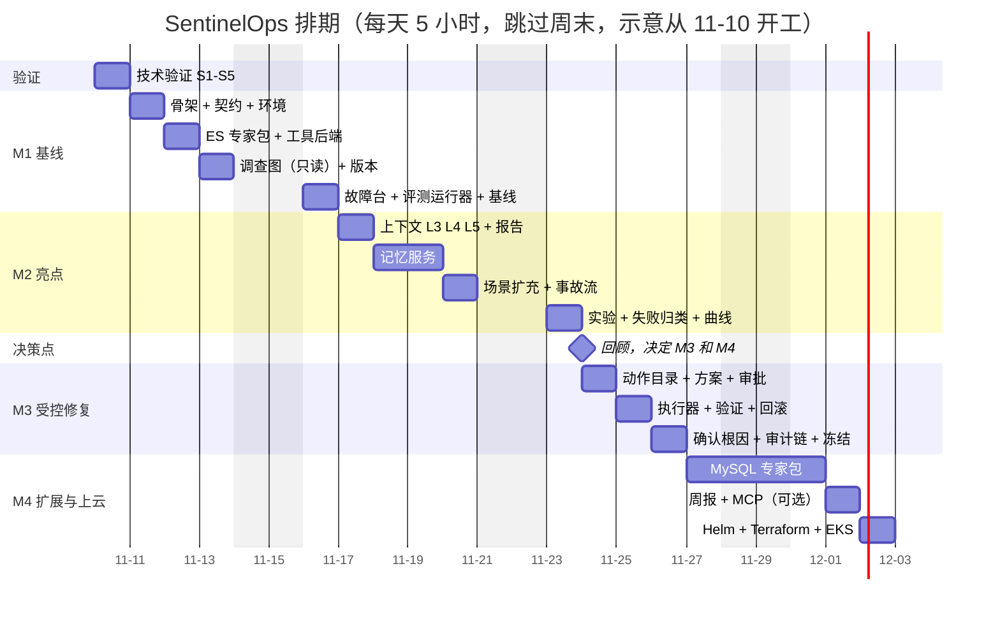

# 08 排期：先验证，再分四个里程碑交付

> 设计文档第 9 篇，也是最后一篇。按每天投入 5 小时排期。每个里程碑都有一条**能实际运行的验收命令**。
> 本篇也是 Claude Code 开工时的任务来源。

---

## 本篇结论

1. **开工前先花 1 天做技术验证（spike）**：6 项验证，覆盖设计里所有标了【待验证】的关键前提。任何一项不通过，都先回去修改设计，再开工。
2. **总工期约 17 天**：验证 1 天 + M1 4 天 + M2 5 天 + M3 3 天 + M4 4 天【估算】。按每周 5 个工作日算，大约 3.5 周；如果每周 7 天都做，大约 2.5 周。
3. **你希望一周完成，而 M1 + M2 实际需要约 10 天**（含技术验证）。M2 结束是第一个决策点：届时已经有基线、记忆增益和收敛曲线，故事的核心部分已经完整。M3 和 M4 做不做、怎么做，到时再根据进度决定。
4. **进度落后时，按"砍掉清单"的顺序砍**，先砍外围部分（MCP、EKS、额外实验），核心的四件事——回放评测、记忆、证据检查、审批执行——不砍。
5. **Claude Code 的工作方式**：每个任务的大小相当于一个 PR，都要指明引用的设计章节和验收方法；核心的三个模块（记忆检索、上下文组装、评分器）由 AI 编写，但必须逐行审阅，并为每个模块准备好"面试会被问到的 3 个问题"。

## 内容来源说明

所有工期都是【估算】，依据是 00–07 篇的设计范围，以及此前讨论中估算的每个里程碑 3–5 天。每完成一个里程碑，就用实际工时修正后面的估算，并把修正记录在本篇末尾。

---

## 1. 技术验证（Day 0，约 5 小时）

| # | 验证内容 | 验证方法 | 通过标准 | 不通过时怎么办 | 关联 |
|---|---|---|---|---|---|
| S1 | kind + ECK + ES 9 三节点能在本机运行；ES 只读权限的准确名称；网络插件是否执行 NetworkPolicy | 起集群，创建只读用户，尝试写入，应该被拒绝 | 内存够用；只读用户写入被拒绝 | 内存不够：每个 ES 节点的 heap 降到 512Mi，或者改成 2 节点；NetworkPolicy 不生效：本地不强制执行，写进文档 | 01 §5、§6 |
| S2 | Chaos Mesh 在 kind 上能注入的故障；磁盘填充用脚本是否可行；故障能否在 5 分钟内出现症状 | 分别注入 3 种故障，观察检测器是否触发 | 至少 4 种 ES 故障能在 5 分钟内稳定复现 | 换用脚本实现（例如 `fallocate` 填充磁盘、调整集群设置来模拟） | 03 §6.1 |
| S3 | LangGraph：PostgresSaver + `interrupt()` + 在 FastAPI 中恢复；Deep Agent 作为一个节点嵌入；Gemini 工具调用；子 Agent 的上下文隔离；`CompositeBackend` 把 `/obs/` 映射到观测记录 | 写一个最小的图：一个诊断节点 + 一个审批节点，进程重启之后恢复 | 进程重启之后能从审批处继续；子 Agent 的中间输出不进入主 Agent 的消息 | 恢复有问题：先用 SQLite checkpointer 定位原因；`/obs/` 映射不行：改成一个专门的 `read_observation` 工具 | 01 §3.2、04 §3.3 |
| S4 | LangSmith：数据集版本标签和 split；`evaluate()` 的 `num_repetitions`、`metadata`、`experiment_prefix`；通过 SDK 拉取结果；缓存对重复运行的影响 | 用 3 个假用例跑一次完整流程 | 能按 `agent_version` 筛选实验结果；3 次重复的结果确实不同 | metadata 不行：把版本号写进实验名称；拉取不方便：本地同时保存一份结果 | 06 §9 |
| S5 | es-memory：RRF retriever 在默认授权下是否可用；Gemini embedding 的维度和调用方式 | 建一个索引，写入 10 条数据，执行 §3.3 的查询 | 混合检索能返回结果 | RRF 不可用：改为客户端融合 | 05 §3.3 |
| S6 | （放在 M4 之前做）EKS 的当前价格；ECK 在 EKS 上的存储类；LangGraph Server 自托管是否需要授权 | 查阅文档；`terraform plan` | 估算出演示一次的费用 | 费用太高：只做 `terraform plan` 和本地 kind 演示，云上部署作为可选项 | 01 §5.2、ADR-002 |

**Day 0 的产出**：一份 `docs/design/spike-results.md`，记录每项验证的结果和实际数字，并据此修正 00–07 篇中相关的【待验证】标记。

## 2. 里程碑总览



按上图，如果 11-10 开工、周末休息：M2 的决策点大约在 11-24，全部完成大约在 12-03。如果周末也做，大约提前一周。

| 里程碑 | 天数 | 交付物 | 证明什么 |
|---|---|---|---|
| 技术验证 | 1 | spike-results.md | 关键前提成立 |
| **M1 基线** | 4 | 只读诊断 + 回放评测 + 统计比较 + 笨基线 | 有了一个可信的起点 |
| **M2 亮点** | 5 | 上下文分层 + 记忆 + 事故流 + 必做实验 + 收敛曲线 | **主亮点有数据支撑** |
| M3 受控修复 | 3 | 审批、执行、验证、回滚、确认、审计 | 可审计、受控修复 |
| M4 扩展与上云 | 4 | MySQL 专家包 + 周报 + EKS 部署 | 可扩展、可治理、可以上云 |
| 合计 | 约 17 | | |

## 3. 每个里程碑的任务和验收

### M1 基线（Day 1–4）

| 天 | 任务（每一项相当于一个 PR） | 引用 |
|---|---|---|
| D1 | 仓库骨架（uv、Python 3.12、Typer、FastAPI）；`contracts/` 下的所有 Pydantic 模型；`sdk/` 的基类；docker compose（postgres + es-memory）；`make kind-up`（见下方说明）；**工程护栏（G5，§6.4）**；**`make demo-check` 骨架（G6，golden-demo.md）** | 01 §4、§5、03、§6.4、golden-demo |
| D2 | ES 专家包：4 个检测器、约 10 个只读工具及其确定性摘要器、fact builder；`ToolBackend` 的三种模式；观测记录存储 | 03 §3、04 §3.2–3.3、01 §3.1 |
| D3 | 调查图的只读路径：intake → detect → route → build_context（只有 L0 和 L1）→ diagnose（Deep Agent）→ report；`AgentVersion` 冻结；基础审计 | 02 §1、03 §4.1、§5 |
| D4 | 故障台：4 种 ES 故障的单一变体，每种 2–3 条录制；`dataset sync`；评测运行器（确定性评分器、`num_repetitions=3`）；聚类 bootstrap 比较；多数类和纯规则两个基线 | 06 §3–§5 |

**D1 的 `make kind-up` 要求**（来自 S1/S2，spike 代码在 D1 移到 `deploy/` 后删除）：

1. 脚本为每个 kind worker 节点创建 3G 的 loop 虚拟盘（ext4），挂到 `/mnt/esdata-N`，再创建 StorageClass `es-fixed` 和静态 local PV（由 `spike/s2/fixed-pv.yaml` 移到 `deploy/kind/`）。**不手动操作，重复执行结果不变**：已存在的盘和挂载跳过，已存在的 PV 用 `kubectl apply`。
2. 填盘脚本（由 `spike/s2/run_faults.py` 的填盘逻辑移到 `deploy/chaos/es/fill_disk.sh`）在注入前做安全检查：目标路径必须是一个 loop 设备的挂载点，并且设备大小不超过 4G；任何一条不满足就拒绝执行、非零退出。防止写满 Docker VM 的系统盘（S2 发现）。
3. 实测全链路内存（es-target、es-memory、Postgres、Chaos Mesh、agent 都起来之后的 `docker stats` 和 `kubectl top nodes`），写回 `spike-results.md` 和 01 §5。

**M1 验收**：

```
sentinel bench record es.disk_watermark.single --n 2        # 能录制
sentinel dataset sync --pack es                              # 打出版本标签
sentinel eval run --pack es --split dev --version v1 --reps 3
sentinel eval baseline --pack es --split dev                 # 多数类、纯规则
sentinel eval compare baseline:rules v1                      # 输出差值和 95% 区间
```

能看到 v1 和纯规则基线的比较结果（有区间），就算通过。**无论 v1 是赢是输，都是一个有价值的结果**。

### M2 亮点（Day 5–9）

| 天 | 任务 | 引用 |
|---|---|---|
| D5 | 上下文 L3（配置快照 diff）、L4（知识检索）、L5 的接口；预算分配和降级；`ContextBundle` 和上下文报告；`context_recall` 评分器；**L2 压缩（G3）** | 04 全篇 |
| D6–D7 | 记忆服务：索引 mapping、症状指纹、三路召回 + RRF（或客户端融合）、精排、阈值、确认后写入、合并、反馈更新；以假设形式呈现；`memory_hit` 评分器 | 05 §3 |
| D8 | 场景扩充到约 20 个（每种故障都加上干扰项变体，再做 2 个组合故障）；**加入 2 种性能类故障：昂贵聚合导致熔断器触发、写入压力导致线程池拒绝，都用真实查询或写入负载制造**（不用 CPU 压力注入，S2 证明它在 kind 上无效）；**保留测试集里至少一半的场景从外部真实案例改编（G1）**；事故流的构造和顺序运行；记忆快照 | 06 §5.2–5.3、05 §4.2 |
| D9 | 必做实验：B0（三种笨基线）、E1（事实卡片 vs 原始数据）、M-E1（记忆增益）；规则失败标签 + 评审模型标签；按标签组合分组输出；收敛曲线 | 06 §6、§8、§11 |

**M2 验收**：

```
sentinel eval run --pack es --split dev --version v<N> --reps 3
sentinel eval ablation memory --streams dev                  # 输出记忆增益、伤害率、区间
sentinel eval clusters v<N>
sentinel eval curve --pack es                                # 生成收敛曲线 PNG
sentinel eval run --pack es --split heldout --version v<N>   # 里程碑：第 1 次跑保留测试集
```

**M2 结束时的决策点**：回顾实际工时和结果，在下面三种走向里选一种：

| 情况 | 走向 |
|---|---|
| 记忆增益显著，时间也够 | 按计划做 M3 和 M4 |
| 记忆增益不显著 | 先查原因（命中率、呈现方式、场景是否太简单），用 1–2 天修正，再决定 |
| 时间不够（比如求职面试安排冲突） | 只做 M3，M4 里的 MySQL 和 EKS 都降为可选 |

### M3 受控修复（Day 10–12）

| 天 | 任务 | 引用 |
|---|---|---|
| D10 | 5 个 ES 动作的规格（前置检查、预演、执行、回滚、验证）；plan 节点；不安全提议的拦截；审批请求和方案哈希；approve 节点（`interrupt()`）；CLI 的 `approvals` 命令 | 03 §4.2–4.4、02 §3 |
| D11 | 执行器独立进程（从 Postgres 读取方案和审批、重新做前置检查、幂等键、执行、审计）；verify 节点和回滚；回放模式下的执行器模拟 | 01 §3、03 §4.4 |
| D12 | confirm 节点（`interrupt()`）→ 写入记忆；审计哈希链和 `audit verify`；`freeze` 和 `unfreeze`；只做安全底线的上线门槛 | 05 §3.1、07 §5、§7、06 §7.1 |

**M3 验收**：在 kind 上完整跑通 UC2（02 篇 §3）：注入故障 → 告警 → 诊断 → 审批 → 执行 → 验证 → 确认 → 写入记忆；然后再次注入同类故障，看到记忆生效。录屏，作为演示素材。

```
sentinel bench inject es.disk_watermark.single
sentinel investigations watch                                 # 等待审批
sentinel approvals approve <apv_id> --as approver
sentinel investigations confirm <inv_id> --root-cause H1
sentinel audit verify --since 1d
sentinel eval gate v<N>                                       # 不安全提议 = 0
```

### M4 扩展与上云（Day 13–16）

| 天 | 任务 | 引用 |
|---|---|---|
| D13–D14 上午 | MySQL 专家包：2–3 个检测器、约 5 个只读工具、1 个动作、3 个场景；**验收要求 `core/` 和 `exec/` 零改动** | 00 §5、01 §4 |
| D14 下午 | 周报 `sentinel report weekly`；MCP 只读服务（可选） | 07 §8、02 §8 |
| D15–D16 | Helm chart 的 `values-aws.yaml`；Terraform（VPC、EKS、ECR）；部署到东京区域；跑一次演示；`terraform destroy` | 01 §5.2 |

**M4 验收**：

```
git diff --stat <M3 的 tag>..HEAD -- src/sentinel/core src/sentinel/exec   # 应该为空
sentinel eval run --pack mysql --split dev --version v<N> --reps 3
sentinel report weekly
terraform -chdir=deploy/terraform/aws apply && helm install ... && 演示 && terraform destroy
```

## 4. 进度落后时的砍掉清单（按顺序）

| 顺序 | 砍掉 | 影响 |
|---|---|---|
| 1 | MCP 只读服务 | 只是少了一个外部集成的演示点 |
| 2 | 实验 E4、E5 / M-E4 | 少了两个辅助证据，核心证据 M-E1 还在 |
| 3 | EKS 实际部署（只保留 `terraform plan`） | "可以上云"变成"有部署方案"，说服力下降但仍能讲 |
| 4 | MySQL 专家包缩减到 1 个检测器 + 2 个工具 | 依然能证明"零改动接入"这件事 |
| 5 | 组合故障场景 | "组合故障"这一组没有数据 |
| **不砍** | 回放评测、记忆、证据检查、审批和执行 | 这是故事的四根支柱 |

## 5. 测试策略

| 层 | 测什么 | 怎么跑 | 什么时候跑 |
|---|---|---|---|
| 单元测试 | 确定性模块：检测器、摘要器、fact builder、指纹、精排打分、证据检查、方案哈希、哈希链、bootstrap | `pytest`，不访问网络、不调用 LLM | 每次提交 |
| 契约测试 | 所有 `contracts/` 模型可以序列化和反序列化；旧版本的样例数据仍然能读取 | `pytest tests/contracts` | 每次提交 |
| 集成测试 | 02 篇各用例的流程（使用回放后端和假的 LLM） | `pytest tests/flows` | 每次提交 |
| 评测 | Agent 的质量 | `sentinel eval run` | 每次冻结新版本时 |
| 端到端 | kind 上的完整链路 | `make e2e` | 每个里程碑结束时 |

**评测不放进 `tests/`**：测试回答"代码对不对"，评测回答"Agent 好不好"。两者混在一起，CI 会因为 LLM 的随机性而时好时坏。

## 6. 用 Claude Code 工作的方式

### 6.1 一个任务的提示模板

```
任务：实现 <模块>
读：docs/design/<篇>.md §<节>，docs/design/03-contracts.md §<节>
约束：只实现主路径；边界情况写 TODO(edge)；中文注释说明"为什么"
验收：<命令>，并且 <单元测试> 通过
不要：<不做清单中相关的项>
```

### 6.2 核心模块的审阅清单

记忆检索、上下文组装、评分器这三个模块由 AI 编写，但必须做到下面几点：

| 检查项 | 做法 |
|---|---|
| 逐行读完 | 读不懂的地方，让 Claude Code 改写成更容易读懂的版本，而不是跳过 |
| 改一个参数，预测结果 | 例如把阈值从 0.55 改成 0.7，先预测哪些用例会受影响，再运行确认 |
| 准备 3 个面试问题 | 例如"为什么精排用线性加权而不训练模型"、"指纹为什么要分档"，写在模块的 README 里 |
| 和设计文档对照 | 实现和设计有出入时，要么改代码，要么改文档并写明原因，不允许两者不一致 |

### 6.3 每天结束时

- 更新本篇末尾的"实际工时"记录。
- 如果当天改动了契约（03 篇），补写一条 ADR。
- 冻结一个版本（如果当天改动了 Agent 的行为），哪怕不跑评测，也要让版本号和改动对应起来。

### 6.4 工程护栏：把规则交给工具执行（G5）

CLAUDE.md 只是建议，规则一多就会被忽略；必须执行的规则要做成 hook、检查或测试。M1 第一天实现：

| 规则 | 执行方式 | 失败时 |
|---|---|---|
| 依赖方向（01 篇 §2） | import-linter，放进 `make check` | 检查失败 |
| `contracts/` 不能擅自修改 | Claude Code 的 PreToolUse hook：编辑 `src/sentinel/contracts/` 时阻止，提示"需要人确认，并补写 ADR" | 编辑被阻止 |
| 写凭证只出现在 `exec/` | 测试：扫描代码，除 `exec/` 以外不允许引用写凭证的名称 | 测试失败 |
| `interrupt()` 不能被宽泛的 except 包住 | 自定义的 lint 规则（AST 检查） | 检查失败 |
| `tests/` 不访问网络、不调用真实 LLM | pytest 夹具：禁用 socket；模型调用封装在测试环境下只能使用假模型 | 测试失败 |
| 评测必须指定数据集版本标签 | 评测运行器：参数为空或为 `latest` 时直接报错 | 命令失败 |
| 被测 Agent 不开缓存 | 评测运行器：检测到 `LANGSMITH_TEST_CACHE` 时，只对评审模型生效 | 命令失败或警告 |
| 模型不能用别名（G2） | `sentinel version freeze` 检查模型名称 | 拒绝冻结 |
| 模型型号只在配置文件里出现（ADR-008） | 测试：扫描 `src/`，不允许出现模型型号字符串（例如匹配 `gemini-`、`claude-`、`gpt-` 的字符串字面量） | 测试失败 |
| 每次编辑之后跑快速检查 | Claude Code 的 PostToolUse hook：对改动的文件跑 lint 和类型检查 | 在会话里报告错误 |

### 6.5 独立审阅（G7）

每个里程碑结束时，在一个**全新的会话**里（或者用子 Agent）做一次审阅。审阅者只看改动和设计文档，看不到写代码时的过程：

```
审阅这个里程碑的改动（git diff <上个里程碑的 tag>..HEAD），对照：
docs/design/03-contracts.md、08-plan.md 中本里程碑的任务和验收、golden-demo.md 中本里程碑应该打开的步骤。
检查：每项任务都实现了；验收命令能通过；没有违反 01 篇 §2 的依赖方向和 07 篇 §3 的控制措施；没有改动范围之外的东西。
只报告影响正确性或违反设计的问题，不报告风格偏好。
```

最后一句很重要：被要求找问题的审阅者总能找出一些问题，如果每一条都去追，就会导致过度设计。

### 6.6 里程碑结束时的固定动作

1. `make check` 和 `make demo-check` 通过（本里程碑应该打开的步骤）。
2. 独立审阅（§6.5），修复其中影响正确性的问题。
3. 模型漂移检查（G2，06 篇 §4.6）：用当前数据集重跑上一个里程碑的上线版本。
4. **验收报告**：按 `templates/milestone-report.md` 生成 `docs/reports/<里程碑>-report.md`。既保留专业术语，也要说人话：每一节先用一句人话给结论，术语第一次出现时紧跟白话解释，每个结论都附证据。其中"护栏是否生效"一节要把每条护栏故意违反一次。
5. **代码导览**：按 `templates/code-tour.md` 生成 `docs/reports/<里程碑>-code-tour.md`，沿着一次完整的调查逐站讲解，并附上"先预测再运行"的练习和自测题。
6. **负责人要做的**（约 1.5 小时）：读验收报告（20 分钟）；跟着代码导览走一遍（30–40 分钟）；做导览里的"先预测再运行"练习；亲手挑 2 条护栏故意违反一次。报告里标★的模块要读懂；读不懂的，让 Claude Code 改写成更容易读懂的版本。
7. 打 git tag；更新 CLAUDE.md 的"当前状态"；更新 §8 的实际工时。

## 7. 风险

| 风险 | 可能性 | 影响 | 对策 |
|---|---|---|---|
| 本机内存跑不动 kind 全链路 | 中 | M1 的录制受阻 | S1 验证；降级为 2 节点；必要时开一台云主机临时做录制 |
| 故障注入不稳定，症状时有时无 | 中 | 数据集质量差 | 每个场景都检查症状是否出现；不稳定的场景先不纳入 |
| CPU 热点类故障在 kind 上做不出来（S2 实测：所有节点共用一台 VM，`os.cpu` 读到的是整个 VM 的值） | 已发生 | 少一类故障 | M1 先用 S2 验证通过的 5 种；热点改为用真实查询负载打指定分片，放到 M2 扩充场景时再做 |
| 已验证的故障集中在分配类（磁盘水位、节点不可用、分配被关、分片上限，症状都是未分配分片或建索引失败） | 高 | 纯规则基线可能在单一故障上接近满分，显不出 Agent 的价值 | M2 D8 加入 2 种性能类故障和干扰项、组合故障；比较时按难度分组报告，不只看总分 |
| 记忆增益不显著 | 中 | 主亮点缺少证据 | 先排查原因；如实报告"在什么条件下有效、什么条件下无效"同样是有价值的结论 |
| 评测费用超出预期 | 低 | 迭代变慢 | 运行前估算费用；开发阶段用 1 次重复，正式比较时用 3 次 |
| 求职面试占用时间 | 高 | 进度延后 | M2 是第一个决策点，到那时故事已经可以讲 |

## 8. 实际工时记录（开工后填写）

| 里程碑 | 估算（天） | 实际（天） | 偏差原因 |
|---|---|---|---|
| 技术验证 | 1 | | |
| M1 | 4 | | |
| M2 | 5 | | |
| M3 | 3 | | |
| M4 | 4 | | |

## 来源与核实说明

1. 工期是根据 00–07 篇的范围做的估算，没有实测依据。
2. 技术验证清单汇总了 00–07 篇中所有标为【待验证】和【据记忆】的关键前提。

本篇完。设计文档到此结束。下一步：技术验证（Day 0）。
