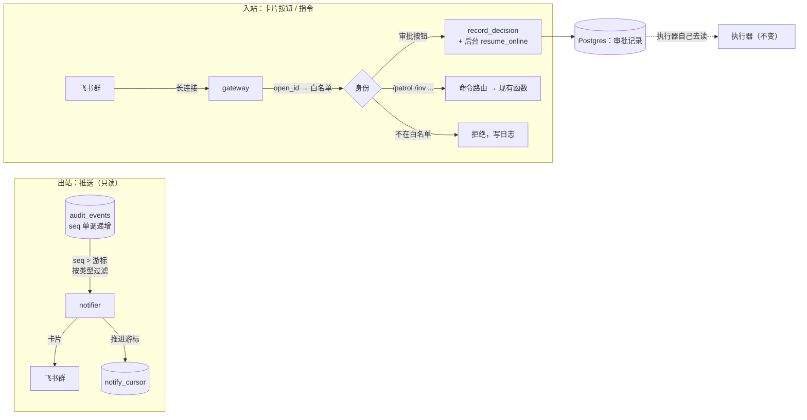

# 09 飞书 ChatOps：把通知、审批和常用命令搬到飞书

> 设计文档第 10 篇，M5 新增。00–08 篇定下的"交互只做 CLI"在这里放宽：飞书成为 CLI 之外的**第二个入口**。安全模型保持不变。范围变更的理由见 ADR-015。

---

## 本篇结论

1. **飞书只是 CLI 的另一个入口，不增加新的权力。** 在飞书里能做的事都是调用 CLI 背后的同一批函数。审批照样要经过"方案哈希 + 独立执行器重新校验"，执行器完全不知道这个审批来自飞书还是 CLI。
2. **一共三块，按风险从低到高做**：推送（只读）→ 卡片审批（写）→ 固定指令（触发）。推送做完就已经有用；审批出了问题，可以退回到"只推送"。
3. **推送读审计表，不在图的节点里调用飞书。** notifier 按 `seq` 游标读 `audit_events`。飞书挂了不影响调查，图的代码一行都不改，Agent 行为不变，所以不需要冻结新版本，也不需要重新评测。
4. **dev 和 prod 是两个独立的飞书应用（bot），各对应一个群。** 长连接不会广播，`open_id` 按应用区分，环境标签写在卡片标题上。两套凭证分开存放，没有一套凭证能同时用于两个环境。
5. **高风险能力用一个开关统一控制。** `high_risk_enabled` 同时决定两件事：high 风险动作能不能在飞书审批，`/freeze` 能不能在飞书用。默认关闭。飞书**永远不能**解冻。
6. **只做固定指令，不做自然语言。** `/help` 返回带模板和示例的卡片，常用的指令直接做成按钮。这样不需要再加一次 LLM 调用来解析意图，也就不会出现"LLM 决定去注入故障"这条路径。

## 内容来源说明

标记体系同 00 篇。飞书开放平台的行为（长连接、卡片回传、多客户端的投递方式、回调时限）在写这篇时没有实测，S7（2026-11-20）实测之后已经改成实测结论（见 spike-results.md S7）。需求来自 2026-11-20 和负责人的对话，6 个决定见 §2。

## 本篇要回答的核心问题

- 飞书能做什么、不能做什么？哪些是由配置决定的？
- 怎样加一个入口，又不削弱 07 篇的安全模型？
- dev 和 prod 怎样分开，不会互相串？

---

## 1. L1 一句话本质

**飞书是一个"会推送的遥控器"：它能看、能按审批按钮、能发起几条固定命令。真正做决定的规则（白名单、哈希、执行器）都还在原来的位置。**

## 2. 范围：负责人的 6 个决定（2026-11-20）

| # | 决定 | 落在哪里 |
|---|---|---|
| D1 | 飞书**不提供**"测试"（`eval run`、`make check`）指令 | §5 指令表里没有它 |
| D2 | 开放 `bench inject / revert / record`，**只在 dev（kind）**；prod 拒绝 | 配置里的 `commands` 白名单 |
| D3 | 能在飞书审批的风险上限可以配置，默认 `medium`。high 风险的审批卡片**照样推送、完整显示**，但不放按钮，改为提示 CLI 命令。整体跑通后再放开到 high | §4 |
| D4 | 支持 `/freeze`，但和"高风险授权"共用开关 `high_risk_enabled`，关闭时拒绝并提示用 CLI。飞书永远不能 `unfreeze` | §5、§6 |
| D5 | 只用固定指令。`/help` 卡片给出模板和示例；无法识别的输入也返回帮助卡片；常用的无参数指令做成按钮 | §5 |
| D6 | kind 和 EKS 都部署：kind 先验证，再上 EKS。dev 和 prod 各用一个 bot | §7 |

**不做**：
- 自然语言指令
- 在飞书里确认根因（`investigations confirm`，推送里只提示 CLI 命令）
- 在飞书里解冻
- 多群、多租户
- 飞书审批流（OA 审批）集成
- 卡片里展示 trace 详情（给出 LangSmith 链接就够了）

## 3. L2 心智模型：两条数据流



`sentinel chatops serve` 在一个进程里同时跑 gateway 和 notifier：D18 先有只跑推送的 `sentinel chatops notify`；D19 有了 `serve`（卡片审批回调 + 推送），D20 给它加上了消息指令（`im.message.receive_v1`）和帮助卡片的指令按钮。新模块是 `src/sentinel/chatops/`，和 `cli/`、`api/` 平级。`.importlinter` 增加一条规则：`sentinel.chatops` 不能 import `sentinel.exec`。

## 4. 推送

### 4.1 推哪些事件

| 审计事件 | 卡片 | 说明 |
|---|---|---|
| `approval.requested` | 审批卡片（§4.3） | 唯一带按钮的卡片 |
| `diagnosis.completed`（这次调查有 finding） | 异常摘要：集群、检测器、H1 和置信度、调查 ID | 只摘要，不贴原始观测 |
| `investigation.escalated` | 需要人接手 | |
| `verify.failed`、`action.rolled_back` | 修复没成功 | |
| `verify.passed` | 修复成功，提示 `sentinel investigations confirm <inv> ...` | 确认根因只在 CLI 做 |
| `freeze.enabled` | 系统已冻结，作废了 N 个审批 | |
| `patrol.healthy` | **不主动推送** | 健康是常态，推了就是噪音；只在回复 `/patrol` 时返回 |

### 4.2 outbox 游标

- `audit_events.seq` 是 bigserial，追加时整表加锁（`governance/audit.py` 的 `pg_append`），所以 `WHERE seq > :cursor ORDER BY seq` 不会漏掉事件，也不会读乱顺序。
- 新增存储接口 `Store.audit_events_since(after_seq, types)`，实现在 `core/store/{base,postgres,memory}.py`。这是存储接口，**不是契约**。`AuditEvent` 契约里没有 `seq`，所以返回 `(seq, 事件)` 二元组，契约不动。
- 第一次启动（这个环境还没有游标）时，游标从当前最新的 seq 开始，不补发历史事件。
- 新增迁移 `004_chatops.sql`：`notify_cursor(env text primary key, last_seq bigint)`。
- 发送成功之后才推进游标（至少一次投递）。同一事件重复推送时，卡片带上事件 ID，用发送消息接口的 `uuid` 字段去重（D18 实测：同一个 uuid 发两次，返回同一个 message_id）。
- 推送失败只记日志、退避重试，**不写审计、不影响调查**。
- TODO(edge)：长时间停机后积压了大量事件时，要合并成一张汇总卡片。

### 4.3 审批卡片

卡片内容和 `sentinel approvals show` **完全一样**：动作、风险、依据的假设、参数、前置检查、预演和影响范围上限、回滚、验证条件、有效期、方案哈希（前 16 位）。人不能在信息更少的界面上做批准。

| 动作风险 | 按钮 |
|---|---|
| ≤ `approval.max_risk_via_chat`（默认 `medium`） | 「批准」「拒绝」 |
| 更高（目前只有 high） | 没有按钮。显示"高风险动作，飞书审批未开启"，再附上可以直接复制的 `sentinel approvals approve <apv> --as <名字>` |

`high_risk_enabled: true` 时，上限自动提到 `high`。现在还没有 high 风险的动作（`packs/*/actions/*.yaml` 里最高是 medium），所以短期内这个开关只影响 `/freeze`。

## 5. 入站：卡片按钮和固定指令

### 5.1 身份

- 每个环境的配置里有 `approvers: {open_id: 名字}`。不在里面的人，点按钮或者发指令一律拒绝，并写日志。
- 映射之后的身份是 `human:<名字>`，和 CLI 的 `--as` 完全同一种格式。`approval.decided` 的 `reason` 前面加上 `[feishu]`，用来区分渠道。**不改契约**：`ApprovalDecision.approver` 的格式不变，也不新增审计事件类型。
- 审批人不能审批自己发起的调查：和 07 §4 一样，第一版不强制。

### 5.2 审批按钮的处理过程

1. 按钮的 value 里**只带 `approval_id`**。哈希、方案都由服务端从 Postgres 重新读取，不信任卡片里的任何内容（T3、T4）。
2. 校验身份（§5.1），再校验风险上限（§4.3）。高于上限时拒绝，因为按钮可能被伪造。
3. 调 `record_decision(...)`（`core/graph/remediate.py`）。`DuplicateError` → 卡片更新为"已被 <谁> 决定过"。
4. **立刻**把卡片更新为"已批准，执行中"，然后在后台线程里调 `resume_online(...)`。原因是飞书的回调**超过约 3 秒就判定超时，而且不会重发**（S7 实测：2.5 秒正常，4 秒超时），而 `resume_online` 最多要阻塞 `EXEC_WAIT_S=300` 秒。
5. 执行和验证的结果不在这里返回，由 notifier 按审计事件推送（`verify.passed` / `verify.failed`）。

`approvals show` 的内容已经抽到 `core/approval_view.py`（D18），CLI 和审批卡片都用 `ApprovalView.lines()`，测试里逐行比对两边。放在 core 而不是 governance：要用 `packs_registry` 取动作规格，而 governance 会被执行器 import，执行器不能依赖 core。

D19 把 CLI `_decide` 里"查审批 → 校验 → `record_decision` → 处理重复"的部分也抽到了同一个文件：`decide_approval(..., max_risk=...)`。CLI 传 `high`（不设上限），飞书传配置里的上限；恢复调查留给调用方（CLI 同步等，飞书放后台线程）。实现时定下的三点：

- **风险上限对「拒绝」也生效。** 高于上限的卡片本来就没有按钮，收到这样的点击只可能是伪造的，所以不区分批准还是拒绝。
- **拒绝之后也要恢复调查**（和 CLI 一样），调查才会以"只出报告"结束，否则会一直停在审批节点。
- **决定之后卡片不再带按钮**：无论在哪里决定的（CLI 或飞书），之后再渲染的审批卡片都显示"已批准 / 已拒绝（谁、什么时候）"。点击处理在 `chatops/approvals.py`（纯逻辑，用假数据测试），lark SDK 的拆装在 `chatops/gateway.py`。

### 5.3 固定指令

| 指令 | 对应的现有函数 / 命令 | dev | prod |
|---|---|---|---|
| `/help` | 帮助卡片：每条指令的模板、示例；按钮：每个目标集群一个「巡检」、「待审批列表」 | ✓ | ✓ |
| `/patrol <target> [--pack es]` | `core/graph/run.py: patrol` | ✓ | ✓ |
| `/inv list` · `/inv show <id>` | 同 `investigations list / show` | ✓ | ✓ |
| `/approvals list` | 同 `approvals list`；每条待审批重新发一张审批卡片 | ✓ | ✓ |
| `/bench inject\|revert\|record <scenario> [--pack]` | 子进程运行 `sentinel bench ...` | ✓ | ✗（D2） |
| `/freeze <reason>` | `governance/kill_switch.py: freeze` | 需要开关 | 需要开关（D4） |
| `/unfreeze` | — | ✗ 一律提示用 CLI | ✗ |
| 其他任何输入 | 返回帮助卡片 | | |

- 解析是确定性的，不调 LLM。消息文本里的 @ 是 `@_user_1` 这样的占位符（S7），先去掉再解析。参数逐个校验：target 必须在 `config/governance.yaml` 的 targets 里；scenario 必须在专家包的场景里。
- 长任务（`patrol` 需要诊断时、`bench`）先回一张"已开始"的卡片，跑完之后更新这张卡片。
- `bench` 为什么用子进程：`record` 要用执行器的写凭证。dev 环境下这个凭证来自开发机上的 `deploy/kind/exec-env.sh`，信任边界和你在终端里敲 CLI 一样。chatops 进程本身不 import `exec/`，也不读写凭证（"写凭证只在 `exec/`"这条护栏不受影响）。

D20 实现时定下的几点（09 原文没写明，或者和原文不同的地方）：

- **飞书的 `/patrol` 用 `remediate` 模式**（CLI 默认是 `report_only`）。原因：飞书这个入口本来就是为了在群里走完"发现 → 审批"，只有 remediate 模式才会出审批卡片。安全性不变：修复照样停在审批，执行器照样重新校验。
- **target 列表取 `config/governance.yaml` 的 `mcp.targets`**（目标 → 专家包）：目前只有这里登记了这张表。`--pack` 可以省略，从目标推出来；写了但和登记的不一致就拒绝。scenario 的 ID 带专家包前缀（`es.disk_watermark.single`）。
- **帮助卡片的按钮 value 里只带一条指令文本** `{"cmd": "/patrol es-target"}`。点击之后交给和手打同一个入口（`CommandHandler.on_message`）重新做全部检查，所以按钮不比手打多出任何权力，value 被伪造也一样。卡片回调按 value 分流：带 `cmd` 的是指令按钮，其余是审批按钮（`commands.route_card`）。
- **`/bench inject` 跑完的卡片上带「巡检」按钮**，把"注入 → 巡检 → 审批"接成一条链路。
- **`/bench record` 的写凭证只进子进程**：子进程的 shell 里 source `exec-env.sh`（端口换成 19202，避免抢执行器 shell 的 port-forward）。chatops 进程自己的环境里没有写凭证。
- 白名单外的人发指令：回一张"已拒绝"卡片并写日志；别的群来的消息：只写日志，不回话。`/freeze` 的原因前面加 `[feishu]`，和审批一样区分渠道。
- `sentinel chatops serve` 启动时先检查群 ID，缺了就拒绝启动。D20 踩坑：没有群 ID 时 notifier 线程在第一轮推送就异常退出，长连接照常运行，从外面看不出来。
- 代码：解析和规则在 `chatops/commands.py`（纯逻辑，依赖注入，`tests/unit/test_chatops_commands.py` 用假数据测）；`gateway.py` 只做 lark 对象的拆装。TODO(edge)：同一条消息被重复投递时，指令会执行两次（卡片按 uuid 去重，只回一次）。

## 6. 配置和开关

`SENTINEL_CHATOPS_CONFIG` 选择配置文件，做法和 `SENTINEL_MODELS_CONFIG` 一样：

```yaml
# config/chatops.dev.yaml（prod 同结构，env_label: eks-prod，commands 里没有 bench）
env_label: kind-dev            # 显示在每张卡片标题上
chat_id: oc_xxx                # 只接收、只推送这个群
approvers:                     # open_id 按应用区分，dev 和 prod 各写各的
  ou_xxx: yuewang
approval:
  max_risk_via_chat: medium    # low | medium | high
high_risk_enabled: false       # true：飞书可以审批 high，也可以 /freeze（D3、D4）
commands: [help, patrol, inv, approvals, bench, freeze]
```

- 配置里还有 `domain`：`https://open.feishu.cn`（国内飞书）或 `https://open.larksuite.com`（Lark），应用建在哪边就只能连哪边（S7）。
- app_id 和 app_secret **不写在配置里**，用环境变量 `FEISHU_APP_ID`、`FEISHU_APP_SECRET`。dev 下 `sentinel chatops serve --env-file ~/.config/sentinelops/feishu-dev.env` 从文件读，不依赖从哪个 shell 启动（S7 踩坑：继承了旧的环境变量）；prod 由 k8s secret 注入。prod 的审批人 open_id 的取法（D21）：先用 prod 凭证在本机临时起一次 serve（审批人为空），在值班群里 @ 机器人，拒绝日志里有 open_id；取到后马上停掉本机进程，再部署。`config/` 在版本哈希里，要在部署前写进配置，只提交一次。
- 别的群里发来的消息一律忽略。
- 改配置要重启进程，第一版不做热加载。

## 7. 部署：dev 和 prod 怎样分开

| | dev（kind） | prod（EKS 悉尼） |
|---|---|---|
| 飞书应用 | `SentinelOps-dev`（自建应用 A） | `SentinelOps`（自建应用 B） |
| 群 | 开发测试群 | 值班群 |
| 运行位置 | 开发机：`sentinel chatops serve`（kind 现在没有用 Helm 部署 agent） | Helm 新增 Deployment `chatops`（`sentinel-system`，单副本，`Recreate`：滚动更新会短暂有两个长连接，事件可能被旧 Pod 收走；`values.yaml` 里默认关、`values-aws.yaml` 打开） |
| 凭证 | 本机文件 `~/.config/sentinelops/feishu-dev.env`（`serve --env-file`） | k8s secret `sentinel-feishu`，由 `aws-up.sh` 用 `kubectl create secret --from-env-file ~/.config/sentinelops/feishu-prod.env` 创建（不经过 helm，和 `sentinel-llm` 一样）；preflight 检查文件存在、三个键齐全（D21 改：原设计是检查环境变量，改成读文件，和 dev 的 `--env-file` 一致，避开 S7 继承旧环境变量的坑）。`*.env` 已加入 `.gitignore` 和 `.dockerignore` |
| 配置 | `config/chatops.dev.yaml` | `config/chatops.prod.yaml` |
| 网络 | 出站访问飞书 | 出站访问飞书（检查 `netpol.yaml`）；**没有 Ingress、没有公网入口**，因为用的是长连接 |

为什么一定要分成两个 bot：
1. **长连接不会广播**：同一个应用有多个客户端连着时，一条事件只投给其中一个（S7 实测：A、B 同时在线，3 个事件各只投给一个）。共用一个 bot 的话，你在本地调试的进程可能会把线上的审批点击"抢走"。
2. `open_id` 按应用区分，白名单本来就要按环境分开配置。
3. 名字和卡片标题都带环境标签，减少"在错误的群里点了批准"的可能。
4. 凭证隔离：dev 的 secret 泄露了，也碰不到 prod。

## 8. 对 07 篇威胁模型的补充

| # | 威胁 | 例子 | 控制措施 |
|---|---|---|---|
| T13 | 飞书身份被冒用 | 群里不是审批人的成员点了「批准」；伪造的卡片回调 | 白名单按 `open_id` 校验；服务端重新校验风险上限；按钮只带 `approval_id`，其余从 Postgres 读；长连接下没有逐条签名，鉴权在连接这一层（S7 实测）——所以 app_secret 就等于"能收到这个应用所有点击"的权力，要和写凭证一样保管 |
| T14 | 环境串用 | dev bot 连到了 prod 的数据库 | 两个应用、两份配置；卡片标题显示 `env_label`；prod 配置里的 `commands` 不含 bench |
| T15 | 数据外流到飞书 | 审批卡片的参数、前置检查里带着索引名、主机名 | 和 T10 一样如实记录数据流向；卡片里只放摘要和 ID，不贴原始观测 |
| T16 | 在手机上随手批准 | 没看清就点了 | 卡片内容和 `approvals show` 一致；high 风险默认不能在飞书批准；有效期照旧（默认 30 分钟） |

## 9. 测试和验收

- **单元测试**（`make check`，不访问网络）：定义 `FeishuClient` Protocol，测试用一个会记录调用的假实现，通过构造函数注入（参照 `tests/harness.py`）。覆盖：
  - 只推送 §4.1 的事件类型，游标不会重复推送
  - 白名单外的人被拒绝
  - 高于上限的风险不出按钮，按钮被伪造时服务端也会拒绝
  - 开关关闭时 `/freeze` 被拒绝
  - prod 配置下 bench 被拒绝
  - 重复点击返回"已被决定过"
  - import-linter 禁止 chatops → exec
- **golden-demo 第 11 步**（M5 打开）：回放 + 假飞书。审计里出现 `approval.requested` → 生成审批卡片 → 模拟点击 → `approval.decided`（actor 是 `human:<名字>`，reason 以 `[feishu]` 开头）→ `action.executed` → 推送结果卡片。
- **kind 手动验证**（dev bot）：`/help` → `/bench inject <场景>` → 收到异常卡片和审批卡片 → 点批准 → 收到 verify.passed；开关关闭时 `/freeze` 被拒绝。
- **kind 实测（D20，2026-11-20）**：上面这条链路用 dev bot 跑通，审计 `approval.decided`（actor `human:yuewang`，reason `[feishu]`）→ `action.executed`（executor，哈希一致）→ `verify.passed`，从批准到验证通过 2 秒。跑之前要注意两件事：① serve 的 shell 要先 source 只读凭证（`dev-env.sh`；巡检 mysql-target 还要 `mysql-env.sh`，没 source 时巡检会失败，调查会停在 running，TODO(edge)），执行器在另一个 shell 用 `exec-env.sh`；② 版本哈希包含整个 `src/`，chatops 的代码改动也会让当前代码没有对应版本，真实巡检会被拒绝。M5 的处理办法：冻结一个"行为不变"的版本（v43，不评测，上线版本仍是 v41），和 v38–v41 的先例一样。
- **EKS 只跑一次**：prod bot 跑 `/patrol` 和一次审批，然后 `make aws-down`。
- **EKS 实测（D21，2026-11-20）**：prod bot 在 EKS 悉尼跑通。注入 `allocation_disabled` → 值班群 @ 机器人 `/help` → 点「巡检 es-target」→ 审批卡片「批准」→ verify.passed。云上审计（版本 v1，对应提交 5240166）依次是：`approval.requested` → `approval.decided`（`human:yuewang`，reason `[feishu]`）→ `action.executed`（executor，哈希一致）→ `verify.passed`（`unassigned_shards=0 status=green`），从批准到验证通过 11 秒。实测发现三点：
  1. **prod 群里的指令要真的 @ 机器人**（从 @ 列表里选，显示成蓝色）。prod 应用只开了"获取群组中其他机器人和用户@当前机器人的消息"，没开敏感权限"获取群组中所有消息"。不 @ 的消息、手打成纯文本的 @，飞书**根本不生成事件**（事件日志里查不到），从外面看就是"机器人不回话"。dev 应用开了后者，所以 dev 群不 @ 也能用。保持现状：值班群要求 @ 才触发，能防误触。帮助卡片上的按钮走卡片回调，不受影响。排查办法：开放平台「日志检索 → 事件日志」。查不到记录，说明消息没变成事件；记录是 `app not online`，说明当时没有长连接在线。
  2. **云上没有 mysql-target**（chart 只部署了 es-target，见 values.yaml 的 TODO），但 `mcp.targets` 里有，所以帮助卡片上会出现「巡检 mysql-target」，点了会因为缺只读凭证而失败。TODO(edge)：帮助卡片只列出本环境有凭证的目标。
  3. chatops Pod 第一次启动时 Postgres 还没就绪，会崩溃重启 2 次，之后自己恢复（和 D16 执行器一样）。TODO(edge)：像执行器那样加 initContainer 等库。

## 10. L5 判断

| 取舍 | 选择 | 理由 |
|---|---|---|
| 长连接 vs HTTP 回调 | 长连接 | 不需要公网入口，kind 和 EKS 用同一种方式；保持 01 篇"没有公网入口"的设计。如果 S7 发现卡片回传不能走长连接，退回到 HTTP 回调：dev 用隧道，prod 加 Ingress，这会改变网络边界，需要先回来找负责人确认 |
| 在节点里直接推送 vs 读审计表 | 读审计表 | 不改 Agent 行为，失败互不影响；审计表本来就是"发生过什么"的唯一来源 |
| 固定指令 vs 自然语言 | 固定指令 | 不多出一条 LLM 路径，不用重新论证评测和安全；用帮助卡片和按钮解决"记不住命令" |
| 新增审计事件 vs 复用 | 复用 | 不改契约。渠道记在 `reason` 前缀里；以后需要正式字段时，再写 ADR 改契约 |

## 11. 常见坑

- 把 `resume_online` 放在回调里同步执行：飞书会超时重试，可能造成重复点击（`DuplicateError` 能兜住，但用户体验很差）。
- 拿卡片里带的哈希去做判断：卡片来自客户端，不可信。
- dev 和 prod 共用一个 app：调试时线上事件会被本地进程消费掉。
- 把 `patrol.healthy` 也推送：群会被刷屏，真正的告警反而被淹没。

## 12. 设计评审自测

1. 有人拿到了 dev bot 的 app_secret，他最多能做什么？（答：在 dev 群里冒充 bot 发消息；审批还是要通过白名单，并且只能影响 dev 环境。）
2. 飞书整个挂掉一小时，调查会受影响吗？（答：不会。notifier 的游标不动，恢复之后补发。）
3. 为什么飞书能 freeze，却不能 unfreeze？（答：紧急停止要越方便越好，恢复要越谨慎越好。）

## 来源与核实说明

1. 飞书开放平台的行为已由 S7 和 D18（2026-11-20）实测。
2. 现有代码的调用点（`record_decision`、`resume_online`、`freeze`、`audit_events.seq`）已经在 2026-11-20 核对过。
