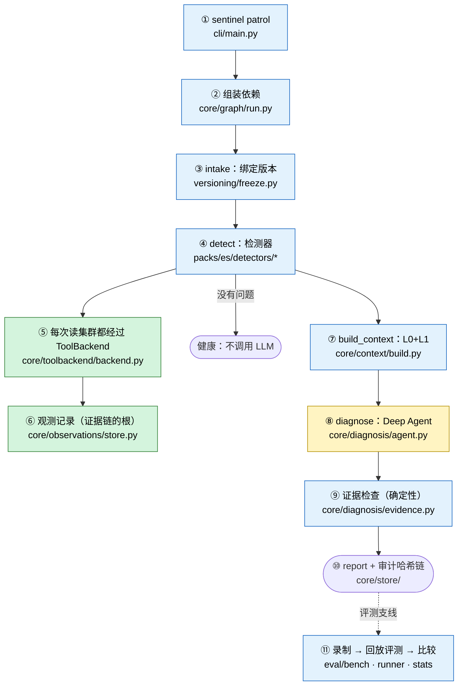

# M1 代码导览：一次巡检从进来到出报告

> 按 `docs/design/templates/code-tour.md` 生成。读者：没有亲手写代码的负责人。目标 30–40 分钟。
> 主线是 M1 的完整路径：**巡检 → 检测 → 组装上下文 → 诊断 → 报告**，外加评测的那一条支线（录制 → 回放评测 → 比较）。
> 行号对应 tag `m1`。

## 1. 路线图

蓝色 = 确定性代码，黄色 = 调用 LLM，绿色 = 读写外部（集群、磁盘、数据库）。整条路上只有 ⑧ 是黄色的。

## 2. 逐站讲解

### ① 入口：`sentinel patrol`

| 项 | 内容 |
|---|---|
| 位置 | `src/sentinel/cli/main.py:142` `patrol` |
| 人话 | 你在终端里敲的命令。它只做参数解析和打印，真正的活交给 core。版本没冻结、或者有未提交的改动时，打一行"拒绝开始调查"就退出 |
| 输入 / 输出 | 输入：集群名、后端（live / record / replay）、录制文件；输出：调查 ID 和状态 |
| 关键概念 | **后端模式**：live 读真集群；record 读真集群的同时录下来；replay 只从录制里读、绝不碰集群（ADR-003） |
| 为什么这样设计 | 01 §4：CLI 和 API（`api/app.py:24` 的 `POST /patrol`）调用同一个函数，不各写一套逻辑 |
| 可能出错的地方 | 没开 port-forward → 连接错误；没冻结版本 → 被拒绝（这是故意的） |
| 面试可能被问 | 问：为什么巡检要能在回放模式下跑？答：评测和演示都需要"同一个输入得到可复现的过程"，回放让这件事不依赖集群 |

### ② 组装依赖

| 项 | 内容 |
|---|---|
| 位置 | `src/sentinel/core/graph/run.py:44` `make_deps`、`:71` `investigate`、`:92` `patrol` |
| 人话 | 把这次调查要用的东西准备好：存储、观测存储、工具后端、真实模型、"当前版本"检查。`make_deps` 是唯一的组装位置：线上巡检用 Postgres，评测运行器用内存存储 + 回放，两边走同一个函数（M1 审阅发现 3 之后改的）。测试再换成假模型，图本身一行不改 |
| 输入 / 输出 | 输出 `Deps`（`core/graph/investigation.py` 里定义） |
| 关键概念 | **依赖注入**：把"用什么存储、什么模型"从图的逻辑里拿出来，测试和线上用同一张图 |
| 为什么这样设计 | 08 §6.4：`tests/` 不能访问网络、不能调真实 LLM，所以图必须能接受假的依赖 |
| 可能出错的地方 | 进程退出太快，LangSmith 的 trace 没传完（D3 踩过，`run.py` 最后的 `wait_for_all_tracers()` 就是为此加的） |
| 面试可能被问 | 问：checkpointer 的 thread_id 用什么？答：调查 ID。M3 的审批暂停恢复时靠它找回状态 |

### ③ intake：这次调查属于哪个版本

| 项 | 内容 |
|---|---|
| 位置 | `src/sentinel/core/graph/investigation.py:79` `intake`；`src/sentinel/core/versioning/freeze.py:52` `require_frozen`；`components.py:56` `collect_components`、`:41` `behavior_sha` |
| 人话 | 先算出"现在这套提示词、模型、工具、策略、代码"的指纹，去版本表里找。找不到就拒绝开工——每次调查的结果都必须能挂到一个具体的版本上 |
| 输入 / 输出 | 输出 `AgentVersion`（03 §5.2） |
| 关键概念 | **AgentVersion**：决定 Agent 行为的全部内容的哈希。**code_sha**：只算 `src/`、`config/`、`uv.lock`、`pyproject.toml`（ADR-012），改文档不会让版本失效 |
| 为什么这样设计 | 收敛曲线上的每一个点都要能说出"这一版改了什么"；没有版本的结果没法比较 |
| 可能出错的地方 | 影响行为的文件有未提交的改动 → 拒绝（实际运行的代码和版本对不上） |
| 面试可能被问 | 问：为什么根因表也要算进版本？答：它会渲染进提示词，改了它，模型的行为就变了（ADR-011） |

### ④ detect：确定性的检测器

| 项 | 内容 |
|---|---|
| 位置 | `src/sentinel/core/detect.py:31` `run_detect`；4 个检测器在 `src/sentinel/packs/es/detectors/`（例如 `disk.py:12`）；`sdk/detector.py:38` `make_finding` |
| 人话 | 用写死的规则判断集群有没有问题：有没有未分配分片、磁盘是否超过水位、节点数是否少了、分片数是否接近上限。没有问题就直接结束，**一次模型都不调用** |
| 输入 / 输出 | 输出 `Finding`（03 §3.2）和 `FactSheet`（03 §3.4） |
| 关键概念 | **指纹**：hash(集群, 检测器, 对象, 严重程度)，不含数值——91% 和 93% 是同一个问题（02 §2 去重用） |
| 为什么这样设计 | P1 确定性优先：能用规则算出来的不交给 LLM。健康巡检几乎零成本 |
| 可能出错的地方 | 水位写成字节形式（"10gb"）时目前退回默认值（`thresholds.py` 的 TODO(edge)） |
| 面试可能被问 | 问：检测器能不能调 LLM？答：不能，而且从结构上做不到——专家包只能 import contracts 和 sdk，import-linter 会拦 |

### ⑤ ToolBackend：所有对集群的读取都走这一个口子

| 项 | 内容 |
|---|---|
| 位置 | `src/sentinel/core/toolbackend/backend.py:54` `ToolBackend`、`:78` `call`；`canonical.py:8` `canonical_args`；`sdk/http.py:22` `ReadOnlyHttp` |
| 人话 | 检测器、fact builder、诊断 Agent 要读集群，都必须调 `call(工具, 参数)`。它负责：真去读 / 录下来 / 从录制里读；把原始输出变成摘要；摘要太长就截断；每次调用写一条观测记录 |
| 输入 / 输出 | 输出 `ToolResult`（观测 ID + 摘要 + 原始数据） |
| 关键概念 | **回放键**：工具名 + 规范化后的参数（排序、去掉默认值）。**replay_miss**：回放时找不到对应录制，直接记下来，不访问集群、不模糊匹配。**只读连接**：`ReadOnlyHttp` 只有 `get` 方法，工具从结构上就写不了集群 |
| 为什么这样设计 | ADR-003：评测要可复现、要快；模糊匹配会让分数虚高 |
| 可能出错的地方 | 新版本 Agent 调了录制里没有的参数 → replay_miss，评测时这个用例从主指标剔除、单独统计 |
| 面试可能被问 | 问：为什么录制时把所有工具都扫一遍，而不是录某次诊断实际用到的？答：下一个版本的 Agent 可能调别的工具，扫一遍才能覆盖 |

### ⑥ 观测记录：证据链的根

| 项 | 内容 |
|---|---|
| 位置 | `src/sentinel/core/observations/store.py:62` `put`、`:96` `get` |
| 人话 | 原始输出存成文件，记下 sha256；索引写进 Postgres。读取时重新算哈希，文件被改过就报错 |
| 输入 / 输出 | `Observation`（03 §3.3） |
| 关键概念 | **raw_ref + digest**：模型只看摘要（digest），评分和审计能回到原始数据（raw_ref） |
| 为什么这样设计 | 03 §3.3：如果诊断引用的内容在摘要里找不到，就可能是幻觉 |
| 可能出错的地方 | 原始文件被删或被改 → `TamperedObservationError` |
| 面试可能被问 | 问：Agent 想看原始输出的细节怎么办？答：读虚拟文件 `/obs/<观测 ID>.json`（`core/diagnosis/obs_backend.py`），只读，同样包在不可信标签里 |

### ⑦ build_context：L0 + L1

| 项 | 内容 |
|---|---|
| 位置 | `src/sentinel/core/context/build.py:39` `build_context`；ES 的事实卡片在 `packs/es/facts.py:18` |
| 人话 | 把问题事件（L0）和事实卡片（L1）拼成给模型看的文字。每层有 token 预算；异常项不删，其余超预算就删，并记下删了什么。所有来自集群的文字都包进 `<untrusted>` 标签，伪造的闭合标签会被转义 |
| 输入 / 输出 | 输出 `ContextBundle`（04 §3.9），里面的 items 就是"上下文报告" |
| 关键概念 | **不可信区块**：标签只能降低注入的概率；真正挡住后果的是权限——诊断 Agent 只有只读工具（04 §3.8） |
| 为什么这样设计 | 04 §3.7：信息分层、有预算，比把原始数据全塞进去更省钱，也更不容易让模型分心 |
| 可能出错的地方 | 单条异常项本身就超过预算时仍然保留（TODO(edge)），预算会被突破，但上下文报告里看得到 |
| 面试可能被问 | 问：为什么"省略了 N 条正常项"要写出来？答：这句话本身就是信息，模型知道其他指标都正常，就不会再去查一遍 |

### ⑧ diagnose：唯一调用 LLM 的地方

| 项 | 内容 |
|---|---|
| 位置 | `src/sentinel/core/diagnosis/agent.py:84` `run_diagnosis`、`:64` `lc_tools`；提示词 `core/diagnosis/prompts/diagnose.md`；模型来自 `core/llm/chat.py:16` `chat_model` |
| 人话 | 用 Deep Agents 搭一个只读的诊断 Agent：11 个只读工具（都经过 ⑤）、能读 `/obs/`、最后按固定结构交出最多 3 个假设，每个论断都要带观测 ID 和逐字引文。模型**不**填调查 ID、步数、token；根因标签不在专家包声明的表里就改成 None |
| 输入 / 输出 | 输入 `ContextBundle`；输出 `Diagnosis`（03 §4.1） |
| 关键概念 | **结构化输出**（`ToolStrategy`）：让模型以"调用一个固定格式的工具"的方式交答案，Gemini 上实测稳定（D3）。**型号只在配置里**：代码里搜不到任何型号字符串（ADR-008，有测试） |
| 为什么这样设计 | ADR-001：外层确定性的图管流程，内层 Agent 只负责开放式的排查 |
| 可能出错的地方 | 模型把系统生成的说明文字当成引文 → 证据检查不通过（v1 就是这样，v2 改了提示词）；置信度低于 0.5 → 升级给人（`investigation.py:204` `_escalation_reason`） |
| 面试可能被问 | 问：怎么保证测试里不会误调真实模型？答：`chat_model` 创建前先调 `guard_real_call`，测试环境直接抛错；另有测试保证只有 `chat.py` 能 import 模型 SDK |

### ⑨ 证据检查：不用 LLM 就能抓编造

| 项 | 内容 |
|---|---|
| 位置 | `src/sentinel/core/diagnosis/evidence.py:27` `check_claim`、`:41` `check_evidence` |
| 人话 | 每个论断：引用的观测 ID 存在吗？属于这次调查吗？引文是那条观测摘要的原文吗？三条都满足才算"有证据支持" |
| 输入 / 输出 | `Diagnosis` + 本次调查的观测记录 → 每个论断的通过/不通过和原因 |
| 关键概念 | **证据支持率**：通过检查的论断 / 全部论断（06 §3.1） |
| 为什么这样设计 | 03 §4.1：大部分编造证据的情况，用确定性检查就能抓到；LLM 评审只留给"证据能不能推出结论"这类语义问题 |
| 可能出错的地方 | 引文里的空白被合并 → 检查只合并空白，不做其他宽松匹配，避免把编造的引文算通过 |
| 面试可能被问 | 问：M1 的证据支持率为什么不是 100%？答：shard_limit 场景里一半运行没给出来自 `cluster_settings` 的有效证据——根因对了，证据链偏弱，这是 M2 要先看的 |

### ⑩ report 和审计

| 项 | 内容 |
|---|---|
| 位置 | `src/sentinel/core/graph/investigation.py:171` `report`；审计 `core/store/postgres.py:62` `append_audit` |
| 人话 | 写入诊断、更新状态（diagnosed / escalated），每一步都写一条审计事件。每条事件记着上一条的哈希，串成一条链，中间改过一条就能发现 |
| 输入 / 输出 | `AuditEvent`（03 §5.1） |
| 关键概念 | **哈希链**：`prev_hash` = 上一条事件的 sha256。`audit verify` 在 M3 做 |
| 为什么这样设计 | 07 篇：审计必须防篡改；成本很低 |
| 可能出错的地方 | 并发写审计时链会分叉 → 写之前锁表，同一个事务里取上一条、算哈希、插入 |
| 面试可能被问 | 问：巡检健康时写什么？答：`investigation.started` → `patrol.healthy` → `investigation.closed`（ADR-011） |

### ⑪ 评测支线：录制 → 回放评测 → 比较

| 项 | 内容 |
|---|---|
| 位置 | 故障台 `eval/bench/bench.py:166` `record`、`:118` `sweep`、`:98` `wait_symptom`；评测 `eval/runner.py:46` `run_one`（经过 `core/api.py` 这个公开接口调用 core）；评分 `eval/scorers.py:28` `score`；统计 `eval/stats/bootstrap.py:43` `compare` |
| 人话 | 故障台按场景注入真实故障、等检测器触发、把所有只读工具扫一遍录下来、撤销故障、往数据集加一条用例。评测时在录制上回放、用真实模型诊断、按真实答案打分。比较两个版本时，按场景重采样算区间 |
| 输入 / 输出 | `ScenarioSpec` → 录制 + `EvalExample`；评测 → `RunScore`（03 §6） |
| 关键概念 | **按场景聚类的配对 bootstrap**：同一种故障的几条录制高度相关，把它们当成一组重采样，区间才不会算得过窄（06 §4.2）。**写操作只在脚本里**：注入故障要管理员权限，这部分全在 `deploy/chaos/es/*.sh`，`src/` 里没有写凭证 |
| 为什么这样设计 | 06 篇：评测要可复现、可比较，"变好了"要有区间 |
| 可能出错的地方 | 症状没出现 → 这条录制作废，不写数据集（防空用例） |
| 面试可能被问 | 问：M1 的结论是什么？答：单一故障上纯规则就满分，Agent 也满分，差值无法判断；M1 只证明了评测流程能跑通，LLM 的价值要在 M2 的干扰项和组合故障上证明 |

## 3. 先预测，再运行

先在纸上写下预测，再运行，最后对照。需要 compose 在运行（`make compose-up`），不需要 kind 集群。

| # | 要运行的命令 | 请先预测 | 实际结果（运行后填写） |
|---|---|---|---|
| 1 | `uv run sentinel patrol es-target --backend replay --fixture tests/fixtures/es/healthy.jsonl`，再用 `docker exec sentinel-postgres-1 psql -U postgres -d sentinel -c "select type from audit_events where investigation_id='<inv>' order by seq"` 看审计事件 | 会不会调用模型？审计里有几条事件，分别是什么？ | |
| 2 | `uv run sentinel patrol es-target --backend replay --fixture tests/fixtures/es/node_down.jsonl`，然后 `sentinel investigations show <inv>` | 会触发哪几个检测器？H1 的根因标签是什么？模型大约调几次工具？ | |
| 3 | 在 `config/context_policy.yaml` 里随便加一行注释（先不提交），再跑一次第 1 条命令 | 会发生什么？为什么？（跑完记得 `git checkout config/context_policy.yaml`） | |

## 4. 自测题

题 1：诊断 Agent 有没有可能改动集群？从哪几层保证？

答案：不可能。① 专家包的工具只拿到 `ReadOnlyHttp`，它只有 `get` 方法；② 集群上的账号是只读角色（S1 实测写操作 403）；③ 写凭证只允许出现在 `exec/`，有测试扫描；④ 注入故障用的管理员操作全在 `deploy/chaos/` 的脚本里，不在 `src/`。

题 2：回放时 Agent 调了一个录制里没有的工具参数，会发生什么？评分怎么处理？

答案：ToolBackend 返回 `replay_miss`，摘要写"录制未覆盖"，不访问集群、不模糊匹配。评分时这个用例的 `replay_misses > 0`，从主指标里剔除，单独列出（06 §3.1）。

题 3：只改了 docs/ 下的文档并提交，需要重新冻结版本吗？

答案：不需要。`code_sha` 只算 `src/`、`config/`、`uv.lock`、`pyproject.toml`（ADR-012）。但如果这几个路径里有未提交的改动，冻结和开始调查都会被拒绝。

题 4：为什么 v6 和纯规则基线比较的区间是 [0, 0]，判断却是"无法判断"而不是"相同"？

答案：两边在每个用例上都全对，差值全是 0，重采样也只能得到 0。区间包含 0 就是"无法判断"——统计上只能说"没有证据表明谁更好"，不能说"两者一样好"。何况只有 4 个场景。

题 5：一个论断的引文是"磁盘使用率 92%，超过高水位 90%"，证据检查为什么不通过？

答案：这句话是检测器生成的问题事件说明（L0），不在任何观测摘要里。证据检查要求引文是被引用观测摘要的原文。这正是 v1 证据支持率只有 67% 的原因；v2 的提示词要求引文只从工具输出里摘。

